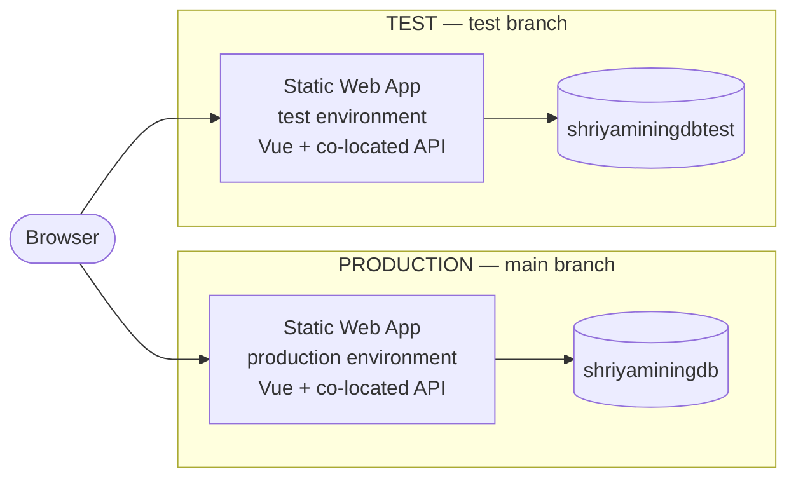
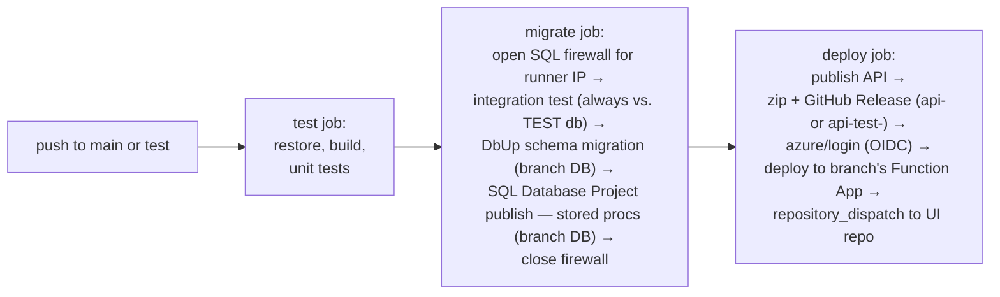
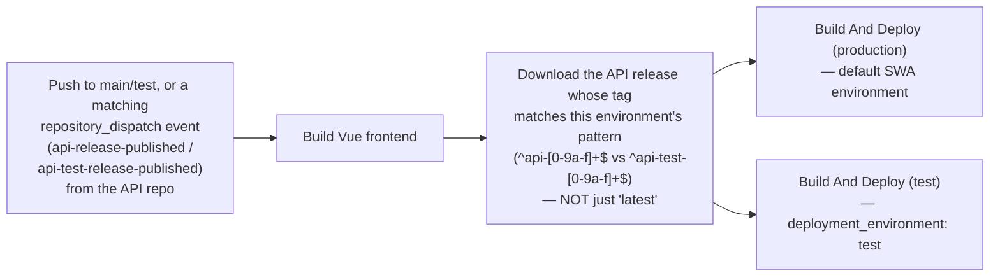

# Shriya Mining Industries — Invoice Platform: Architecture Reference

**Purpose of this document.** This is the living source of truth for the whole system — every
repo, every Azure resource, every pipeline, the database, auth model, costs, and the gotchas that
have actually bitten us in production. If you are new to this project, reading this document
start to finish should be enough to understand how the system fits together, make a change
safely, and debug a real incident. Keep it current: when you change something architectural,
update this file in the same session, not "later."

**Last substantially updated:** 2026-11-10, after building the Test/Prod environment split.

---

## 1. What this system is

A web application for Shriya Mining Industries to manage export invoices: create/edit invoices,
import purchase orders (PO) from Excel, generate Excel/PDF exports and a print layout, manage
company profile data, and administer users/roles. Backend is C# (.NET, Azure Functions isolated
worker); frontend is Vue 3, deployed as its own independently-deployed repository.

---

## 2. Repositories

All three live under the **`shriyaminingindustriesgroup`** GitHub account.

| Repo | GitHub location | Purpose | Branch strategy |
|---|---|---|---|
| `ShriyaMiningIndustries_api` | `shriyaminingindustriesgroup/ShriyaMiningIndustries_api` | The backend: C# / .NET, Azure Functions isolated worker. Owns all business logic, data access, and the SQL Database Project (stored procedures). | `main` (prod), `test` (test env) |
| `ShriyaMiningIndustries_UI` | `shriyaminingindustriesgroup/ShriyaMiningIndustries_UI` | The frontend: Vue 3 + Vite + TypeScript. Deployed as an Azure Static Web App with the C# API's build bundled in as its co-located Functions backend (see §4). | `main` (prod), `test` (test env) |
| `ShriyaMiningIndustries_Docs` | `shriyaminingindustriesgroup/ShriyaMiningIndustries_Docs` | This repo. Living architecture documentation, public so it can be published free via GitHub Pages. **Never put secrets, connection strings, or passwords in here** — reference *where* a value lives (a named GitHub secret, a named app setting), never the value itself. | `main` |

**Local clone layout** (on the primary dev machine), for orientation — not meaningful outside that
machine:
```
C:\Users\<user>\OneDrive\GIT\ShriyaMiningIndustriesApi\ShriyaMiningIndustriesApi\  (api repo — note the folder name doesn't match the GitHub repo name, which is ShriyaMiningIndustries_api)
C:\Users\<user>\OneDrive\GIT\ShriyaMiningIndustries_UI\                        (UI repo)
C:\Users\<user>\OneDrive\GIT\ShriyaMiningIndustries_Docs\                      (this repo)
```

---

## 3. High-level architecture



*Not pictured, to keep this diagram readable:* two standalone Function Apps
(`ShriyaMiningIndustries-api`, `ShriyaMiningIndustries-api-test`) are deployed and healthy but
carry no live traffic — see below. A single shared Application Insights instance
(`ShriyaMiningIndustries-api`) collects telemetry from all four deployments.

**The one non-obvious thing to understand first:** the Static Web App's *co-located* Functions —
not the standalone Function Apps — serve 100% of real user traffic. SWA Free tier cannot "link" to
an external Function App (that needs Standard tier, a real ongoing cost); instead, each SWA
environment (production and test) gets its *own private copy* of the API's compiled build,
uploaded as part of that environment's own deployment. The standalone Function Apps
(`ShriyaMiningIndustries-api`, `ShriyaMiningIndustries-api-test`) are kept deployed and healthy
on purpose, as a **decouple-ready fallback** — if you ever need the API to be a genuinely separate
service (e.g. to upgrade SWA to Standard and link to it, or to serve a non-browser client), the
code and infrastructure are already there and already proven working. See §9 for the exact
decoupling steps.

---

## 4. Environments: Production vs Test

| | Production | Test |
|---|---|---|
| Trigger branch | `main` | `test` |
| UI URL | `https://gray-meadow-0ebc61d10.6.azurestaticapps.net` | `https://gray-meadow-0ebc61d10-test.centralus.6.azurestaticapps.net` |
| SWA environment name | `default` | `test` |
| Database | `shriyaminingdb` | `shriyaminingdbtest` |
| Standalone Function App | `ShriyaMiningIndustries-api` | `ShriyaMiningIndustries-api-test` |
| GitHub Release tag prefix | `api-<sha>` | `api-test-<sha>` |
| Cross-repo dispatch event | `api-release-published` | `api-test-release-published` |

**Promotion workflow:** push/merge changes to `test` first. The pipeline deploys the whole stack
(DB migrations + stored procs + Function App + SWA test environment) in isolation from
production. Validate on the test URL. When satisfied, merge `test` → `main` via a normal PR — the
exact same commit that was validated on test is what reaches production, not a rebuild.

Both databases already exist and both have Azure SQL's **free offer** applied
(`useFreeLimit: true` — confirmed via `az sql db show`): 100,000 vCore-seconds + 32GB storage free
per database per month, for the life of the subscription. At the stated real usage pattern
(≈5 users, max 1–2 hours/day), this comfortably covers compute for both databases combined —
see §10 for the full cost picture.

---

## 5. Azure resources — full inventory

All resources live in resource group **`ShriyaMiningIndustries`**, region **Central US**, under
one Azure subscription.

| Resource | Name | Type / SKU | Notes |
|---|---|---|---|
| Static Web App | `ShriyaMiningIndustries-ui` | Free tier | 2 of its 3 allowed staging environments in use (`default`=prod, `test`). Co-located Functions runtime, no linked backend. |
| Function App (prod) | `ShriyaMiningIndustries-api` | Consumption (Y1), Windows, `dotnet-isolated` | Decouple-ready fallback, not in the live traffic path (see §3). |
| Function App (test) | `ShriyaMiningIndustries-api-test` | Consumption (Y1), Windows, `dotnet-isolated` | Same role as above, for test. |
| Storage account | `stshriyaminingapi` | Standard_LRS | Backs the prod Function App's internal state. |
| Storage account | `stshriyaminingapitest` | Standard_LRS | Backs the test Function App's internal state. |
| SQL Server | `shriyaminingindustries` (`shriyaminingindustries.database.windows.net`) | Logical server | SQL-auth admin login configured (ask a team member for the username/password — neither is written down here; this repo is public). No Azure AD admin configured yet. |
| SQL Database (prod) | `shriyaminingdb` | General Purpose, Serverless, 0.5 vCore min, free-limit enabled, auto-pause after 60 min idle | |
| SQL Database (test) | `shriyaminingdbtest` | Same tier/config as prod | |
| Application Insights | `ShriyaMiningIndustries-api` | Standard | Shared telemetry sink for all four API-side deployments (prod/test × co-located/standalone). One place to watch live traffic for any of them — see §12. |
| Azure AD App Registration | `ShriyaMiningIndustriesApi-github-actions` (App ID `32f692ff-e4ba-4492-a4cc-24375ea72d2a`) | — | Used for GitHub Actions OIDC login (`azure/login@v2`), no stored client secret. Has **two** federated credentials, one per branch — see §6. |

---

## 6. CI/CD pipelines

### 6.1 API repo (`ShriyaMiningIndustries_api`) — `.github/workflows/deploy-ShriyaMiningIndustriesApi.yml`

Triggers on push to `main` or `test`. Branch decides the environment end-to-end via a single
`github.ref_name == 'main'` condition, repeated wherever a per-environment value is needed
(Function App name, SQL connection string, release tag prefix, dispatch event type).



Key points worth knowing when debugging this pipeline:

- **The integration test always runs against the test database**, regardless of branch. This was
  deliberately fixed (it used to run against prod on every single deploy) — a throwaway
  health-check test has no business holding a live connection to production.
- **DbUp migrations and the SQL Database Project publish are branch-targeted**, not "both every
  time." Before the Test/Prod split, every push republished stored procedures to *both* databases
  unconditionally — that defeated the point of having an isolated test environment, so it's gated
  by branch now.
- **The SQL firewall rule name includes the GitHub run ID** (`github-actions-runner-<run_id>`) so
  concurrent runs across branches can't collide.
- **GitHub Releases are tagged with a branch-specific prefix** (`api-<sha>` vs `api-test-<sha>`)
  specifically so the UI repo's pipeline can pick the *right* release for the environment it's
  deploying — GitHub's own "latest release" is just whichever was published most recently across
  *both* prefixes, which is not necessarily correct for a given run.
- **OIDC login needs a federated credential matching the exact branch.** The Azure AD App
  Registration has two: `github-main-branch` (subject ends `ref:refs/heads/main`) and
  `github-test-branch` (`ref:refs/heads/test`). If you ever add a third long-lived branch, it
  needs its own federated credential or `azure/login` will fail with `AADSTS700213` — this bit us
  once already when `test` was first introduced; see §12.

### 6.2 UI repo (`ShriyaMiningIndustries_UI`) — `.github/workflows/azure-static-web-apps-deploy.yml`

Triggers on push to `main` or `test`, on `repository_dispatch` (fired by the API repo's deploy
job, see below), and on pull-request open/sync/close against `main` (SWA's own PR-preview
behavior, unchanged by any of this).



Key points worth knowing when debugging this pipeline:

- **`repository_dispatch` always checks out the repo's default branch (`main`) unless told
  otherwise.** The checkout step explicitly overrides `ref:` to `test` when the dispatch event is
  `api-test-release-published` — without this, a test-environment deploy would silently build
  `main`'s UI code paired with the test API build.
- **Release selection is tag-pattern matched, not "latest."** `gh release list` + a regex `select`
  on the tag name, sorted by publish date, picking the newest match for this environment's
  prefix. This was a real bug waiting to happen: with both environments publishing releases to
  the same repo, GitHub's own latest-release resolution would pick whichever of the two was most
  recently published, not necessarily the one this run is deploying.
- **The cross-repo trigger needs a PAT, not the default `GITHUB_TOKEN`.** `UI_REPO_DISPATCH_TOKEN`
  is a fine-grained PAT (Contents: Read and write, scoped only to this repo), stored as a secret
  on the *API* repo, since the default token can't dispatch into another repository.
- **The SWA deployment token** (`AZURE_STATIC_WEB_APPS_API_TOKEN` secret, this repo) is the one
  credential that, if rotated or regenerated in Azure, needs to be re-copied here by hand — it's
  not something either pipeline can self-heal.

---

## 7. Database

### 7.1 Migration strategy — two separate mechanisms, deliberately

- **DbUp** (`database/migrations/*.sql`, run via `ShriyaMiningIndustries.Migrations`) owns
  **tables and data** — the things a destructive rebuild could lose. Sequential, numbered
  `V###__description.sql` files plus `R__*.sql` repeatable scripts, applied in order.
  Idempotent/tracked by DbUp's own journal table.
- **SQL Database Project** (`database/ShriyaMiningIndustries.Database/*.sqlproj`, built with
  `Microsoft.Build.Sql`, published via `SqlPackage`) owns **stored procedures, views, and
  functions** — pure code, safe to diff-and-replace on every deploy. Published with explicit
  `/p:` flags excluding `Tables;Users;Logins;...` from the diff — a `.publish.xml` profile was
  tried first and found to silently fail to apply these settings; don't reintroduce one without
  re-verifying via `/Action:Script` first, the same way this was originally verified.

**Known footgun:** the `ExcludeObjectTypes` value in the SqlPackage command must stay
double-quoted as one shell token. An unquoted `;` is treated as a command separator by the shell,
silently truncating the exclusion list down to just `Tables` — this was caught locally before it
ever reached CI, but would be a nasty one to debug blind if it recurred.

### 7.2 Schema overview

- **`security` schema** — `User`, `Role`, `Permission`, `UserRole` (many-to-many), `RolePermission`
  (many-to-many). Seeded roles: `Admin` (all permissions), `User`, `Approver`, `Viewer` — see
  `database/migrations/V003__seed-initial-data.sql` for the exact permission grants per role.
- **`app` schema** — Vendor, Buyer, Invoice + InvoiceLine, PO import records, company profile, and
  related master data.

### 7.3 Tooling note — SQL Database Project and Visual Studio 2026

The SQL Database Project uses the **SDK-style** project format (`Microsoft.Build.Sql`), which
Visual Studio 2026 cannot render in Solution Explorer (confirmed against Microsoft's own docs:
SDK-style SQL projects are currently VS-2022-preview-only). This is expected, not a broken
project — use **VS Code's SQL Database Projects extension** to work on it instead. Converting to
the legacy project format would fix the VS 2026 complaint but break the cross-platform Linux CI
build; don't do that.

---

## 8. Authentication & authorization

1. **The Static Web App's built-in Entra ID (AAD) auth** handles the actual login. No custom app
   registration is configured for this (the default, built-in multi-tenant SWA provider is used,
   carried over faithfully from the original app) — hitting `/.auth/login/aad` on either
   environment triggers it.
2. On every authenticated request, SWA injects an `x-ms-client-principal` header (base64 JSON)
   into the request before it reaches `/api/*`. This happens identically for co-located and linked
   backends.
3. **`AuthenticationMiddleware`** (API repo, `src/ShriyaMiningIndustries.Api/Middleware/`) decodes
   that header, extracts the email (`userPrincipalName` or `userDetails`), and looks up roles and
   permissions **by email** — not by any Entra object ID — via `UserRoleLookupRepository`, joining
   `security.User → UserRole → Role → RolePermission → Permission`. This means: logging in via AAD
   always succeeds if your Entra identity is valid, but you get **zero permissions** until your
   email exists as an active row in `security.User` with a role assigned. Login success and
   application-level authorization are two separate things — don't conflate them when debugging a
   "logged in but nothing works" report.
4. There is **no self-service bootstrap**: the very first admin user in a fresh database can't be
   created through the app's own admin console (that requires an already-authenticated admin to
   call it — chicken and egg). Bootstrap it directly via SQL instead:

   ```sql
   -- Bootstraps <email> as an Admin user. Idempotent — safe to run more than once.
   IF NOT EXISTS (SELECT 1 FROM security.[User] WHERE Email = '<email>')
   BEGIN
       DECLARE @NewUserId NVARCHAR(255) = CAST(NEWID() AS NVARCHAR(255));
       INSERT INTO security.[User] (UserId, Email, DisplayName, IsActive, CreatedBy, ModifiedBy)
       VALUES (@NewUserId, '<email>', '<display name>', 1, 'bootstrap-admin', 'bootstrap-admin');
       INSERT INTO security.UserRole (UserId, RoleId, GrantedBy)
       VALUES (@NewUserId, 1, 'bootstrap-admin'); -- RoleId 1 = Admin
   END;
   ```

   Run via the Azure Portal's Query Editor against the target database (`shriyaminingdb` or
   `shriyaminingdbtest`), signed in with the SQL admin login. Remember: the two databases are
   completely separate — bootstrapping prod doesn't touch test, and vice versa.
5. **Entra ID bearer-token validation for non-browser callers is intentionally not implemented.**
   The target design reserves this for an app registration that needs tenant-admin access no
   session has had so far — building JWT validation against a tenant/client ID that doesn't exist
   yet would be speculative, untestable code. The SWA header path above is what the real UI and
   all current testing actually uses.

---

## 9. Decoupling the API later (if/when needed)

The whole co-located-backend design exists specifically so this is an upgrade, not a rewrite,
when the time comes:

1. Upgrade the Static Web App from Free to Standard tier (real ongoing cost — confirm current
   pricing before doing this; it was ~$9/month when last checked, see §10).
2. `az staticwebapp backends link` the SWA to the already-running, already-proven
   `ShriyaMiningIndustries-api` standalone Function App (or its test counterpart).
3. Remove the "Download matching API release" + co-located packaging step from the UI repo's
   workflow — the linked backend serves `/api/*` directly, no bundling needed.

Nothing about the API's code, the auth model, or the database needs to change for this — it was
designed in from the start.

---

## 10. Cost model

Deliberately built to stay at or near **$0/month** at the stated real usage (~5 users, ~10k hits,
max 1–2 hours/day), verified against real Azure pricing rather than assumed:

| Component | Why it's free at this scale |
|---|---|
| Static Web App (both environments) | Free tier. Co-located Functions chosen specifically because Free tier can't link an external backend (that needs Standard, ~$9/month). 2 of 3 allowed staging environments in use. |
| Function Apps (both, standalone) | Consumption (Y1) plan: 1,000,000 executions + 400,000 GB-s free **per month, per subscription** (shared across every Function App in the subscription, not per-app) — confirmed against Microsoft's own Functions pricing page. Nowhere close to this ceiling at the stated usage. |
| SQL Databases (both) | Azure SQL free offer applied (`useFreeLimit: true`, confirmed via `az sql db show`): 100,000 vCore-seconds + 32GB storage free per database per month, for the life of the subscription. At 0.5 vCore minimum, that's ≈55.6 hours of active compute free per database per month — comfortably covers the stated 1–2 hrs/day ceiling. Default behavior on exceeding the limit is auto-pause, not a surprise bill. |
| Application Insights | Shared single instance across all four API deployments rather than one per environment — avoids multiplying ingestion volume for no benefit at this telemetry volume. |
| This docs site (GitHub Pages) | Free for a public repo. |

**Known cost risk, not a concern today:** the Functions execution grant is subscription-wide, not
per-app — if usage grows substantially (more apps, much higher traffic), that shared pool is the
thing that would eventually need watching.

---

## 11. Secrets and credentials — current state and the plan

**Today:** the SQL admin password is duplicated across several places — two GitHub secrets per
repo-that-needs-it (`SQL_CONNECTION_STRING`, `SQL_CONNECTION_STRING_TEST`), the SWA's production
and test environment app settings, and both standalone Function Apps' app settings. This is a
real rotation/drift risk, flagged explicitly rather than ignored.

**The planned fix (not yet built — architecture decision made, implementation deferred):**
- **Near-term:** centralize the password in **Azure Key Vault**, one secret per environment.
  Function App / SWA app settings reference it via a Key Vault Reference
  (`@Microsoft.KeyVault(SecretUri=...)`) instead of holding the raw value — confirmed this works
  for Function Apps; SWA app setting support for Key Vault references specifically needs to be
  verified empirically before relying on it. GitHub Actions fetches it at runtime via
  `az keyvault secret show`, using the OIDC identity already set up for `azure/login` — no
  `SQL_CONNECTION_STRING*` GitHub secrets needed at all once this is done.
- **Longer-term, the real gold standard:** move to Azure AD / Managed Identity authentication for
  SQL entirely — no password anywhere, ever. Needs an Azure AD admin configured on the SQL server
  (not set up yet) and a `CREATE USER ... FROM EXTERNAL PROVIDER` per identity that needs access.
  Bigger lift, worth doing once the system is stable rather than alongside active feature work.

**Never put an actual secret value in this repo.** If you need to document *which* app setting or
GitHub secret holds something, name it — never paste the value.

---

## 12. Debugging playbook — things that have actually gone wrong

These are real incidents from building this system, kept here because they'll recur and the fix
is non-obvious each time.

**"degraded" health status / `Error Number:40613` / connection timeouts against SQL.**
Azure SQL Serverless auto-pauses after 60 minutes idle (`autoPauseDelay: 60`, both databases).
The *first* request after a pause wakes it up but reports degraded/fails; the database is usually
ready within 10–30 seconds. Standard fix: just retry (`gh run rerun <id> --failed` in CI, or
simply re-request in the app). This is not a bug, it recurs regularly, and it's expected —
don't spend time investigating it as if it were new each time.

**Azure Functions silently 404s a route containing the literal segment `admin`.** The Functions
host reserves `/admin/*` for its own internal Admin API, independent of any `api/` prefix your app
uses. If you ever add a new route and it 404s with a bare platform response (no `Server` header,
not your app's own JSON error envelope) instead of your app's actual error handling, check whether
the route contains `admin` anywhere in the path. This is why the admin console's routes are
`console/*`, not `admin/*`, in both the C# routes and `api.ts`.

**`AADSTS700213: No matching federated identity record found` on `azure/login@v2`.** The Azure AD
App Registration's federated credentials are scoped per-branch by exact subject string
(`repo:<org>@<org-id>/<repo>@<repo-id>:ref:refs/heads/<branch>`). Adding a new long-lived branch
(like `test` was) needs a matching new federated credential — see §6.1 and §5 for where this
lives (`ShriyaMiningIndustriesApi-github-actions` app registration).

**A `gh release list` "latest" pick grabs the wrong environment's build.** Don't rely on "latest"
when two environments publish to the same repo's releases — match on a tag pattern instead (see
§6.2). If you ever add a third environment, give it its own tag prefix too.

**`skip_api_build` reported as an "unexpected input" warning by `Azure/static-web-apps-deploy@v1`,
then co-located deploy fails with "Couldn't detect a version for the platform 'dotnet'."** The
input is real and declared in the action's own `action.yml` (confirmed by reading it directly) —
without it, Oryx tries to detect a buildable platform in the already-compiled `api-package`
folder (which has no `.csproj`, just publish output) and fails. If this warning reappears, verify
against the action's actual `action.yml` before assuming the input is invalid — the warning text
can be misleading.

**VS 2026 shows "Target framework not installed" for the SQL Database Project.** Expected, not a
bug — see §7.3. Use VS Code's SQL Database Projects extension for that project instead of VS 2026.

**A print/PDF export call fails even though Excel export on the same invoice works fine.** Print
layout (`format=print`) is deliberately **not served by the API at all** — it's built entirely
client-side (`buildLegacyPrintHtml` in `src/services/legacy-invoice.js`) from data already fetched.
If you see a call to `GET /invoices/{id}/export?format=print` anywhere, that's a regression of a
bug that was already fixed once (see commit history on both repos, "print HTML client-side"); the
fix is to call the client-side builder instead of adding the format back to the API.

---

## 13. Common tasks

**Deploy a change:** push to `test`, watch its CI run (both repos — the API repo's deploy
auto-triggers the UI repo's via `repository_dispatch`), validate on the test URL, then open a PR
merging `test` → `main`.

**Add a new user:** run the bootstrap SQL pattern in §8 against the target database, or (once
you're logged in as an existing Admin) use the admin console's "Create user" — same effect as
the SQL script, friendlier UI, but needs an existing admin to already be logged in to use it.

**Rotate the SQL password:** today, that means updating it in every location listed in §11 by
hand. This is exactly the pain point §11's Key Vault plan is meant to fix — until then, be
thorough and don't skip one of the locations.

**Check whether a deployed request actually hit the C# backend, not something stale/cached:**
open DevTools → Network tab → inspect the response JSON for `InvoiceResponseDto`'s duplicate
field pairing (both `id` and `invoiceId`, both `createdOn` and `createdAt`, present together) —
that pairing is a fingerprint unique to this codebase. For a more authoritative check,
open Application Insights → Live Metrics (§5) and watch requests arrive in real time as you use
the app.

---

## 14. Open items / not yet done

- Key Vault centralization for the SQL password (§11) — architecture decided, not yet built.
- No custom domain configured for either SWA environment (default Azure-issued domains only).
- SWA app setting support for Key Vault references not yet empirically verified.
- Azure AD admin not yet configured on the SQL server (blocks passwordless/Managed Identity SQL
  auth, §11's longer-term plan).

---

## 15. Local development — running the API from a fresh clone

**If you've just cloned `ShriyaMiningIndustries_api` and want to run it locally with the
interactive Swagger UI, this section is everything you need.** Verified end-to-end, not
theoretical — every step here was actually run successfully before being written down.

### 15.1 Prerequisites

| Tool | Version | Install |
|---|---|---|
| .NET SDK | 10.0.x | https://dotnet.microsoft.com/download — no `global.json` pins a specific SDK, any .NET 10 SDK works |
| Azure Functions Core Tools | v4 | `npm install -g azure-functions-core-tools@4` |
| Azurite (local storage emulator) | any recent | `npm install -g azurite`, then run `azurite` in its own terminal (or use the Azurite extension in VS Code) |
| A SQL connection string | — | ask an existing team member for the `shriyaminingdbtest` connection string, and ask them to add your current public IP as a SQL Server firewall rule (same server as production, different database — see §5). **Never** request or use the production (`shriyaminingdb`) connection string for local development. |

### 15.2 One-time setup

1. `git clone https://github.com/shriyaminingindustriesgroup/ShriyaMiningIndustries_api.git`
2. Copy the template and fill in the real connection string someone gave you:
   ```
   cd src/ShriyaMiningIndustries.Api
   cp local.settings.json.example local.settings.json
   ```
   `local.settings.json` is git-ignored — it will never be committed, and the repo only ever
   ships the `.example` template (no real values in it). **Never commit a filled-in
   `local.settings.json`.**
3. Make sure Azurite is running (`azurite` in a separate terminal, defaults are fine —
   `AzureWebJobsStorage` in the template already points at it via `UseDevelopmentStorage=true`).

### 15.3 Run it

```
cd src/ShriyaMiningIndustries.Api
dotnet run --configuration Release
```

**Use `dotnet run`, not `func start`.** `func start` run directly against this project prints its
own warning that it may not correctly load function extensions for a .NET isolated-worker
project — `dotnet run` is what was actually verified to work cleanly.

Once it's up (watch for `Host lock lease acquired` in the console), open:

**`http://localhost:7071/api/swagger/ui`**

Every endpoint is listed, grouped by tag, each with an auto-generated sample request body you can
edit and a "Try it out" button that calls your real local API and shows the real response. The
raw OpenAPI 3.0 spec is also available at `http://localhost:7071/api/openapi/v3.json` if you want
to import it into another tool (Postman, Insomnia, etc.).

### 15.4 Testing authenticated endpoints without a real login

The template's `LocalDevelopment:AutoAuthenticateAsEmail` setting auto-authenticates every local
request as the email you set there — no need to construct a real `x-ms-client-principal` header
by hand (see §8 for what that header normally carries). This bypass is double-gated so it can
never activate anywhere real: it only works when `ASPNETCORE_ENVIRONMENT`/the hosting environment
is `Development` (true only for a local run, never a deployed one), **and** only when this exact
config key is set, which only ever exists in the git-ignored `local.settings.json`, never
committed, never deployed.

This only gets you *authenticated* — it does not grant permissions by itself. The email you put
there still needs to exist as an active row in `security.User` with a role assigned, in whichever
database your connection string points at (`shriyaminingdbtest` for local dev), exactly like any
other user — see §8 for the bootstrap SQL script. Run it against `shriyaminingdbtest` with your
own email (or the template's placeholder `localdev@shriyaminingindustries.test`) to get real
permissions when testing locally.

To test the real authentication path instead (as the deployed app actually behaves), delete the
`LocalDevelopment:AutoAuthenticateAsEmail` key, or set it to `""` — then only a request carrying a
real `x-ms-client-principal` header is treated as authenticated, same as production.
