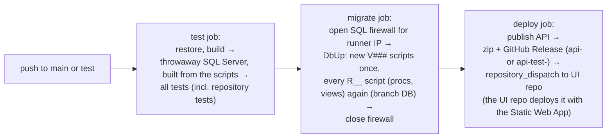
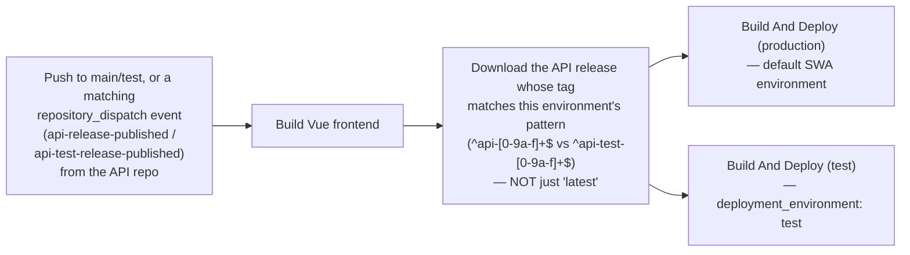

# Shriya Mining Industries — Invoice Platform: Architecture Reference

**Purpose of this document.** This is the living source of truth for the whole system — every
repo, every Azure resource, every pipeline, the database, auth model, costs, and the gotchas that
have actually bitten us in production. If you are new to this project, reading this document
start to finish should be enough to understand how the system fits together, make a change
safely, and debug a real incident. Keep it current: when you change something architectural,
update this file in the same session, not "later."

**Last substantially updated:** 2026-11-19: our own sign-in (§8: password sign-in, temporary passwords),
operations and observability (Health page, alerts, smoke tests, uptime check, §5 and §12.1), all-or-nothing
procedures (§7.3), the role cache (§8), enforced coding standards and API conventions (§7.7), the module
split (§7.7) and the **checklist every change follows (§7.8)**. Earlier: 2026-11-10, the final-review punch
list (UI test coverage, monitoring alerts, rollback runbook, API repo private, Docker-based local dev).

---

## 1. What this system is

A web application for Shriya Mining Industries to manage export invoices: create/edit invoices,
import purchase orders (PO) from Excel, generate Excel/PDF exports and a print layout, manage
company profile data, and administer users/roles. Backend is C# (.NET, Azure Functions isolated
worker); frontend is Vue 3, deployed as its own independently-deployed repository.

---

## 2. Repositories

All three live under the **`shriyaminingindustriesgroup`** GitHub account.

| Repo | GitHub location | Purpose | Branch strategy |
|---|---|---|---|
| `ShriyaMiningIndustries_api` | `shriyaminingindustriesgroup/ShriyaMiningIndustries_api` (**private**) | The backend: C# / .NET, Azure Functions isolated worker. Owns all business logic, data access, and the database scripts (`database/migrations`, applied by DbUp). | `main` (prod), `test` (test env) |
| `ShriyaMiningIndustries_UI` | `shriyaminingindustriesgroup/ShriyaMiningIndustries_UI` | The frontend: Vue 3 + Vite + TypeScript. Deployed as an Azure Static Web App with the C# API's build bundled in as its co-located Functions backend (see §4). | `main` (prod), `test` (test env) |
| `ShriyaMiningIndustries_Docs` | `shriyaminingindustriesgroup/ShriyaMiningIndustries_Docs` | This repo. Living architecture documentation, public so it can be published free via GitHub Pages. **Never put secrets, connection strings, or passwords in here** — reference *where* a value lives (a named GitHub secret, a named app setting), never the value itself. | `main` |

**Tech stack** (all on the newest stable release, checked against the package registries on
2026-11-18; long-term-support lines where there is a choice):

| Area | What | Version | Note |
|---|---|---|---|
| API runtime | .NET, Azure Functions isolated worker | .NET 10 (LTS), Functions v4, Worker 2.52 / SDK 2.1 | .NET 11 (STS) is out; 10 is the LTS line, supported to Nov 2028. `global.json` pins the 10.0 SDK band. |
| Data access | Dapper, Microsoft.Data.SqlClient | 2.1.89, 7.1.2 | Every query is a stored procedure (§7.4). |
| Migrations | DbUp (dbup-sqlserver) | 7.2.0 | §7.1 |
| Email, files | MailKit, ClosedXML, ExcelDataReader, PdfPig, HtmlSanitizer | 5.0.0, 0.105.1, 3.9.0, 0.1.16, 11.0.26 | MailKit 5: refused recipients are handled on the send request. |
| Telemetry | OpenTelemetry, Azure Monitor exporter | 1.21.0, 1.10.0 | |
| API tests | xUnit.net v3 on Microsoft Testing Platform v2, FluentAssertions | 4.0.3, 7.2.2 | FluentAssertions stays on 7.x, the last Apache-2.0 line (8.x needs a paid licence). |
| Database | Azure SQL Database (serverless); CI uses a SQL Server 2025 container | | |
| UI | Vue, vue-router, axios | 3.5.45, 5.5.1, 1.21.1 | |
| UI build | Vite (Rolldown), @vitejs/plugin-vue, Vitest | 8.3.8, 6.0.11, 5.1.0 | |
| UI types | TypeScript, vue-tsc | 6.0.3, 3.3.14 | TypeScript 7 (the native compiler) is out, but vue-tsc can't run on it yet; 6.0 is the newest that checks `.vue` files. |
| UI pipeline | Node.js | 26 (Active LTS) | |
| Pipelines | actions/checkout, setup-dotnet, setup-node, azure/login | v7, v6, v7, v3 | All run on Node 24. |
| Docs diagrams | Mermaid | 12.3.0 | Loaded as an ES module, `securityLevel: 'strict'`. |

**Local clone layout** (on the primary dev machine), for orientation — not meaningful outside that
machine:
```
C:\Users\<user>\OneDrive\GIT\Shriyamining\ShriyaMiningIndustries_api\   (api repo)
C:\Users\<user>\OneDrive\GIT\Shriyamining\ShriyaMiningIndustries_UI\    (UI repo)
C:\Users\<user>\OneDrive\GIT\Shriyamining\ShriyaMiningIndustries_Docs\  (this repo)
```

---

## 3. High-level architecture


*Not pictured, to keep this diagram readable:* two standalone Function Apps
(`ShriyaMiningIndustries-api`, `ShriyaMiningIndustries-api-test`) are deployed and healthy but
carry no live traffic — see below. A single shared Application Insights instance
(`ShriyaMiningIndustries-api`) collects telemetry from all four deployments.

**The one non-obvious thing to understand first:** the Static Web App's *co-located* Functions —
not the standalone Function Apps — serve 100% of real user traffic. SWA Free tier cannot "link" to
an external Function App (that needs Standard tier, a real ongoing cost); instead, each SWA
environment (production and test) gets its *own private copy* of the API's compiled build,
uploaded as part of that environment's own deployment. The standalone Function Apps
(`ShriyaMiningIndustries-api`, `ShriyaMiningIndustries-api-test`) are kept, **stopped** (since
2026-11-17; not deleted), as a **decouple-ready fallback** — if you ever need the API to be a genuinely separate
service (e.g. to upgrade SWA to Standard and link to it, or to serve a non-browser client), the
code and infrastructure are already there and already proven working. See §9 for the exact
decoupling steps.

---

## 4. Environments: Production vs Test

| | Production | Test |
|---|---|---|
| Trigger branch | `main` | `test` |
| UI URL | the company's own domain, app at its root (19 Nov 2026; host kept out of these public docs); also `https://gray-meadow-0ebc61d10.6.azurestaticapps.net` | `https://gray-meadow-0ebc61d10-test.centralus.6.azurestaticapps.net` (a custom domain needs its own Static Web App: preview environments can't have one) |
| SWA environment name | `default` | `test` |
| Database | `shriyaminingdb` | `shriyaminingdbtest` |
| Standalone Function App | `ShriyaMiningIndustries-api` | `ShriyaMiningIndustries-api-test` |
| GitHub Release tag prefix | `api-<sha>` | `api-test-<sha>` |
| Cross-repo dispatch event | `api-release-published` | `api-test-release-published` |

**Promotion workflow:** push/merge changes to `test` first. The pipeline deploys the whole stack
(DB migrations + stored procs + Function App + SWA test environment) in isolation from
production. Validate on the test URL. When satisfied, merge `test` → `main` via a normal PR — the
exact same commit that was validated on test is what reaches production, not a rebuild.

Both databases already exist and both have Azure SQL's **free offer** applied
(`useFreeLimit: true` — confirmed via `az sql db show`): 100,000 vCore-seconds + 32GB storage free
per database per month, for the life of the subscription. At the stated real usage pattern
(≈5 users, max 1–2 hours/day), this comfortably covers compute for both databases combined —
see §10 for the full cost picture.

---

## 5. Azure resources — full inventory

All resources live in resource group **`ShriyaMiningIndustries`**, region **Central US**, under
one Azure subscription.

| Resource | Name | Type / SKU | Notes |
|---|---|---|---|
| Static Web App | `ShriyaMiningIndustries-ui` | Free tier | 2 of its 3 allowed staging environments in use (`default`=prod, `test`). Co-located Functions runtime, no linked backend. |
| Function App (prod) | `ShriyaMiningIndustries-api` | Consumption (Y1), Windows, `dotnet-isolated` | **Stopped, and no longer deployed to (2026-11-17)** — a decouple-ready fallback, never in the live traffic path (see §3). On its own it trusted any caller's identity header, so anyone could have claimed to be any user (§8). Start it again only with App Service Authentication turned on. |
| Function App (test) | `ShriyaMiningIndustries-api-test` | Consumption (Y1), Windows, `dotnet-isolated` | Same as above, for test: stopped, not deployed to (2026-11-17). |
| Storage account | `stshriyaminingapi` | Standard_LRS | Backs the prod Function App's internal state. |
| Storage account | `stshriyaminingapitest` | Standard_LRS | Backs the test Function App's internal state. |
| SQL Server | `shriyaminingindustries` (`shriyaminingindustries.database.windows.net`) | Logical server | SQL-auth admin login configured (ask a team member for the username/password — neither is written down here; this repo is public). No Azure AD admin configured yet. |
| SQL Database (prod) | `shriyaminingdb` | General Purpose, Serverless, 0.5 vCore min, free offer, auto-pause after 60 min idle | Auto-pause delay is managed by Azure on a free-offer database: the Portal shows no auto-pause setting to change (checked 2026-11-17), so it stays as Azure sets it. Data max size 32 GB = the free storage amount. Max vCores 2 / min 0.5: billing is per second for the larger of the minimum and what queries use (about 2% CPU), so lowering max vCores would save almost nothing. **When the monthly free allowance runs out: continue with charges** (pay as you go, since 2026-11-17; before, the database paused until the 1st with error 42119 and the app went down). Backup storage redundancy: **Zone-redundant** (since 2026-11-17; same price as locally-redundant, survives losing one datacenter in Central US; geo-redundant isn't offered on the free offer). |
| SQL Database (test) | `shriyaminingdbtest` | Same tier as prod, free offer | **Continues with charges** when the monthly free allowance runs out (pay as you go, since 2026-11-17, like prod; before, it paused until the 1st and test deploys skipped the database). It costs money only for the time it's awake beyond the free allowance: auto-pause stops billing for compute when it's idle. |
| Application Insights | `ShriyaMiningIndustries-api` | Standard | Shared telemetry sink for all four API-side deployments (prod/test × co-located/standalone). One place to watch live traffic for any of them — see §12. Its data lives in the Log Analytics workspace `DefaultWorkspace-19669aa1-…-CUS` (pay as you go). **Usage 18 Nov 2026: 0.56 GB in 31 days** (about 18 MB a day; mostly AppMetrics) against the free 5 GB a month, so $0 (the Portal's "$1.54 estimated" ignores the free 5 GB). **Daily cap 0.3 GB/day on the workspace** (set 18 Nov 2026, resets 09:00 UTC): about 16 times a normal day, so it only stops a runaway error loop. No "cap reached" alert (a log-search alert, $0.50/month): the exception and failed-request alerts fire long before a loop reaches the cap. |
| Azure AD App Registration | `ShriyaMiningIndustriesApi-github-actions` (App ID `32f692ff-e4ba-4492-a4cc-24375ea72d2a`) | — | Used for GitHub Actions OIDC login (`azure/login@v2`), no stored client secret. Has **two** federated credentials, one per branch — see §6. |
| Action Group | `ShriyaMiningAlerts` | Email (verified) | Notifies on the three alert rules below. |
| Metric alert | `ShriyaMining-ExceptionSpike` | Severity 2 | Fires when `exceptions/count` on the shared Application Insights instance exceeds 5 in a 15-minute window — catches a real error spike in any of the four API deployments. |
| Metric alert | `ShriyaMining-FailedRequests` | Severity 2 | Same trigger pattern, on `requests/failed`. Neither alert fires on the known SQL cold-start flake (§12) — that reports a 200 with `"status":"degraded"` in the body, not an exception or a failed request. |

| Metric alert | `ShriyaMining-EmailSendFailed` | Severity 3 | Fires when the custom metric `email_send_all_failed` (an invoice email that reached no To recipient) totals more than 0 in 15 minutes (checked every 5). Independent of the mail provider, so it still works when Zoho is down. The API reports a 0 for it at every start (`ReportEmailMetricOnStart`): Azure only lists a custom metric for alert rules after it has received a value. |
| Custom metrics (Operations plan, Phase 1, 18 Nov 2026) | `account_email_failed`, `signin_refused`, `signin_locked` (meter `ShriyaMining.Accounts`) | — | Counts only, nothing personal. Reported as 0 at every start so alert rules can be created. **Alert rules (added in the Portal 18 Nov 2026, action group `ShriyaMiningAlerts`, Total over 15 minutes checked every 5):** `ShriyaMining-AccountEmailFailed` (> 0, severity 3), `ShriyaMining-SignInLocked` (> 0, severity 3), `ShriyaMining-SignInRefusedBurst` (> 30). Six alert rules in all: within the 10 free monitored series, $0. Runbook: §12.1. A failed account email is also an Error logs entry, `AUTH-EMAIL-FAILED` (V045), with the reason. |
| Admin → Health (Phase 2) | `/admin/health`; `GET console/health`, `console/sign-ins`, `console/emails` | — | Tiles for 24 hours / 7 days / 30 days with a target each (green or amber): server errors (none, or under 1% of logged requests), nobody locked out, account and invoice emails at least 99% sent; errors by code (links to Error logs); every sign-in attempt and every email with the mail server's answer, filterable and exported to Excel. Read from the app's own logs (`R__platform-65-health.sql`): no Azure cost. Admin role + `errorlog.view`. |
| Smoke test after every deploy (Phase 3) | UI repo `scripts/smoke-test.sh`, last step of the deploy workflow | — | Waits until the live site answers with the new API build, then checks the pages load, sign-out's cookie gets through the Static Web App (`max-age=0`), the CSRF check refuses a request without the app's header, and admin data refuses a stranger. No sign-in, no database, nothing changed. A failure turns the deploy red (GitHub emails it). Would have caught both cookie bugs of 18 Nov 2026. |
| Uptime check (Phase 3) | Docs repo `.github/workflows/uptime.yml`, hourly at :17 | — | Production and test: `/api/ping` (no database: never wakes or bills it) and the sign-in page, one retry after 30 s. In the public Docs repo because Actions minutes are free there. A red run is emailed to whoever last changed the schedule. |
| Build stamp | `/api/ping`, `/api/health`, the app's footer | — | Each API build carries its commit (`-p:SourceRevisionId`) and works out its environment from the database name; the UI build carries its own (`GITHUB_SHA`). `/api/ping` reports both without touching the database. |
| Test-data refresh (19 Nov 2026) | API repo `.github/workflows/refresh-test-data.yml`, tool `src/ShriyaMiningIndustries.DataRefresh` | — | Copies production's business data into the test database on a schedule or on demand (§6.3). Signs in with its **own** Entra identity (GitHub OIDC, protected environment `test-refresh`, `main` only): read-only in production, writes only the business tables in test, and a custom role that can only add and remove firewall rules on this SQL server. Runs recorded in `ops.DataRefreshRun` (test). |
| Budget | `ShriyaMining-Monthly` | $20 / month, subscription | Emails at 50% and 80% of actual cost and at 100% forecast. Added when the production database moved to pay as you go (2026-11-17). Free. |

The first two alert rules were added specifically to close a real gap: before they existed,
Application Insights was collecting telemetry nobody would be notified about — an outage or error
spike would only be noticed if someone happened to be looking. All three are within Azure Monitor's
free allowance (the first 10 monitored metric time series a month are free, then $0.10 each;
log-search alerts would cost $0.50/month each at 15-minute frequency — Azure Retail Prices API,
2026-11-17). Budgets and alert emails (up to 1,000 a month) are free.

Inside the app, the **Email Alerts** service (Company profile → Services, `EMAIL_ALERTS`) emails
its To address when an invoice email reaches nobody; it sends through Zoho, which is why the Azure
alert above exists as well.

---

## 6. CI/CD pipelines

### 6.1 API repo (`ShriyaMiningIndustries_api`) — `.github/workflows/deploy-ShriyaMiningIndustriesApi.yml`

Triggers on push to `main` or `test`. Branch decides the environment end-to-end via a single
`github.ref_name == 'main'` condition, repeated wherever a per-environment value is needed
(Function App name, SQL connection string, release tag prefix, dispatch event type).



Key points worth knowing when debugging this pipeline:

- **The test job has its own throwaway SQL Server** (2026-11-17): a `mcr.microsoft.com/mssql/server:2025-latest`
  container on the runner (free; SQL Server 2025 since 2026-11-18, the closest to Azure SQL's engine), with a random password made for that run and never stored. The
  migrator builds an empty database from `database/migrations`, and `SQL_CONNECTION_STRING` points the
  tests at it, which switches on `ShriyaMiningIndustries.Repositories.Tests` (every repository against
  real SQL, plus a check that every procedure and view still compiles) and the other database tests.
  So every push also proves the scripts build an **empty** database. Tests run on xUnit.net v3
  with Microsoft Testing Platform (`global.json` → `"test": { "runner": "Microsoft.Testing.Platform" }`):
  `dotnet test --solution ShriyaMiningIndustriesApi.slnx --configuration Release --no-build --max-parallel-test-modules 1`.
  The test projects run one after another: run together, they made a small database wait for
  query memory and time out.
- **The migrate job has no integration test any more** (removed 2026-11-17, with the test
  database's password): the test job's throwaway database already runs every repository against
  real SQL, and the health endpoint is checked after each deploy.
- **DbUp migrations are branch-targeted**, not "both every time." Before the Test/Prod split,
  every push republished stored procedures to *both* databases unconditionally — that defeated the
  point of having an isolated test environment, so it's gated by branch now.
- **The SQL firewall rule name includes the GitHub run ID** (`github-actions-runner-<run_id>`) so
  concurrent runs across branches can't collide.
- **GitHub Releases are tagged with a branch-specific prefix** (`api-<sha>` vs `api-test-<sha>`)
  specifically so the UI repo's pipeline can pick the *right* release for the environment it's
  deploying — GitHub's own "latest release" is just whichever was published most recently across
  *both* prefixes, which is not necessarily correct for a given run.
- **OIDC login needs a federated credential matching the exact branch.** The Azure AD App
  Registration has two: `github-main-branch` (subject ends `ref:refs/heads/main`) and
  `github-test-branch` (`ref:refs/heads/test`). If you ever add a third long-lived branch, it
  needs its own federated credential or `azure/login` will fail with `AADSTS700213` — this bit us
  once already when `test` was first introduced; see §12.

### 6.2 UI repo (`ShriyaMiningIndustries_UI`) — `.github/workflows/azure-static-web-apps-deploy.yml`

Triggers on push to `main` or `test`, on `repository_dispatch` (fired by the API repo's deploy
job, see below), and on pull-request open/sync/close against `main` (SWA's own PR-preview
behavior, unchanged by any of this).



Key points worth knowing when debugging this pipeline:

- **`repository_dispatch` always checks out the repo's default branch (`main`) unless told
  otherwise.** The checkout step explicitly overrides `ref:` to `test` when the dispatch event is
  `api-test-release-published` — without this, a test-environment deploy would silently build
  `main`'s UI code paired with the test API build.
- **Release selection is tag-pattern matched, not "latest."** `gh release list` + a regex `select`
  on the tag name, sorted by publish date, picking the newest match for this environment's
  prefix. This was a real bug waiting to happen: with both environments publishing releases to
  the same repo, GitHub's own latest-release resolution would pick whichever of the two was most
  recently published, not necessarily the one this run is deploying.
- **The cross-repo trigger needs a PAT, not the default `GITHUB_TOKEN`.** `UI_REPO_DISPATCH_TOKEN`
  is a fine-grained PAT (Contents: Read and write, scoped only to this repo), stored as a secret
  on the *API* repo, since the default token can't dispatch into another repository.
- **Downloading the API release also needs a PAT**, for the same underlying reason in the
  opposite direction: `API_REPO_READ_TOKEN` (fine-grained, Contents: Read-only, scoped only to
  `ShriyaMiningIndustries_api`), stored as a secret on *this* repo. This is only needed because
  the API repo is private (§2) — the default `GITHUB_TOKEN` only sees the repo its own workflow
  runs in, so it couldn't see a private API repo's releases. (It worked without this token while
  the API repo was briefly public, which masked the need for it — worth knowing if this ever
  looks like it "used to just work.")
- **The SWA deployment token** (`AZURE_STATIC_WEB_APPS_API_TOKEN` secret, this repo) is the one
  credential that, if rotated or regenerated in Azure, needs to be re-copied here by hand — it's
  not something either pipeline can self-heal.

### 6.3 Test-data refresh (API repo) — `.github/workflows/refresh-test-data.yml` (19 Nov 2026)

Replaces the test database's business data with production's, so testing happens on real-shaped data.
Full design and decisions: the plan `plan/test-data-refresh` (kept with the owner); developer notes in its 06.

- **When:** a timer fires daily at 02:30 UTC (08:00 IST). A small *decide* job (no secrets) reads the API repo's
  Actions variables and stops unless a run is due: `TEST_REFRESH_SCHEDULE` = `off` · `daily` · `weekly:SUN` (any
  day) · `monthly:1` (day 1–28); `TEST_REFRESH_PAUSE_UNTIL` = empty or `YYYY-MM-DD`; `TEST_REFRESH_MODE` = `full`
  (delta later). **Pause:** schedule `off` (indefinitely) or a pause date. **On demand:** Actions → *Refresh test
  data from production* → Run workflow (or `gh workflow run refresh-test-data.yml -f dry_run=true`); on demand
  always runs, even when paused. One refresh at a time (concurrency group).
- **What:** `database/refresh/tables.json` gives **every** table `copy`, `keep` or `clear` (emptied, never copied: since
  20 Nov 2026, for environment caches such as the invoice archive's cloud folder ids and queue, so production's never
  reach test; nothing copied or kept may point at a cleared table). Copied: the business tables
  (`app`, `sales`) except settings, mail-service settings and the email log. Kept: all of `security` (test's own
  users and sign-in; production's passwords and sessions never leave production), `log`, `ops`, the migration
  journal. A table without a rule stops the run, and a test (`DataRefreshTests.EveryTable_HasASafeRule`)
  fails the build first.
- **How:** the tool reads production in one SNAPSHOT transaction (one point in time) and replaces test's copied
  tables in **one transaction**: checks off, rows deleted (children first), streamed bulk copy keeping identity
  values (parents first), constraints validated `WITH CHECK`, row counts compared with the snapshot, commit. Any
  failure rolls back: test is exactly as it was. Columns are the ones both databases have, so test may be a
  release ahead (its new columns need defaults; the tool says which).
- **Safety checks before anything changes:** the target's name must end in `test` and differ from the source;
  the source must be read-only for the identity and allow SNAPSHOT; every table classified; no foreign key between
  a copied and a kept table. Exit codes: 0 done / dry run, 1 failed (test unchanged), 2 not run (a check failed).
- **Logs** show table names and row counts only. The run's summary is on the workflow page and in
  `ops.DataRefreshRun` (test).
- **Status (20 Nov 2026):** built and tested against two databases built from the migrations (locally and in CI:
  full copy, rollback on failure, dry run, every table classified). Identity, database users, firewall role,
  environment (`main` only) and variables set up by the owner. **First dry run against the real databases:** sign-in,
  firewall, permissions (production read-only confirmed) and every rule passed; plan 24 tables copied, 21 kept,
  about 11 MB. It stopped on one check: production didn't allow SNAPSHOT, so **V048** allows it (only allows a
  transaction to ask for it; no change for the app, no cost). **First real refresh 20 Nov 2026 02:26 UTC**
  (V048 in production first): 24 tables, 523 rows, every count matched production; test healthy afterwards.
  The schedule stays `off` (on demand only) until the owner switches it on (`weekly:SUN` recommended).

---

## 7. Database

### 7.1 Migration strategy — one owner: DbUp (2026-11-17)

**DbUp** (`database/migrations/*.sql`, run by `ShriyaMiningIndustries.Migrations`) owns every
database object:

- **`V###__description.sql`** — tables, indexes, constraints and data changes. Each runs **once**
  (DbUp's journal, `dbo.SchemaVersions`), in number order. Write them so they're safe on any of our
  databases: check what exists first (`COL_LENGTH`, `sys.indexes`, …), because production was
  created before these scripts existed (`seed-baseline`), and its system-made constraint names
  differ from a database built from V001.
- **`R__*.sql`** — every stored procedure, view and function, as `CREATE OR ALTER`. They run **on
  every deploy** (`ScriptType.RunAlways`), after all `V###` scripts, so a changed procedure reaches
  the database just by editing it there. Nothing in them may change data or assume it runs once.
  Since 2026-11-18 they are **one file per area**, run in file-name order:
  `R__error-handling.sql` (error-log insert, log purge), then `R__platform-00-shared.sql` (the invoice
  views and the functions the others use), `-10-invoices`, `-11-old-invoices`, `-12-invoice-review`,
  `-13-email`, `-20-po-import`, `-21-po-ledger`, `-22-purchase-orders`, `-30-buyers`,
  `-31-delivery-rules`, `-40-crates`, `-45-company`, `-50-admin`, `-60-settings-logs`. Each object
  lives in exactly one file (a second copy would overwrite it on every deploy). The single
  `R__platform-procedures.sql` (2,729 lines) was split byte for byte.

Until 2026-11-17 there were two owners. DbUp ran `R__` scripts only once (journaled by name), so
procedure changes actually reached the databases through a second tool: a SQL Database Project
(`database/ShriyaMiningIndustries.Database`) published with SqlPackage, holding a hand-copied
duplicate of every procedure. Its table files had no keys or indexes, so publishing was safe only
because of a long list of exclude flags (a `.publish.xml` attempt once nearly dropped and rebuilt 8
live tables). The project, its pipeline steps and the SqlPackage tool were removed, after checking
that the `R__` files held every procedure and view with identical text. Verified by building an
empty database from V001–V029 + `R__` and running it again (only the `R__` files re-ran, cleanly).

### 7.2 Schema overview

- **`security` schema** — `User`, `Role`, `Permission`, `UserRole` (many-to-many), `RolePermission`
  (many-to-many). Since V042 (user accounts, Epic 1): `User.Status` (`Invited` / `Active` / `Disabled`,
  with who changed it, when and why) replaces `IsActive`; `SignInMethod` (lookup of the ways to sign in);
  `UserExternalLogin` (a person's Google / Microsoft account, matched on the provider's id, never the
  email); `UserChange` (every change an Admin makes to a person, before / after as JSON). `log.SignInEvent`
  records every sign-in attempt (no foreign keys, purged like the other logs). Seeded roles: `Admin` (all permissions), `User`, `Approver`, `Viewer`, and `Manager` (V011; see §8) — see
  `database/migrations/V003__seed-initial-data.sql` for the exact permission grants per role.
- **`app` schema** — Vendor, Buyer, Invoice + InvoiceLine, PO import records, company profile, and
  related master data.
- **Partial fulfillment (`sales` + `app`)** — `sales.POLine` is the durable PO ledger. Every
  uploaded row must carry a unique, uploader-maintained **Line Id** column (rejected otherwise,
  with the exact rows named); re-uploads match on it alone, so quantity updates — and even
  PO#/SKU/SO Ref# corrections — update the same line in place while `POLineId` (the PK) and the
  fulfillment history attached to it survive. Rows imported before the Line Id column existed
  are adopted by a natural-key fallback (PO# + SKU + SO Ref# + occurrence) and stamped on their
  next upload. Each upload reports per-line import actions (Added / Updated / Unchanged).
  `app.InvoiceLine.POLineId` links each invoiced line back to the PO line it (partially)
  fulfills. A PO line's status (Open / Partial / Fulfilled / Over-invoiced) is **computed on
  read** from the live invoice lines (`sales.usp_PoFulfillment_GetList`), never stored — it
  can't drift. Saving an invoice is hard-blocked (`INV-VALIDATE-400`, with the specific lines
  named) when a line would push a PO line past its ordered quantity; quantities are compared
  directly regardless of UOM, per the product decision. A matching 50400 backstop lives in
  `usp_Invoice_Create`/`usp_Invoice_Update`, which also take `UPDLOCK, HOLDLOCK` on the
  referenced `sales.POLine` rows **before** writing any invoice line, so two concurrent saves
  against the same PO line are serialized and can't both pass the remaining-qty check.
  "Fulfilled" means "invoiced": there is no separate shipment record (product decision).
- **Lossless PO import (V009)** — `sales.POImportRow` keeps **every row of every worksheet of
  every upload** whole: all cells as displayed (`CellsJson`, column order preserved), the typed
  value where Excel stored a number/date that displays differently (`TypedJson`), the sheet and
  row number, and the import result — `Added`/`Updated`/`Unchanged` (ledger lines), `Skipped`
  (first sheet, no usable qty, with the reason), `Stored` (other sheets), `Restored`, or
  `Legacy` (the key-fields-only row backfilled for lines imported before V009 — the other
  columns were never saved and can't be recovered from the database). Re-uploads add rows
  rather than overwrite, so a line's full history survives. Columns are read **by position**: a
  blank heading becomes `Column X` instead of shifting later values (a real pre-V009 bug).
  `PONumber`/`SKU`/`SOReference`/`ExternalLineId` are `NVARCHAR(200)` and `Supplier`
  `NVARCHAR(1000)`; longer values are cut in the ledger only, never in the stored row. The
  uploaded **file itself is not kept** (product decision). `POLine.FirstImportBatchId` is the
  upload that first added a line (`POImportBatchId` is overwritten on every update);
  `LatestImportRowId` points at its newest full row. A **Restore** upload
  (`usp_POImport_Restore`) stores an old file's rows as history for the lines it matches (by
  Line Id, or PO# + SKU + SO Ref# + occurrence for files from before the Line Id column) and
  never changes a ledger value.
- **Buyer ownership (V009)** — `POImportBatch.BuyerId` is the buyer selected for an upload;
  `POLine.BuyerId` is set by the upload that first adds a line and never changes. The PO list,
  PO lines, fulfillment view and upload history are buyer-filtered, and an invoice may only
  include PO lines of its own buyer (service check naming the lines, plus a 50400 backstop).
  **Line Id stays unique across all buyers** — an upload carrying a Line Id another buyer owns
  is rejected with the rows named (`usp_POLine_GetOwners`). Only the legacy natural-key
  adoption index `UX_POLine_NaturalKey` is per-buyer (`BuyerId, PONumber, SKU, SOReference,
  Occurrence`), so two buyers can share PO numbers. Backfill: the buyer of invoices raised
  against the line, else the most-invoiced buyer, else the only buyer.
- **"Use existing PO"** (PO Import step 1) — POs are listed per buyer for an upload-date
  period (`usp_POLine_GetPoSummaries`: a PO is in [from, to) when any upload in it included
  the PO). A PO's lines (`usp_POLine_GetByPo`) are grouped by the upload that first added them;
  later updates don't move a line. Lines from several POs of one buyer are collected in a
  selection basket (kept in the tab's `sessionStorage`) and invoiced together. Line history:
  `usp_POLine_GetHistory`; upload history: `usp_POImport_GetBatches` / `usp_POImport_GetRows`.
  API routes: `GET /api/po-ledger/pos`, `GET /api/po-ledger/lines`,
  `GET /api/po-ledger/lines/{id}/history`, `GET /api/po-import/batches`,
  `GET /api/po-import/batches/{id}/rows`, `POST /api/po-import/restore` — all `file.upload`.
- **Purchase order PDFs are the PO source (V010)** — the buyer's PO PDF is uploaded, read and
  kept as a Pending `sales.PODocument` (original file in `Content VARBINARY(MAX)`, plus what was
  extracted); the user reviews/edits it and confirms. Reading is text-layer only (PdfPig,
  Apache-2.0; scanned PDFs are rejected) with one layout reader, `NsrPurchaseOrderLayout`, that
  locates columns from the table headings and handles both NSR line variants (a "Desc:" packaging
  line, or a main qty/price plus a second CRATE qty/price; the first qty is always the main one).
  `sales.PurchaseOrder` holds one row per buyer + PO# with the printed header; the first confirmed
  PDF is revision 1 and **every later PDF of the same PO# is an update** — lines are matched on SKU
  (letters/digits only, + occurrence), changed lines keep their `POLineId`/Line Id/invoice history,
  new lines get the next number, and missing lines get `RemovedInRevision` (never deleted; they can't
  be invoiced again). **Line Ids are generated**: `{PO#}-{NN}` (e.g. `172021-01`); if another buyer already has that PO number, `{PO#}-{NN}-B{BuyerId}` (e.g. `172021-01-B2`) so Line Ids stay unique across buyers, with a note on the import screen. A saved PO keeps its Line Ids across revisions.
- **POs may run over several pages**: the reader continues past page breaks (later pages have no table header) until the totals. **Invoice quantities match the PO**, up to 2 decimals (e.g. 2,050.56 SF), in the app, the API and SQL (DECIMAL qty × rate, rounded half away from zero to cents). The PO prints the per-crate price rounded to cents, so a crate total within half a cent per crate of the line total is a note, not an error; qty × price must still equal the line total exactly.
- **Crate numbers run on across invoices** (V012): the first crate is 1000 and each new PO invoice continues after the highest crate number any invoice uses (`app.Invoice.CrateStart`/`CrateEnd`). The server assigns them on save and rewrites the document's start and per-line ranges; a Draft keeps its start when edited; **Manager and Admin** may type another start. The save procedures hold an app lock and refuse any range that overlaps another invoice's (50409, naming it); an automatic range taken meanwhile is retried once. Checks before saving:
  qty × price (and alt qty × alt price) = Extended per line, lines = Subtotal = Total (acknowledgeable),
  whole quantities, buyer/supplier names, older file version (`_N_` in the file name). **Invoice
  rates for PO lines are locked to the PO unit price** (service check naming the line + SQL backstop;
  `InvoiceLine.POUnitPrice` records the price used); a draft priced from an older PO version must be
  updated before it can be saved. `app.Buyer.PoInputMethod` (`Pdf` default for all buyers |
  `Spreadsheet`) — the PendingOrders spreadsheet upload is rejected for `Pdf` buyers (no admin
  screen yet). Spreadsheet-only POs were backfilled as revision 0 (`Source='Spreadsheet'`), so a PDF
  of the same PO# becomes an update of those lines. Routes: `POST /api/purchase-orders/extract`,
  `POST /api/purchase-orders/manual/check` and `POST /api/purchase-orders/manual` (POs entered by hand, V050),
  `POST /api/purchase-orders/documents/{id}/confirm|discard`, `GET /api/purchase-orders/{id}`,
  `GET /api/purchase-orders/documents/{id}/file` (also `file.download`), `GET /api/po-ledger/line-prices`.
  Storage: the two sample PDFs are 27 KB and 174 KB — 10,000 such POs ≈ 0.3–1.9 GB.
- **Old invoices before go-live (V018)**: `app.Invoice.IsLegacy` marks an invoice made in the old
  Excel process and recorded so its PO lines count as shipped. It keeps its own plain number ("72")
  in `InvoiceNumber` (app numbers are `SMI-YYYY-MM-NNN`, so they can't clash; the unique index refuses
  a second "72"). Its lines are read-only; its status can be set to any value, in either direction,
  without shipping details (`usp_Invoice_SetLegacyStatus`); the normal edit and status paths refuse it.
  `usp_Invoice_CreateLegacy` skips the checks that only apply to app invoices: PO price, remaining
  quantity (an old invoice may over-ship; the line then shows Over-invoiced), container fit, shipping.
  A line without a PO line may have a negative rate (the "LESS DISCOUNT" line). Its crate range is
  stored only when it doesn't overlap another invoice's, so the crate counter (largest + 1) and the
  overlap checks work unchanged. `app.LegacyInvoiceUpload` keeps each uploaded old Excel file
  (`Content VARBINARY(MAX)`), what was read from its INV sheet (ExcelDataReader, MIT, reads .xls and
  .xlsx; fields found by their labels), the user's draft choices and the invoice it became.
  `usp_Invoice_DeleteLegacy` (Admin) deletes one, frees its number and returns its file to the list.
  Lines whose PO isn't in the app use the fixed PO reference `LEGACY`. Routes (Admin or Manager):
  `POST /api/legacy-invoices/uploads`, `GET /api/legacy-invoices`, `GET|DELETE /api/legacy-invoices/uploads/{id}`,
  `PUT .../uploads/{id}/draft`, `POST .../uploads/{id}/save`, `POST /api/legacy-invoices` (no file),
  `POST /api/legacy-invoices/status`, `POST /api/legacy-invoices/{id}/delete`, `GET /api/legacy-invoices/file`,
  `GET /api/legacy-invoices/po-open-lines`, `POST /api/legacy-invoices/mark-shipped` ("Mark as shipped
  before go-live": one Delivered old invoice numbered `GL-<PO#>` for everything still open). V018 also
  widens `app.Buyer.Phone` to 40 characters (buyers in any country), and the buyer code can now change
  at any time (it's only a label; POs and invoices use `BuyerId`). **Buyer first (20 Nov 2026):** the buyer is
  chosen before uploading (the upload refuses none) and kept on each file's draft (`buyerId`); every file is saved
  for it. A file whose PO numbers belong to another buyer isn't saved automatically: the list and the Check screen
  say whose POs they are. Files uploaded before that still have the buyer worked out (PO numbers, then the
  consignee). The list shows each invoice's buyer (`InvoiceBuyerId` from the list procedure).
- **Photos in the email to the buyer (V027, 2026-11-16).** The Save and send email popup has
  **Add photos** (the computer's file picker, several at once; thumbnails with remove). The browser
  compresses each photo (`email-photos.ts`, **adaptive since 20 Nov 2026**, plan/cloud-drive-integration §3.7):
  a 1600 px high-quality JPEG "master" per photo (upright; metadata including GPS dropped), then encoded at the
  gentlest step and stepped down together (quality 0.82 → 0.55, then 1280 / 1024 px) until the PDF and photos fit.
  **iPhone HEIC** photos are converted in the browser: Safari natively, other browsers with `heic-to` (libheif,
  LGPL-3.0, CSP-safe build, used unmodified), a separate 3.2 MB file (809 KB compressed) downloaded only when a
  HEIC photo is chosen; it runs in a `blob:` worker, so the CSP has `worker-src 'self' blob:`. **Limits: at most
  20 photos, and the invoice PDF plus photos at most `EMAIL_MAX_ATTACHMENTS_MB` (default 10 MB, refused above
  14)**: Zoho sends 25 MB, but encoded mail grows by a third and many receiving servers stop at 20–25 MB, and
  Static Web Apps accepts requests of at most 30 MB (14 MB of attachments is ~19 MB of JSON). With
  `EMAIL_PROVIDER=Graph` the limit drops to 3 MB automatically (Microsoft 365's simple send). The draft
  (`GET …/approval-email`) carries `attachmentLimitBytes` and `maxPhotos`, so the popup and the API always
  agree; above 5 MB the popup notes that large emails may not reach every mailbox. The API checks again
  (`EmailPhotos`: count, JPEG/PNG by the file's first bytes, clean distinct names, the total) before
  anything is sent. Everyone on the email (To, CC, BCC, the service mailbox) gets
  the PDF and the photos; acknowledgement emails don't. **The photos aren't stored** (no database
  growth): `app.InvoiceReviewRequest.PhotosJson` keeps only `{ name, bytes, sha256 }` per photo, listed
  as "Photos sent" on the Buyer approval card; the buyer's review page is unchanged. In the payload log
  the photos' `contentBase64` becomes a size + SHA-256 summary.
- **Black and white email and invoice; the From name (V028, 2026-11-17).** Agreed so the
  documents print well on black-and-white printers.
  - *Email* (`EmailContent.Compose`): laid out like an ordinary business email. The message, the
    invoice details as a plain table with grey rules, a black **Review and approve invoice** button
    (To people only) and the link note, then the sign-off, then a small grey footer. No coloured box.
    `SplitSignOff` finds the last paragraph starting "Regards," / "Kind regards" / "Thanks" /
    "Sincerely"… (followed by a line break) and puts the details and button above it, so the email
    ends with the sender's name; a message without a sign-off gets them after it. Unit test: only
    greys (`#xxxxxx` with equal channels) appear in the HTML.
  - *Invoice / packing list* (`legacy-invoice.js`, workbook palette): black text, light grey heading
    fills, mid-grey borders; no brown, gold or green. Excel, Preview, Print and the emailed PDF all come
    from this one workbook layout, so all four match.
  - *From name* (V028: `app.OrganizationService.FromName NVARCHAR(100) NULL`): set on Company
    profile → Services next to the From email (e.g. "Sandeep Namburi"). `{senderName}` is the Invoice
    Email Service's From name, whoever is signed in; until it's set, the sign-in (usually an email
    address), and the popup says so (`ApprovalEmailDraftDto.SenderNameMissing`). Checked on save:
    spaces tidied, at most 100 characters, no "@". Names are kept for the From only, not for CC (the
    user's choice). A first version the same day put a Name on Admin → Users instead
    (`security.usp_User_SetName`); it was replaced before use, and V028 drops that procedure.
- **Payload log (V026, 2026-11-16).** `log.PayloadLog` stores API calls with their request and
  response so a failure can be read exactly as it happened. `PayloadLoggingMiddleware` is registered
  **first** (outside `ErrorHandlingMiddleware`), so it records the final answer, error envelopes
  included. It reads the request body up front and rewinds it (`EnableBuffering`: some functions dispose
  the stream after reading it), and swaps the response body for a `CaptureStream` that passes every byte
  straight on while keeping a copy (first 1 MB, plus total size and SHA-256). Which calls: app settings
  **`PAYLOAD_LOG_FAILURES` = 1** (status 400 and above) and **`PAYLOAD_LOG_SUCCESSES` = 0** (built, off
  until needed), re-read by each running copy at most once a minute. **Redaction** (`PayloadRedactor`,
  unit-tested): login/session headers (`x-ms-client-principal…`, Authorization, cookies), `X-Review-Token`,
  and JSON fields or query values named like a password/secret/token become `[redacted]`, and so does
  `code` on the buyer's `public/` routes (the one-time code; elsewhere `code` is an ordinary product or
  error code); a `…Base64` field (the emailed PDF), a binary body (PDF/Excel download) or a text value
  over 16 KB becomes a one-line summary with size and SHA-256; a body is cut at 32 KB (`Truncated`).
  Never logged: `health`, `ping`, Swagger/OpenAPI, and `console/payload-log` itself. **Retention:**
  `PAYLOAD_LOG_DAYS` = 30. Static Web Apps' managed Functions have no timer triggers, so the API purges
  **opportunistically**: at most once an hour per running copy, `DELETE TOP (2000)` up to 10 batches,
  so no extra resource or cost. **Link to errors:** `log.ErrorLog.PayloadLogId` (nullable, optional:
  not every error comes from an API call) is filled when the payload row is written, matching on the
  request's CorrelationId; no foreign key, so purging payloads never touches the longer-lived error
  rows. A call the Functions **host** rejects before the worker runs (e.g. no matching route) isn't
  logged. Admin → **Payload logs** (`/admin/payloads`; Admin role + `errorlog.view`): list with
  filters, the call in full, and the switches/days (`GET /api/console/payload-log`, `.../{id}`,
  `GET|PUT .../settings`); Error logs → **View payload** opens the matching call. The go-live clean-up
  clears it with the other logs. Cost: one extra insert per logged call, inside the existing database.
- **Emailing invoices to buyers for approval (V025, 2026-11-16; part 2).** On a Draft/Rejected
  invoice, choosing In Review turns **Save** into **Save and send email**: the edits are saved
  (status kept), the browser builds the **PDF** from the Preview/Print layout (`invoice-pdf.ts`:
  html2canvas + jsPDF, pages cut only between items), and a popup shows the email (To/CC/BCC from the
  buyer's list, the service mailbox locked in CC, subject and a formatted message). **Confirm and send**
  (`POST /api/invoices/{id}/submit-for-approval`, `invoice.send` + `invoice.status`) runs the In Review
  checks first (`InvoiceService.PrecheckReviewAsync`), sends **one email per To person with their own
  link** (delivered only to them) and **one copy without links** for CC/BCC/the service mailbox, and
  **only if a To address was accepted** moves the invoice to In Review; some failed → the sender is
  emailed; all failed → nothing changes, the Email Alerts service's To are emailed and the
  `email_send_all_failed` metric is counted. Admin only: "Don't email the buyer". Tables:
  `app.InvoiceReviewRequest` (subject, message, the PDF, the invoice RowVersion it was sent for, state),
  `app.InvoiceReviewRecipient` (only the **SHA-256 of each link token**; send result; opens; one-time
  code hash, tries, lock-out), `app.InvoiceReviewDecision` (once per sending: unique index),
  `app.EmailTemplate` (default subject/message), `app.AppSetting` (link days 14, code required 0),
  `app.Buyer.RequireReviewCode` (per-buyer exception). **The buyer's page** is `/review#t=<token>`
  (outside the app frame and sign-in; the token stays in the `#` part, sent in the `X-Review-Token`
  header to the anonymous routes `GET /api/public/invoice-review`, `.../attachment`, `POST .../code`,
  `POST .../decision`). A link works only while its sending is Open, unexpired, undecided and the
  invoice is **In Review with the same RowVersion** it was sent for: any change to the invoice makes it
  stale ("changed"), a newer email replaces it ("replaced"). `app.usp_InvoiceReview_Decide` re-checks
  all of that under lock, records the decision (email from the token row, typed name, IP from
  `X-Forwarded-For`, browser), saves the buyer's shipping reference (the old one named), and moves the
  status through `usp_Invoice_Update` with `Source='Buyer email'`; everyone on the email then gets an
  acknowledgement (no links). Messages are cleaned server-side (HtmlSanitizer, allow-list). Company
  profile → **Email settings** edits the template, link days and the code switch.
- **Email: Services and buyers' invoice email lists (V024, 2026-11-16; part 1 of emailing invoices
  to buyers for approval, plan in `plan/email-functionality` outside the repos).**
  `app.OrganizationService` is **Admin → Company profile → Services**: one row per service the system
  sends email as, with **From / To / CC** (JSON lists), display name, reply-to and a fixed `ServiceKey`
  the code uses. Two system rows (can't be deleted): `INVOICE_EMAIL` (Invoice Email Service; its To
  comes from the invoice's buyer, `ToFromBuyer`) and `EMAIL_ALERTS` (who's told when emails fail).
  V024 creates both **with empty addresses**: they're typed on screen per environment, so no person's
  address is in a migration. `app.BuyerContact` is each buyer's **invoice email list** (Admin →
  Buyers → Invoice emails): To (approves), Cc, Bcc; an address once per buyer. `app.EmailLog` keeps
  every email sent or tried, with the provider's answer. Sending goes through one `IEmailSender`:
  `SmtpEmailSender` (MailKit, MIT; Zoho Mail today) or `GraphEmailSender` (Microsoft Graph
  `sendMail`, for the planned move to Microsoft 365), picked by the `EMAIL_PROVIDER` app setting, so
  the switch is a settings change. Routes: `GET|POST /api/organization/services`,
  `PUT|DELETE /api/organization/services/{id}`, `POST /api/organization/services/{id}/test-email`
  (`vendor.manage`), `GET|PUT /api/console/buyers/{id}/invoice-emails` (Admin). Mailbox passwords
  are never in the database or on screen (§11). The go-live clean-up keeps Services and the buyer
  lists (the lists go only with `@KeepBuyers = 0`) and clears `EmailLog` with the logs.
- **Tracking → Product groups on the SKU without its delivery prefix** (2026-11-16, no migration).
  NSR prints a delivery code in front of some SKUs (`BED-GRNABSBLK1224FL` goes to Los Angeles · BED);
  the rest of the SKU names the stone, colour, size and finish (`GRN` granite, `ABSBLK`, `1224`,
  `FL` flamed). `sales.usp_PoFulfillment_GetList` works out each line's `ProductSku` **at read time**
  from the buyer's active delivery rules: every `itemStartsWith` value (today `TLBR`, `DAL`, `BED`) is a
  prefix, removed only when followed by a dash (`BEDROCK12` is untouched; the longest prefix wins).
  By-product rows group on `ProductSku + unit`, so `BED-X` and `X` are one product, with a delivery
  chip per place and `skus` listing the SKUs as printed. Lines merge **only** when the rest of the SKU
  is identical, never on the description. It is read-time on purpose: `sales.POLine` is written in four
  procedures (`usp_POImport_Create`/`_Upsert`, `usp_PurchaseOrder_Confirm`/`_Edit`), and a rule an Admin
  changes applies at once with nothing to backfill. Only Tracking → Product uses it; PO import, Line Ids,
  revisions, invoices, Create Invoice and the PO/Invoice tracking views keep the SKU as printed.
- **Invoice currency (V009)** — `app.Invoice.Currency CHAR(3)` default `USD`, returned as
  `currency`. PO invoices carry no tax (the printed export invoice has no tax column); totals
  show Tax 0.00.

### 7.3 Database design rules (review of 2026-11-17, V029)

A review of the real schema (built from the scripts) led to these rules and fixes:

- **All or nothing (review of 18 Nov 2026).** By default SQL Server only cancels the statement that failed and
  carries on, even to a `COMMIT`: a `DELETE` followed by a failing `INSERT` would save the delete. So:
  (1) every procedure that writes sets `XACT_ABORT ON` (any error ends it and rolls its transaction back);
  (2) every procedure with more than one write wraps them in `BEGIN TRANSACTION … COMMIT` (called from
  another procedure's transaction, it joins that one). The audit found no procedure that could save half a
  change, but two helpers (`usp_Invoice_SetPurchaseOrders`, `usp_POStatus_Recalculate`) relied on their callers;
  they now have their own transaction, and 40 procedures gained `XACT_ABORT ON`. Enforced on every build by
  `ProcedureTransactionTests` (API repo), which lists the reviewed exceptions with their reasons (the batched
  log purge, the payload-log cross-link, and procedures where only one of two writes can run). Also keep a
  `WITH … AS (…)` block directly before the statement that uses it: `BEGIN TRANSACTION` goes before the `WITH`.
- **Locking belongs in the procedures that write**, never in a shared view. `app.vInvoiceDetails`
  had `WITH(UPDLOCK,HOLDLOCK)`, so every invoice list and detail read took update locks and readers
  blocked each other and saves. Removed; every writer that reads it (`usp_Invoice_SaveSnapshot`,
  called by create/update/delete) already holds the invoice row's lock in its own transaction.
- **An email is one user for ever.** `security.User.Email` is unique across all rows, so
  `usp_User_Create` gives a deleted user their old row back (same `UserId`, only the roles given now)
  instead of failing with "User already exists".
- **Codes and numbers:** invoice number, vendor code and user email are unique across all rows
  (never reused). Buyer code and name are unique among **active** buyers (`UX_Buyer_Code_Active`,
  `UX_Buyer_Name_Active`), as `usp_Buyer_Save` always checked. V029 drops V001's table-wide buyer
  code constraint, which blocked reusing a deactivated buyer's code with a raw error. `app.Buyer.IsDeleted`
  means *deactivated*; a buyer is only really deleted when nothing uses it.
- **Log retention** (`log.usp_Log_Purge`, called by the API at most hourly): payload log per its
  setting (30 days), error log 90 days (Info/Warning codes) or 1 year, application events 90 days,
  email log 1 year. Real deletes in small batches. The old `usp_ErrorLog_Purge` was never called and
  only marked rows deleted; V029 drops it.
- **Allowed-value checks** on status columns written from a fixed list in the code
  (`InvoiceReviewRequest.Status`, `EmailLog.Status`, `EmailLog.Kind`), added only when existing rows
  fit (otherwise V029 prints a warning). Deliberately **none** on statuses computed by a single
  procedure (`POLine.Status`, `POStatus.Status`, from `sales.usp_POStatus_Recalculate`; the value set
  is combinatorial, e.g. "In Transit - Partial") or on history columns (`InvoiceStatusChange`), which
  must keep whatever was true then.
- **Every foreign key column is indexed** (plain, not filtered: the database's own checks can only
  use plain indexes). V029 added seven, e.g. `IX_Invoice_BuyerId`.
- **No duplicate indexes:** V029 dropped the filtered non-unique indexes that repeated a unique one
  (`IX_Invoice_InvoiceNumber`, `IX_Vendor_VendorCode`, `IX_User_Email`, `IX_Buyer_BuyerCode`).
- **Same value, same type:** money `DECIMAL(19,2)` (V029 widened `InvoiceReviewDecision.InvoiceTotal`),
  PO numbers `NVARCHAR(200)` (V029 widened `POImportBatch.PONumber`).

Reviewed and **kept on purpose**:

- **The invoice is stored as a document and as rows.** `app.Invoice.DocumentJson` is the invoice
  as built (the source for Print/PDF/Excel); `InvoiceLine` rows, the header columns copied out of it
  (container no, shipping reference, vessel) and the invoice's PO numbers (`app.InvoicePurchaseOrder`,
  one row per PO, V041) are derived from it, **only** by `usp_Invoice_Create`/`usp_Invoice_Update` in the same transaction,
  for PO fulfilment maths and searching. Never write those columns anywhere else.
- **Files in the database** (`PODocument.Content`, `LegacyInvoiceUpload.Content`, each emailed
  PDF in `InvoiceReviewRequest.AttachmentContent`): they are records (what was received / sent) and
  are small. They are the main source of growth; move them to Blob Storage only if the database size
  becomes a problem (that adds a storage cost).
- **Random GUID keys** (`NEWID()`) on invoices, lines and PO lines: they fragment large tables, but
  at hundreds to thousands of rows it doesn't matter, and procedures create the ids themselves, so
  changing it means rewriting the inserts. Revisit above ~100,000 rows.
- **Email columns** are 255 or 320 characters: both hold any real address (the practical maximum is
  254). `security.User.UserId` is a GUID stored as text, and `Invoice.InvoiceDate` is a date stored
  with a time of midnight: changing either touches keys, snapshots and every caller for no gain.

### 7.4 Repository rules (review of 2026-11-17)

Every database call goes through a repository: an interface in the module's `Abstractions`, a
class in `Infrastructure`, Dapper, a **stored procedure**, the cancellation token passed on, and
connections from `IDbConnectionFactory` (which waits while the database wakes up). Services and
functions never hold SQL. On top of that:

- **Every query is a stored procedure** (2026-11-18). The C# carries no SQL text: reads and writes
  alike are procedures in the area's `R__platform-NN-*.sql` file, where they are reviewed, tested from
  an empty database and deployed with the schema they use. (Until then, simple reads and small set-up
  tables used SQL in the repository; about 55 such queries in 15 repositories were moved, each reading
  and writing exactly what it did.) The conventions:
  - String parameters are `NVARCHAR(MAX)`: a value longer than its column then fails (error 2628) as
    before, instead of being cut short silently by a too-short parameter.
  - Lists go in as a JSON array read `WITH (value NVARCHAR(4000) '$')`, which gives the values the
    database collation (case-insensitive), as Dapper's `IN @list` did. `OPENJSON`'s default output is
    a binary collation: compared directly, PO numbers would become case-sensitive.
  - A save checked against the version the editor opened returns a status (`'Conflict'`) and the
    repository throws the same `ConflictException` and message as before.
  - Not procedures, on purpose: the migrator's own journal table (it runs before any procedure can
    exist) and the health check's `SELECT 1`. `SqlInRepositoriesTests` fails on SQL text anywhere
    else in the API's C#.
- **All or nothing = one call.** Two writes that must both happen are ONE procedure, or ONE
  repository method with its own transaction (e.g. `AppSettingsRepository.SaveAsync`), never two
  repository calls from a service: each call opens its own connection, so they can't share a
  transaction. A flow that can't be one transaction (an email goes out in the middle) uses explicit
  states instead (a review request is Pending → Open → closed).
- **Errors.** Procedures refuse with `THROW 50400` (bad input), `50404` (not found) or `50409`
  (conflict), with a message written for the user. Repositories are registered with
  `AddRepository<IX, X>()` (`Shared.Data/RepositoryErrors`), a thin wrapper that turns those into
  `DatabaseRuleException` (400, **message shown** — it used to be hidden behind "Invalid input
  provided"), `NotFoundException` and `ConflictException` as they leave any repository
  (`SqlErrors`), so a service can catch them. `ErrorHandlingMiddleware` uses the same translation as
  a safety net, and also answers a request body that isn't readable JSON (empty or broken) with
  **400 `API-BODY-400`** instead of a 500 and a false alarm in the error log
  (`ErrorHandlingMiddleware.ToAppException`, 2026-11-17).
- **What repositories return.** Lists and screens may return a contract DTO straight from SQL.
  Anything a service changes and checks rules on comes back as a domain record (`Invoice`,
  `ReviewLookup`, `OrganizationServiceRecord`) and the service builds the DTO. Applied when code is
  touched, not as a rewrite.
- **No database call per item in a loop.** Read everything the loop needs first (e.g. old-invoice
  import reads all PO lines and taken invoice numbers once, not per file). Bounded loops of a few
  calls (the ≤ 10 recipients of an invoice email) are fine.
- **No SQL built from values.** Values always go in as parameters (`@Id`). (Procedures were not
  needed for security — parameterised SQL is immune to injection too — they were chosen for one
  place to review, test and deploy the SQL.) `SqlInjectionGuardTests` scans the API
  source on every push and fails on an interpolated or `+`-joined SQL string with a non-const value,
  on `CommandText` from a variable, and on dynamic SQL (`EXEC(@sql)`, `sp_executesql`) in the `R__`
  scripts. The app connects as a limited database user (§11).
- **One owner per table.** `app.AppSetting` is only read and written through `IAppSettings`
  (`Shared.Data/AppSettingsRepository`), whatever the module. `PayloadLogWriter` reads its three
  settings with the same procedure (`app.usp_AppSetting_GetList`) on its no-wait connection: it runs
  on the failure path and must not wait for a sleeping database.
- **Short forms.** `Shared.Data/Db` runs procedures only: `Db.Proc(...)` (a stored-procedure
  `CommandDefinition`, for several result sets) and `ProcAsync`, `ProcQueryAsync`,
  `ProcFirstOrDefaultAsync`, `ProcScalarAsync`; the plain-SQL helpers were removed (2026-11-18).
  `Shared.Data`'s three writers (role lookup on every request, error and payload log) keep plain
  ADO.NET commands on purpose (hot or failure path), calling procedures too.
- **Messages people see.** Every 400/403 says what's wrong: `ValidationException` shows its
  reason (it used to be hidden behind "Invalid input provided", copied from the old Node API), and a
  missing permission or role reads "You do not have permission to do this (needs the invoice.status
  permission)" (`ForbiddenException.ForPermission` / `ForRole`; it used to be a doubled sentence).
  Responses that carry two names for one value (`id`/`invoiceId`, `items`/`lineItems`, …, from the
  Node API) keep them because the UI reads both; **no new endpoint adds duplicates**, and an old one
  is removed only together with the UI change for that screen.
- **Big services are split by job, into files** (`partial`): `InvoiceService` → `.Queries`,
  `.Status`, `.Edits`; `PoImportService` → `.Fulfillment`, `.Spreadsheets`; the constructor and
  shared helpers stay in the main file. Same class, so callers, DI and tests are unchanged; a real
  split into separate classes only when one part needs different dependencies.
- **Tested against real SQL.** `ShriyaMiningIndustries.Repositories.Tests` runs every repository
  against a database built from the scripts (`MovedQueryTests` covers the queries moved on
  2026-11-18 that no other test calls; measured with an Extended Events session, every procedure
  runs in tests except `Invoice_UpdateShipping`, `InvoiceContainerFit_Save`, `POImport_Restore` and
  the PDF-PO ones, which `PurchaseOrderEndToEndTests` covers when `SMI_SCRATCH_DB` is set) (in CI on every push, §6.1; locally set
  `SQL_CONNECTION_STRING` to a database built with the migrator). Its first run found a real bug:
  a buyer with a ship-to address or invoice emails couldn't be deleted (raw foreign-key error);
  `usp_Buyer_Delete` now removes the buyer's own set-up rows in the same transaction.
- `IInvoiceReviewRepository` keeps the sendings (requests, recipients, links, decisions); the email
  template and each buyer's code choice moved to `IReviewSetupRepository`.


### 7.5 Database objects review (2026-11-17): standards and fixes

Reviewed: 37 tables, 58 stored procedures, 2 views; no functions or triggers (by design: no
hidden logic in triggers, no row-by-row scalar functions). Standards every procedure meets:
`SET NOCOUNT ON`; any transaction has `SET XACT_ABORT ON` and rolls back on error; refusals are
`THROW 50400/50404/50409` with a message for the user; no `NOLOCK`, no dynamic SQL, no cursors;
writes that must agree run in one transaction (`sales.usp_POStatus_Recalculate` always runs
inside its caller's).

**High — fixed (V031):**
- `R__error-handling.sql` held an **old copy of `app.usp_Invoice_Create`** without the PO quantity,
  price and buyer checks. The copy in `R__platform-procedures.sql` overwrote it on every deploy (it
  runs later), so it was harmless only by file order. Removed, with two unused invoice procedures.
- **Procedures nothing called** — `app.usp_Invoice_UpdateStatus`, `app.usp_Invoice_GetVersionHistory`,
  `sales.usp_POImport_Create` (would also have cut PO numbers to 50 characters),
  `security.usp_User_AssignRole` — removed from the scripts and dropped by V031. (A database test
  that used `usp_Invoice_UpdateStatus` now goes through `usp_Invoice_Update`, as the app does.)
- `log.usp_ErrorLog_Insert`: `@ErrorCode` 20 → 25 characters, as the column. Its `PRINT` stood
  above the `GO`, which made it part of the procedure (every logged error printed it); moved below.

**Medium — fixed (V032):**
- **Standard constraint names.** 102 constraints had names SQL Server made up
  (`DF__Invoice__Statu__3B75D760`), different in every database, so scripts had to look them up.
  All renamed to one pattern worked out from table and column — `PK_<Table>`,
  `UQ_<Table>_<Columns>`, `DF_<Table>_<Column>`, `CK_<Table>_<Column>`, `FK_<Table>_<Referenced>` —
  so production, Test and a fresh database now have the same names. **New constraints are always
  named this way in the script that creates them.**
- **One UTC function:** every default and procedure uses `SYSUTCDATETIME()` (the 24 `GETUTCDATE()`
  defaults, 3 ms precision, were recreated; two procedures changed).
- **A PO line and a PO import always have a buyer:** `CK_POLine_BuyerId_Required`,
  `CK_POImportBatch_BuyerId_Required` (a check, so the indexes on `BuyerId` stay; production had no
  row without one).

**Low — fixed (no migration; procedures and views only):**
- **No `SELECT *` in objects other code depends on:** `app.vInvoiceDetails` lists its 33 columns
  (the same, in the same order, so saved invoice versions keep their shape) and
  `sales.usp_PurchaseOrder_GetHeaders` its six. A new invoice column is added to the view on purpose.
- **`security.usp_Role_Save` / `usp_Role_Delete` follow the standard pattern** (TRY/CATCH around one
  transaction), and their checks moved inside it with locks: a user given a role between the "nobody
  has it" check and the delete used to lose it silently, and two people saving the same new role name
  could get a raw duplicate-key error.

**Decided, no change:**
- `log.ApplicationEvent` is empty (only the removed procedures wrote to it). Kept for the planned
  admin audit log ("who changed what"), rather than dropped and recreated.
- Watch only: list-screen text search (`CHARINDEX`, `LIKE '%…'`) scans the table — fine at today's
  size, full-text search above ~50,000 invoices; `POStatus.BuyerKey` vs `BuyerId` and `UpdatedOn` vs
  `ModifiedOn` are renamed only when that code changes; child and cache tables (`InvoiceReviewRecipient`,
  `InvoiceSnapshot`, `POStatus`, `AppSetting`) carry their dates through their parent or update time.
- Read-committed snapshot (readers never wait for writers) is **on** in production (checked
  2026-11-17: `is_read_committed_snapshot_on` = 1, Azure SQL's default). Keep it on.

### 7.6 Table structure review (2026-11-17): keys, normalization, indexes

Every table, column, key and index was checked on a database built from empty by the migrations.
Already right: every table has a primary key (no heaps), every foreign key column has an index (now
a repository test), no `float`/`money`/`datetime`, all text is `nvarchar`.

**High — fixed (procedure only):** delivery rules are kept by buyer **code** (a rule may be set up
before its buyer exists), but changing a buyer's code left its rules behind, so they silently stopped
applying. `app.usp_Buyer_Save` now moves the rules to the new code in the same transaction.

**Medium — fixed (`V033`, guarded: a rule old data breaks is skipped with a warning, never a failed deploy):**
- Foreign keys `FK_InvoiceHistory_Invoice` (gone with the table, V037), `FK_POEdit_Buyer`, `FK_POStatus_Buyer` (`POStatus` rows with
  `BuyerKey` 0 were unreachable since V032 and are removed). `usp_Buyer_Delete` refuses a buyer with PO
  edits and clears its PO status cache.
- Allowed values: `InvoiceStatusChange.Source` (App, Buyer email, Old invoice) and
  `InvoiceReviewRecipient.SendStatus` (Pending, Sent, Failed). History status columns and the worked-out
  PO line statuses get no list on purpose (history keeps what was true then; line statuses are combinations).
- `IX_Invoice_InvoiceDate`; and `usp_Invoice_GetList` filters and pages without the large `DocumentJson`,
  reading it only for the page's invoices (same columns returned).

**Low — fixed (`V034`):** dropped `IX_InvoiceLine_InvoiceId` and `IX_POLine_Buyer_PONumber`, covered by
`IX_InvoiceLine_LineNumber` and `UX_POLine_NaturalKey`.

**Optimistic locking on hand-edited records — fixed (`V035`, procedures, API and screens):** a save
sends back the version the screen opened; if someone else saved in between, it's refused with a 409
("Someone else changed this … Reload") instead of silently overwriting. No version sent = no check,
so older callers keep working.

| Record | Version |
|---|---|
| Buyer (with its ship-to addresses) | `Buyer.RowVersion`, checked in `usp_Buyer_Save` |
| Delivery rule, email service | new `RowVersion` columns (V035) |
| Buyer's invoice email list | "row count – highest id" (the list is replaced as a whole, so every save changes it) |
| Edit PO | `sales.ufn_PoEditVersion`: newest `POEdit` id + `PurchaseOrder.RowVersion` (another edit or a re-upload); checked under an app lock inside `usp_PurchaseOrder_Edit` |
| Company profile (`app.Vendor`) | `Vendor.RowVersion`, checked in the profile update |
| Role (name and permissions) | `Role.RowVersion` (every save updates the role row), checked in `usp_Role_Save` |
| User's roles | `User.RowVersion`, checked in `usp_User_SetRoles` (nothing else writes the user row, so signing in doesn't change it) |
| Crate type | new `RowVersion` column (V036), checked in `usp_CrateType_Save` |

Every record a person edits now has this check. Email templates and app settings are single-Admin
settings and are left without it. `RowVersionToken` (Shared.Kernel) turns versions into the 16-character
token the screens hold.

**Audit tables — fixed:** `app.InvoiceHistory` was written on every save but read by nothing (the
History screen reads `InvoiceSnapshot`; status changes are in `InvoiceStatusChange`). The procedures
stopped writing it, and `V037` removed the table. Its old rows repeated what those two tables hold; to
see them, restore the database to a point in time before V037 ran (Azure keeps 7 days) as a new database.

**Baseline indexes — fixed:** both live databases were set up with `seed-baseline`, which marked
V001–V006 as run without running them, so 17 indexes those scripts create were never made (18 on
production, which also lacked `UX_Vendor_OnlyOneActive`). Among them: no index on
`InvoiceLine.InvoiceId`, and seven foreign key columns without one. `V038` creates each missing index
with the same definition. A read-only comparison of each live database with one built from the scripts
(tables, columns with type/length/null, indexes, constraints) then showed only `dbo.__MigrationHistory`,
left by a migration runner used before DbUp, with its two system-named defaults; nothing used it, and
`V039` dropped it. Test, production and a database built from empty now have the same structure.

**Decided, not changed:**
- Random GUID keys (`NEWID()` in the procedures): fragmentation is harmless at this size, and a
  `NEWSEQUENTIALID()` default would do nothing because the procedures make the ids themselves.
- `sales.POLine.Supplier` / `PODate` are **not** a normalization fault: the spreadsheet import
  keeps each row as received (lossless import, V009), and they can differ by row in the file.
  `sales.PurchaseOrder` holds the PDF header. Readers take MIN/MAX per PO.
- `Buyer.Address` is the buyer's own address block, not a ship-to; `Buyer.ShipTo` is a copy of the
  default `BuyerAddress`, kept by `usp_Buyer_Save` as the invoice fallback.
- Kept as is: whole-document JSON columns (`DocumentJson`, `RawData`, `ConditionsJson`, `PhotosJson`), the
  and the email lists on `OrganizationService` (small settings).

**Standards review (2026-11-18) — fixed:** a catalog audit of every table found every table keyed and
clustered, every foreign key enforced and indexed, no duplicate indexes, consistent names and no old
data types. What it found, fixed:
- `V040` column standards: an `ISJSON` check on the ten JSON columns that had none; emails 320
  everywhere (Buyer, Vendor, User were 255) and the company phone 40; `Invoice.InvoiceDate` a `DATE`;
  sizes for short text that was `NVARCHAR(MAX)` (`InvoiceLine.Description` 2000, `CrateRanges` 400,
  `POLine.SPSItem` 1000, `Buyer.Address` 1000; the procedures refuse longer text in words);
  `POLine.ShipTo` dropped (never written or read); `Vendor.Address` a computed column from
  AddressLine1-3; `POLine.BuyerId` and `POImportBatch.BuyerId` `NOT NULL` instead of a CHECK. Each step
  is skipped with a warning when existing rows don't fit.
- `V041` first normal form: `Invoice.PONumber` held a list in one column. Each invoice's PO numbers are
  now rows in `app.InvoicePurchaseOrder` (`InvoiceId, PONumber, Seq`; PO number indexed). The text typed
  on the invoice is split on "," and ";" (`app.ufn_SplitPoNumbers`) and saved by
  `usp_Invoice_SetPurchaseOrders` inside the invoice save; the PO column filter matches rows exactly;
  `vInvoiceDetails` still returns a `PONumber` text (the numbers joined with ", ") so the API and screens
  are unchanged.
- `V042` user accounts (login plan, Epic 1): `security.User.Status` replaces `IsActive` (1 → Active,
  0 → Disabled; the procedures still return a worked-out `IsActive`), plus `SignInMethod`,
  `UserExternalLogin`, `UserChange`, `log.SignInEvent` and the `AUTH_*` settings (added only when
  missing). Rules in the procedures (`R__platform-50-admin.sql`): disabling needs a reason; nobody can
  disable themselves; the last active Admin can't be disabled or removed (`ufn_IsLastActiveAdmin`);
  every create / restore / role change / status change / removal writes a `UserChange` row.
- `V043` our own sign-in (Epic 2, password only): `security.UserPassword` (hash, failed count, lock),
  `security.UserSession` (token hash, idle/absolute expiry, end reason), `security.UserLink` (single-use
  emailed links: token hash, purpose, expiry, sent/used/revoked), the `ACCOUNT_EMAIL` service, `Account` as
  an email-log kind, and the settings `AUTH_LOCK_AFTER` 5, `AUTH_LOCK_MINUTES` 15, `AUTH_LINK_MINUTES` 60,
  `AUTH_ALLOW_PLATFORM_SIGN_IN` true. Procedures in `R__platform-55-accounts.sql`; C# in the new
  `Modules.Accounts` project (no SQL or mail code: email goes through `IAccountMailer`, implemented by `Api/Adapters/AccountMailer`). §8.
- `V047` (19 Nov 2026) the **Loading agent** service (`LOADING_AGENT`, a system service; From copied from
  `INVOICE_EMAIL`, so that mailbox login is reused; To/CC entered in Company profile → Services) and
  `LoadingPlan` as an email-log kind. The container fit's **Loading plan** is a picture plan for loaders who
  don't read English (wall, doors, sides by colour, each spot's steps and stack picture, a checklist with each
  crate from above with its two measurements, the invoice / container no. / shipping reference at the top);
  spots are the fit check's own stacks (`loadingSpots`). On the map (option A2, 19 Nov 2026) each spot has
  its steps as a dark badge and its crates top first as bars to scale (length against the bottom crate, height
  against the stack), coloured by size, the crate number as big as the bar allows; the entrance (E1) is the
  doors wide open with a green arrow and a forklift coming in, and crates that don't fit sit beyond it. The **Fit** tab shows the same map, a ✓/✗ card,
  crates that don't fit in red with their size and the reason as a picture, and the rules as pictures; the
  office figures, table and numbered top view are under Details. **Email to loading agent** builds a PDF of
  the plan in the browser (`loading-plan-pdf.ts`, html2canvas + jsPDF like the invoice PDF; the header line on
  every page) and `POST invoices/{id}/loading-plan-email` (`LoadingPlanEmailService`, invoice.send) sends it
  from the Loading agent service, logged as `LoadingPlan`; on test the allow-list applies.
- `V050` (20 Nov 2026) **POs entered by hand**: `Manual` joins `Pdf` and `Spreadsheet` as a buyer's PO format
  (Admin → Buyers, "Manual PO") and as a PO's `Source`. Picking such a buyer on Upload POs opens the form (PDF
  upload stays as the second choice) with the Upload PO review's fields (PO#, date, buyer as printed, terms, dates,
  SO#, entered by, currency, ship to, terms and conditions) and lines in the invoice's columns: category, stone,
  finish, size (fractions like 17-1/2), SKU, crates, qty, UoM, rate (may come later; invoicing then has no PO price
  to lock), amount. Line IDs show as they'll be saved ({PO#}-01…). The description is written "STONE W x L FINISH"
  and a blank SKU starts with the category code (GRN, SLT, LIM, QTZ), so an invoice finds the stone, finish, size and
  goods category by itself. Checks show only after Create PO. It is saved through the PDF confirm (line
  Ids, delivery location, history), with a text record of what was entered as its document (`Layout` `Manual`,
  `text/plain`). A PO number the buyer already has is refused. V050 also undoes V049 (orders sent as text, tried on
  test and reverted): `Text` buyers become `Manual`.
- `V053` (20 Nov 2026) **Email copy** from the invoice preview: the invoice to the buyer for reference, with no
  approval link, no review request and no status change (`GET|POST invoices/{id}/copy-email`, invoice.send). Only a
  saved invoice (the button says "Save first" otherwise), so the copy matches the app. Same popup as Send for approval
  in copy mode: To/CC/BCC from the buyer's list, the invoice PDF, photos, and **Add loading document**: the loading
  plan PDF drawn off-screen from the saved fit report ("Check container fit first" when there's none). Wording from
  the `InvoiceCopy` email template (Company profile → Email settings); logged as email-log kind `InvoiceCopy`.
- **Delivery column without delivery rules (20 Nov 2026, no migration):** the Invoices list's Delivery is the
  invoice's PO lines' delivery location; when they have none (a buyer with no delivery rules, e.g. Stone Avy), it
  falls back to the invoice's own Port of discharge (`DocumentJson` header), marked "from the invoice" like an old
  invoice's (`usp_Invoice_GetList` and the Delivery filter's values). The invoice itself and adding PO lines still
  use only the PO lines' location.
- **Invoice in the site's colours (20 Nov 2026, option B, everywhere):** the invoice workbook (preview, Excel,
  emailed PDF, printout) uses light tints on white paper: parchment title, sand table heads, brown headings,
  terracotta labels; body text stays black. The tints print as light grey on black-and-white printers, as the
  greys of 17 Nov did. Borders: the thin row under each line keeps the column lines, and the packing list's
  Quantity spans columns 7-9 so its table reaches the right edge. The invoice view page's own print HTML
  (`buildLegacyPrintHtml`) is separate and unchanged.

### 7.7 Coding standards and API conventions (18 Nov 2026)

**Enforced by the build** (API repo, `Directory.Build.props` + `.editorconfig`): the recommended .NET
analyzers, code style in the build, and **warnings as errors** (package security advisories stay warnings
so a newly published one doesn't block deploys). File-scoped namespaces, no unused `using`s, no `this.`,
`string`/`int` not `String`/`Int32`; culture-safe comparisons and formatting (ordinal for fixed markers,
invariant culture for numbers and dates written into files); cancellation tokens passed on; JSON options
reused. Every rule switched down in `.editorconfig` says why. Guard tests add the rules analyzers can't
check: no SQL in C#, every foreign key indexed, all-or-nothing procedures (§7.3), cookie rules (§8).

**Modules (split 19 Nov 2026):** **Invoice** (invoices, POs: import, tracking, edits; old invoices; container
fit; the invoice review by email and buyers' contact lists), **MasterData** (buyers and their addresses,
company profile, delivery rules, the master-data lists), **Notifications** (email senders for Zoho SMTP and
Microsoft 365, settings, the services on Company profile → Services, the email log, buyer contact storage),
**Admin** (users, roles, error and payload logs, Health) and **Accounts** (sign-in). Dependencies point one
way: Invoice uses MasterData and Notifications; MasterData and Notifications use only `Shared`; the API's
`Adapters/AccountMailer` connects Accounts to Notifications. Each module registers itself (`Add<Module>Module`)
and its endpoints live in `Api/Functions/<Module>`.

**Folders:** `Modules/<Area>/{Abstractions, Application, Contracts, Domain, Infrastructure}`; the `Api`
project holds only `Functions/<area>` (HTTP endpoints, thin), `Middleware` and `Adapters` (bridges between
modules, e.g. `AccountMailer`); `Shared.Kernel` has no database code, `Shared.Data` is the only database
access. Comments that explain behaviour copied from the retired Node API say "the old Node API".

**API conventions** (every new endpoint; existing ones follow them since 18 Nov 2026):
- **Routes:** lower-case, plural nouns (`console/users/{id}`); never the word `admin` (the Functions host
  reserves it: use `console`). Reading is `GET`; creating `POST`; replacing `PUT`; partial changes `PATCH`;
  removing `DELETE`. A **command that isn't a field change** gets a verb segment with `POST`
  (`…/disable`, `…/enable`, `…/password-link`, `…/temporary-password`).
- **Paged lists** always answer `{ items, total, pagination: { page, pageSize, totalCount, totalPages } }`
  (`PagedResponse<T>` in `Shared.Kernel`), with `page` (from 1) and `pageSize` query parameters and the
  filters as query parameters. A list with extra information (PO tracking's status counts) adds fields
  beside these three. The UI reads the old names (`users`, `errors`, `invoices`, `imports`) for one release
  (`paged()` in `api.ts`); remove that after 2026-12-01.
- **Errors:** always `{ error: { code, message, referenceId, timestamp } }` with a stable code
  (`AREA-THING-STATUS`, e.g. `AUTH-SIGNIN-401`) and a message written for the person reading it. Status codes:
  400 input, 401 not signed in, 403 not allowed (or CSRF), 404 not found, 409 conflict (including a stale
  `rowVersion`), 429 too many attempts, 503 not set up / database waking.
- **Concurrency:** anything edited on a screen carries `rowVersion`; a stale one answers 409 with what to do.
- **JSON:** camelCase; dates in UTC ISO 8601; no new duplicate aliases of the same value.
- **Versioning:** none yet: the only client (the UI) deploys with the API. Add `/v1` before a second client
  (e.g. a mobile app) ships.

### 7.8 Checklist for every change (the standard, 19 Nov 2026)

Every enhancement or fix, by anyone (people or AI sessions), follows this list. Most of it is enforced by
the build and tests; the rest is reviewed. Each rule exists because of a real problem found in this system.

**Database**
- [ ] Every query is a stored procedure (no SQL text in C#: a test fails). Parameters `NVARCHAR(MAX)` so
  overlong input fails (2628) instead of being cut; JSON lists read `WITH (value NVARCHAR(4000) '$')`;
  a conflict returns a status the C# turns into a 409.
- [ ] Schema changes in a new `V###` script (runs once, safe to re-run); procedures in the area's one
  `R__platform-NN-area.sql` file (each procedure in exactly one file). Proven on an **empty database and a
  re-run** (`sqlcmd -I` when running by hand).
- [ ] A procedure that writes sets `XACT_ABORT ON`; several writes are one transaction (`BEGIN TRANSACTION`
  goes before a `WITH … AS (…)` block). A test enforces both (§7.3).
- [ ] Names `PK_/FK_/UQ_/UX_/IX_/CK_/DF_<Table>_<Column>`; every foreign key indexed (a test checks);
  normalized tables; changes an Admin makes to people are history rows.
- [ ] A **new table gets a rule** in `database/refresh/tables.json` (`copy` from production, `keep` test's
  own, or `clear` for environment caches like cloud ids), and a new NOT NULL column gets a default (test may be a release ahead of production during a refresh).
  A test fails otherwise (§6.3).
- [ ] No dynamic SQL in procedures (a test fails). The one reviewed exception is the test-data refresh's
  `R__platform-70-data-refresh.sql`: it works on any table, so names are matched against the catalog and
  passed through `QUOTENAME`; the test allows only that file and refuses any name joined in unquoted.

**API (C#)**
- [ ] Builds with **0 warnings** (analyzers and code style are errors). Culture-safe text (ordinal
  comparisons, invariant numbers and dates in files), cancellation tokens passed on, JSON options reused.
- [ ] The right module (§7.7): Invoice may use MasterData and Notifications, never the reverse; service →
  repository → procedure; the module registers its own services; endpoints in `Api/Functions/<Module>`,
  cross-module bridges in `Api/Adapters`.
- [ ] API conventions (§7.7): routes under `console/` (never `admin`), paged lists as `{ items, total,
  pagination }`, the one error envelope with a stable code and plain-words message, `rowVersion` → 409.
- [ ] Security: secrets only in app settings (never in a repo or these public docs); tokens stored hashed;
  changing requests carry `X-Requested-With: smi`; cookies use **Max-Age only (never Expires)** and are set
  **before** the response body (§8); no test-only endpoint answers in production.
- [ ] A new failure that matters gets an error code (Error logs) and, if people need telling, a metric and
  an alert (§12.1).

**UI (Vue)**
- [ ] Calls go through the shared API client (it adds the CSRF header and reads paged lists); font sizes
  from the theme tokens (a test checks) and colours from the theme too; every screen says what's happening (loading, empty,
  error) instead of going blank.
- [ ] **Every screen works on phones, tablets and computers: §7.9 is the standard** (owner, 21 Nov 2026: used on
  iPhone, iPad, Samsung Tab and laptops; `npm run check:devices` passes). Nothing wider than the screen or cut off at 360, 390, 430 (phones), 768, 800, 820 (tablets portrait),
  1024, 1180, 1280 (tablets landscape), 1366, 1920 px. Rules that make it so: the main menu folds behind *Menu* under
  1100 px; `.page-stack` is one `minmax(0, 1fr)` column and scroll boxes (`.table-wrap`, `.table-scroll`, …) have
  `min-width: 0`, so a wide table scrolls inside its box instead of widening the page (grid and flex items otherwise
  grow to their content); bars and toolbars wrap (`flex-wrap`) instead of overlapping, and aren't pinned on small
  screens; on touch screens text boxes are 16 px (`--font-size-input-touch`, else iOS Safari zooms on every tap) and
  buttons at least 2.5rem tall.
- [ ] `npm run type-check`, `npm run test` and `npm run build` pass.

**Tests and release**
- [ ] New behaviour has tests: procedures against a real database (`Repositories.Tests`), rules as unit tests.
- [ ] Full check before pushing: build, fresh database migrated twice, every test.
- [ ] Commit per story; fetch and rebase first (another session pushes to the same branches); push **test**
  first and watch its smoke test; **production only on the owner's go-ahead**. When the API and UI change
  together, release the side that accepts both shapes first.
- [ ] Cost: $0 unless agreed; prices from the Azure Retail Prices API before adding anything; no keep-alive
  calls to the database.
- [ ] Docs in the same session: this file (and its §7.8 if a new rule is learned) and `index.html`.

---

### 7.9 Every screen on every device (the UI standard, 21 Nov 2026)

The owner and staff use the app on **phones (iPhone, Android), tablets (iPad, Samsung Tab, held either way) and
computers**. So every UI change — a new screen, a new pop-up, a new column, a restyle — must work on all of them
before it is released. This is part of "done", like the tests: a change that only works on a laptop is not finished.

**The sizes it must work at** (CSS pixels, the width the browser reports):

| Device | Widths checked |
|---|---|
| Phones | 360 (small Android), 390 (iPhone), 430 (large phones) |
| Tablets, portrait | 768 (iPad mini), 800 (Samsung Tab), 820 (iPad Air) |
| Tablets, landscape | 1024 (iPad), 1180 (iPad Air), 1280 (Samsung Tab) |
| Computers | 1366 (laptop), 1920 (desktop) |

**What "works" means**
- Nothing is wider than the screen: the page never slides sideways, and nothing is cut off at the right edge.
- Nothing overlaps: buttons, titles, status steps and menus never sit on top of each other (the 21 Nov bug: the
  editor's Save button covered the invoice title on an iPhone).
- Everything can be reached and tapped: the menu, every action, every pop-up's buttons.
- Wide tables keep readable columns and **scroll sideways inside their own box**; they are never squeezed into
  slivers and never widen the page.

**The rules that make it so** (follow them; the shared styles already do most of it)
- **Menu:** under 1100 px the main menu folds behind the *Menu* button (`MainLayout.vue`). Don't add menu items
  that only fit a wide bar.
- **Layout:** put a screen's content in `.page-stack` (one `minmax(0, 1fr)` column). Any grid or flex item that holds a
  wide table needs `min-width: 0` (grid and flex items otherwise grow to their content and widen the page). Wrap wide
  tables in a scroll box (`.table-wrap`, `.table-scroll` or your own with `overflow-x: auto; min-width: 0`) and give
  the table a sensible `min-width` so its columns stay readable.
- **Bars and toolbars:** `flex-wrap: wrap`, never a fixed two-column grid that squeezes the title; under 900 px put
  the actions on their own row. Don't pin (sticky/fixed) a tall bar on small screens: it hides half a phone screen.
- **Pop-ups (modals):** `width: min(100%, …)`, `max-height` with scrolling inside, buttons that wrap.
- **Touch:** text boxes are 16 px on touch screens (`--font-size-input-touch`, set in `ui.css`; under 16 px iOS
  Safari zooms the page on every tap) and buttons at least 2.5rem tall. Don't rely on hover to show anything
  important (tablets have no hover).
- **Breakpoints used:** 1099 px (menu folds, tables scroll in their box), 900 px (bars stack), 700 px (phones).
- Font sizes and colours still come from the theme tokens (§7.8).

**How to check (before every UI release)**
1. `npm run check:devices` in the UI repo (scripts/device-check): it starts a sample-data API, the app and a headless
   Edge/Chrome, opens **every screen at all 11 widths** and fails if any page is wider than the screen or cuts
   something off; screenshots of problems go to `device-check-out/`. `npm run check:devices -- invoices 390,820`
   checks some screens at some widths; `SHOTS=1` screenshots every screen.
2. Look at the screenshots of the screens you changed at a phone, a tablet portrait and a tablet landscape width
   (overlaps aren't measured, only seen).
3. A new screen: add its route to `routes` in `sweep.mjs`, and its data to `mock-api.mjs` if it shows an error state
   there (made-up sample data only).
4. On a real phone or tablet when the change is big (the browser's device mode is a good second best).

### 7.10 Brand and installable app (22 Nov 2026)

- **Brand:** a serif **S** monogram in sandstone over the gold rule, on the header's dark earth (owner's choice: a logo
  from the name; **MINING** in small capitals under the S on the larger icons). Made by `scripts/brand/make_brand.py`
  (SVG sources) and `render_pngs.mjs` (exact PNG sizes, headless Edge/Chrome); colours from `theme.css`.
- **Deployed icons** (`public/`): `favicon.svg` (tab; also the header and sign-in tile), `icon-192.png`, `icon-512.png`
  (home screens, installed app, `apple-touch-icon`). Earlier renders (maskable, 16/32 px, logo lock-ups) are kept
  locally in `public/old/` (git-ignored, not deployed).
- **Installable:** `public/manifest.json` (name, short name, standalone, colours, icons) and `public/sw.js`, registered
  by `src/main.ts` in built sites only. The service worker **caches nothing** (a fetch handler that never answers): a
  release shows at once and nothing signed-in stays in a cache. `staticwebapp.config.json` serves `sw.js` and
  `manifest.json` with `Cache-Control: no-cache`; the fallback route excludes `*.json, *.js, *.svg, *.png`. The smoke
  test checks they're served as themselves.

## 8. Authentication & authorization

**Our own sign-in (login plan Epic 2, V043, 18 Nov 2026; password only for now, plan decision D16).**
During the changeover two sign-ins work side by side; the setting `AUTH_ALLOW_PLATFORM_SIGN_IN`
(`app.AppSetting`, `true` by default) decides whether the old one (items 1–3 below) is still accepted.

- **Pages:** `/sign-in` (email + password, *Forgot password?*, and *Sign in with Microsoft* while the
  setting is true), `/set-password?token=…` (from an emailed link; the page removes the token from the
  address bar), `/account` (change password, sign out everywhere, recent sign-ins). Admin → Users has
  **Password link** (emails the person a link to set their password; an Admin never sees or sets one).
  A first-time visitor is sent to `/sign-in`; *Forgot password* is also how someone sets their first password.
- **Session:** a random 32-byte token in the cookie `smi_session` (HttpOnly, Secure, SameSite=Strict,
  path `/`; the Static Web App adds `Domain=<site host>`, proved in Sprint 0). **Two platform rules found
  in production (18 Nov 2026):** the Static Web App silently removes any `Set-Cookie` that has an
  `Expires` attribute (use `Max-Age` only; `Max-Age=0` clears), and a cookie appended after the response
  body is written is lost (append first). Both broke sign-in once; `SessionCookieOrderTests` guards them. The database stores only
  its SHA-256 (`security.UserSession`): idle 60 minutes (slid at most every 5 minutes), absolute 12
  hours. Each API instance remembers a session for 30 seconds (`SessionCache`); roles and status are
  still read on every call. Disable / remove / password change / *Sign out everywhere* end sessions.
- **Passwords:** never stored. `security.UserPassword` holds PBKDF2-HMAC-SHA512 (210,000 rounds, 16-byte
  salt, version and rounds in the hash so they can be raised) of HMAC-SHA256(**pepper**, password). The
  pepper is the app setting **`AUTH_PASSWORD_PEPPER`** on each Static Web App environment (a secret: never
  in a repo or the database; never change it once people have passwords). Without it, password sign-in
  answers 503 "not set up" and `GET /api/auth/status` says `passwordSignIn: false`. Rules (NIST): 12–128
  characters, not common, not the email name, not in a breach (Have I Been Pwned range check, free, only
  5 hash characters leave the API; if unreachable, the local rules still apply). 5 wrong passwords lock
  password sign-in for 15 minutes (Forgot password still works); 30 refusals from one address in 15
  minutes slow that address down. A wrong password and an unknown email get the same words and take the
  same time.
- **Emailed links** (`security.UserLink`, only the token's SHA-256 stored, single use): Forgot password
  (60 minutes, at most 5 an hour per person and 20 per address; the answer is the same whether or not the
  email has an account) and an Admin's set-password link (7 days). Links are built only from the app's own
  addresses (`SiteAddresses`: the Static Web App hosts and the company domains, plus `AUTH_SITE_URLS`), as
  site + `SitePaths.App` ("": the site root, 19 Nov 2026) + page,
  never from the caller's Host or Origin. Sent by the **Account emails** service (`ACCOUNT_EMAIL`, Company
  profile → Services; V043 copied the Email Alerts From address, so its mailbox login is reused), logged in
  `app.EmailLog` as kind `Account`. On Test, `EMAIL_TEST_ALLOWLIST` still applies.
- **Temporary passwords (V044, plan D17):** Admin → Users → **Temporary password** makes a random
  password (three groups of four easy-to-read characters, about 69 bits), shows it to the Admin **once**
  to pass on privately, and stores only its hash (`UserPassword.MustChange`, `TemporaryUntil`; 72 hours,
  `AUTH_TEMP_PASSWORD_HOURS`). It needs no email. The person's sessions end and their history records it;
  not for yourself. Signing in with it gives a session marked `MustChangePassword`: the API refuses every
  call except `me`, `me/password`, `auth/*` and health (403 `AUTH-CHANGE-PASSWORD-403`) and the app shows
  only **Choose your password** (`/choose-password`; no current password asked, must differ from the
  temporary one). Expired: refused with a message.
- **CSRF:** a changing request that carries `smi_session`, or goes to `auth/*` / `me/*`, must send
  `X-Requested-With: smi` (the UI's axios client always does) and, when sent, an Origin that is one of
  the app's addresses.
- **API:** `GET auth/status` · `POST auth/password` · `POST auth/sign-out` · `POST auth/password/forgot` ·
  `GET auth/link?token=` · `POST auth/link/password` · `PUT me/password` · `POST me/sign-out-everywhere` ·
  `GET me/sign-ins` · `POST console/users/{id}/password-link` (Admin). `/api/me` returns `signInMethod`
  (`password` or `platform`) so Logout ends the right session. Every attempt is a `log.SignInEvent` row
  (purged after a year; ended sessions after 30 days; links a day after they expire).
- **Changeover (plan 02 §2.11):** on Test both sign-ins work; people set a password with *Forgot
  password*. When everyone has one, set `AUTH_ALLOW_PLATFORM_SIGN_IN` to `false` (Test, then Production):
  the API then ignores `x-ms-client-principal` entirely, which also closes the forged-header weakness in
  item 3. Setting it back to `true` is the rollback.

**Before Epic 2 (still accepted while `AUTH_ALLOW_PLATFORM_SIGN_IN` is true):**

1. **The Static Web App's built-in Entra ID (AAD) auth** handles the actual login. No custom app
   registration is configured for this (the default, built-in multi-tenant SWA provider is used,
   carried over faithfully from the original app) — hitting `/.auth/login/aad` on either
   environment triggers it.
2. On every authenticated request, SWA injects an `x-ms-client-principal` header (base64 JSON)
   into the request before it reaches `/api/*`. This happens identically for co-located and linked
   backends.
3. **`AuthenticationMiddleware`** (API repo, `src/ShriyaMiningIndustries.Api/Middleware/`) decodes
   that header, extracts the email (`userPrincipalName` or `userDetails`), and looks up roles and
   permissions **by email** — not by any Entra object ID — via `UserRoleLookupRepository`, joining
   `security.User → UserRole → Role → RolePermission → Permission`. This means: logging in via AAD
   always succeeds if your Entra identity is valid, but you get **zero permissions** until your
   email exists as an `Active` row in `security.User` (V042 `Status`) with a role assigned. A
   `Disabled` or `Invited` person gets no roles, and `/api/me` returns `accountStatus` so the app says
   "Your access has been turned off" or "invitation not accepted yet" instead of a blank page. Admins
   disable / enable people (reason required) and see each person's history on Console → Users. Login success and
   application-level authorization are two separate things — don't conflate them when debugging a
   "logged in but nothing works" report.
   **Role cache (18 Nov 2026):** the roles, permissions and status are kept in memory for 30 seconds per API
   instance (`UserRoleCache`, `CachedUserRoleLookup`), so most calls make no database read for them. Any
   Admin change to users or roles clears the instance's cache at once; other instances catch up within 30
   seconds. Disabling someone also ends their sessions in the database immediately. No cost.
   **The header is trusted only because the Static Web App sits in front.** Every endpoint is
   `AuthorizationLevel.Anonymous` at the Azure level; the Static Web App removes any
   `x-ms-client-principal` a caller sends and adds its own after a real sign-in. Run the same API
   anywhere else and the header is just text the caller chose. Found 2026-11-17: the standalone
   Function Apps (`ShriyaMiningIndustries-api`, `-api-test`) answered a made-up user as signed in,
   with the production standby connected to the production database — anyone sending an admin's
   email in that header would have had that admin's access there. They were stopped and taken out
   of the pipeline the same day (§5, §6). **Rule:** never expose this API except behind the Static
   Web App, or behind **App Service Authentication** (free, built into Function Apps: Azure checks
   the sign-in or token itself and strips forged headers). That is also how a mobile app would call
   it (Entra sign-in in the app, a token on each call); the middleware would then also need to read
   App Service Authentication's header format, which differs from the Static Web App's.
4. There is **no self-service bootstrap**: the very first admin user in a fresh database can't be
   created through the app's own admin console (that requires an already-authenticated admin to
   call it — chicken and egg). Bootstrap it directly via SQL instead:

   ```sql
   -- Bootstraps <email> as an Admin user. Idempotent — safe to run more than once.
   IF NOT EXISTS (SELECT 1 FROM security.[User] WHERE Email = '<email>')
   BEGIN
       DECLARE @NewUserId NVARCHAR(255) = CAST(NEWID() AS NVARCHAR(255));
       INSERT INTO security.[User] (UserId, Email, DisplayName, Status, CreatedBy, ModifiedBy)
       VALUES (@NewUserId, '<email>', '<display name>', N'Active', 'bootstrap-admin', 'bootstrap-admin');
       INSERT INTO security.UserRole (UserId, RoleId, GrantedBy)
       VALUES (@NewUserId, 1, 'bootstrap-admin'); -- RoleId 1 = Admin
   END;
   ```

   Run via the Azure Portal's Query Editor against the target database (`shriyaminingdb` or
   `shriyaminingdbtest`), signed in with the SQL admin login. Remember: the two databases are
   completely separate — bootstrapping prod doesn't touch test, and vice versa.
5. **Entra ID bearer-token validation for non-browser callers is intentionally not implemented.**
   The target design reserves this for an app registration that needs tenant-admin access no
   session has had so far — building JWT validation against a tenant/client ID that doesn't exist
   yet would be speculative, untestable code. The SWA header path above is what the real UI and
   all current testing actually uses.

6. **Roles** (`V003` seeds the first four, `V011` adds Manager and `Invoice.Status`). Admins change
   anyone's roles on **Admin → Users** (tick roles, *Save roles*; `PUT /api/console/users/{id}/roles`).
   Safeguards: every user keeps at least one role, an Admin can't remove their own Admin role, and
   the last Admin can't lose it.

   | Role | Can do |
   |---|---|
   | Admin | Everything, including the Admin screens (users/roles), Error logs and Company profile. Can move an invoice from **any status to any status**. |
   | Manager | Everything Admin can **except** the Admin screens, Error logs, Company profile and buyer management. Can move an invoice **one step forward** only: Draft → In Review → Approved → Shipped. |
   | Approver | Read invoices, download files, view reports (`invoice.approve` is granted but can't change status today — reserved for a future buyer-side approver). |
   | User / Viewer | Unchanged from `V003`. |

   **Invoice status** is a dropdown on the invoice page (with **Update status**:
   `POST /api/invoices/{id}/status`) and on both editors (Edit invoice, PO invoice review), where it is
   saved **together with the edits in one request** (`PATCH /api/invoices/{id}` with `status`). Either way
   it needs `invoice.status` and follows the rules above; every change is in the invoice's version
   history. **Only Draft invoices can be edited** — or edited in the same save that moves the invoice
   back to Draft (Admin). After every save the app opens the invoice's page.

   **Status sync (ticket 382840, V013):** invoice statuses are Draft → In Review → Approved or
   **Rejected** (remarks required; editable again, then back to In Review) → Approved → **Final
   Information Pending** → **In Transit** → **Delivered** (formerly Shipped). Manager takes the next
   step only; Admin any status to any status. **Approved needs the shipping reference (shipment
   number); from Ready to Ship on, the container no. too** (changed 2026-11-16, V025: there's no
   container no. yet when a buyer approves by email; Shipping details card on the invoice page, or
   the review page's header fields). PO line
   and PO statuses are **stored** (`sales.POLine.Status`, `sales.POStatus`) and recalculated by
   `sales.usp_POStatus_Recalculate` in the same transaction as every invoice create/update/delete, PO
   confirm and spreadsheet upload. Line: least advanced of its invoices (Invoiced, In Review, Approved,
   In Transit, Delivered / Partially Delivered), Open when on none, plus Removed and Over-invoiced. PO:
   Fulfilled (every line Delivered), Partially Fulfilled, Open. Every status change is recorded in
   `app.InvoiceStatusChange` (who, when, from/to, remarks). Tracking hides Fulfilled POs unless
   "Show fulfilled POs" is ticked.

   **Pages:** **Create Invoice** (`/create-invoice`, the home page for anyone with `file.upload`) picks lines from saved POs, then review & save; editing a PO invoice opens it too. **PO Import** (`/po-import`) only uploads and saves POs, then offers Create invoice. **Home page:** Create Invoice for anyone with `file.upload` (Admin, Manager, User); Invoices for
   everyone else. Admin pages also check the role by address, not just in the menu.

---

## 9. Decoupling the API later (if/when needed)

The whole co-located-backend design exists specifically so this is an upgrade, not a rewrite,
when the time comes:

1. Upgrade the Static Web App from Free to Standard tier (real ongoing cost — confirm current
   pricing before doing this; it was ~$9/month when last checked, see §10).
2. `az staticwebapp backends link` the SWA to the already-running, already-proven
   `ShriyaMiningIndustries-api` standalone Function App (or its test counterpart).
3. Remove the "Download matching API release" + co-located packaging step from the UI repo's
   workflow — the linked backend serves `/api/*` directly, no bundling needed.

Nothing about the API's code, the auth model, or the database needs to change for this — it was
designed in from the start.

---

## 10. Cost model

Deliberately built to stay at or near **$0/month** at the stated real usage (~5 users, ~10k hits,
max 1–2 hours/day), verified against real Azure pricing rather than assumed:

| Component | Why it's free at this scale |
|---|---|
| Static Web App (both environments) | Free tier. Co-located Functions chosen specifically because Free tier can't link an external backend (that needs Standard, ~$9/month). 2 of 3 allowed staging environments in use. |
| Function Apps (both, standalone) | Consumption (Y1) plan: 1,000,000 executions + 400,000 GB-s free **per month, per subscription** (shared across every Function App in the subscription, not per-app) — confirmed against Microsoft's own Functions pricing page. Nowhere close to this ceiling at the stated usage. |
| SQL Databases (both) | Azure SQL free offer applied (`useFreeLimit: true`, confirmed via `az sql db show`): 100,000 vCore-seconds + 32GB storage free per database per month, for the life of the subscription. At 0.5 vCore minimum, that's ≈55.6 hours of active compute free per database per month — comfortably covers the stated 1–2 hrs/day ceiling. Default behavior on exceeding the limit is auto-pause, not a surprise bill. |
| Application Insights | Shared single instance across all four API deployments rather than one per environment — avoids multiplying ingestion volume for no benefit at this telemetry volume. |
| This docs site (GitHub Pages) | Free for a public repo. |
| Test-data refresh (§6.3) | GitHub Actions minutes in the private API repo (a ~1-minute check each day plus the run itself), inside the free monthly minutes. While it runs, both databases are awake: a weekly run uses a small part of each database's free 100,000 vCore-seconds; after the allowance, the same pay-as-you-go rate as any other use. Nothing runs between refreshes. |

**Known cost risk, not a concern today:** the Functions execution grant is subscription-wide, not
per-app — if usage grows substantially (more apps, much higher traffic), that shared pool is the
thing that would eventually need watching.

---

## 11. Secrets and credentials — current state and the plan

**The live app no longer connects as the SQL administrator (2026-11-17, production).** It uses
its own contained database user in `shriyaminingdb` (`CREATE USER … WITH PASSWORD`, no server
login) with only `db_datareader`, `db_datawriter` and `EXECUTE`: it can read and write rows and run
the stored procedures (everything the API does — checked: no table changes, permissions, DBCC or
dynamic SQL at run time), but it can't create, change or drop tables, grant permissions or create
logins. The SWA production setting `ConnectionStrings__ShriyaMiningIndustriesDb` holds that user,
and so does the production standby Function App's (`ShriyaMiningIndustries-api`, same setting name,
App settings tab; both checked healthy).
Verified live: reads (health, a review-link lookup) and writes through both plain SQL (payload
log) and a procedure (error log) succeed. The administrator login is kept for **migrations
only** (the pipeline's `SQL_CONNECTION_STRING` GitHub secret), which genuinely need to change tables.

**Production migrations use no password (2026-11-17).** The SQL server has a Microsoft Entra admin
(a named person's Entra account; "Microsoft Entra authentication only" stays **off**, or the app's
SQL login would stop working). In `shriyaminingdb` the pipeline's Azure identity — the GitHub
Actions OIDC app registration `ShriyaMiningIndustriesApi-github-actions` — is a user
(`CREATE USER … FROM EXTERNAL PROVIDER`) in `db_owner`, and the `main` migrate step gets a database
access token from that login (`az account get-access-token --resource https://database.windows.net/`)
and passes it to the migrator (`SQL_ACCESS_TOKEN`; the connection string `SQL_PASSWORDLESS_CONNECTION`
has no user or password). A first version used `Authentication=Active Directory Default`, which
tries a managed identity before the CLI login; on a GitHub runner that probe sometimes errors
instead of passing on, and one production migration failed that way (nothing deployed; fixed the
same day). The `SQL_CONNECTION_STRING` GitHub secret (the
administrator password) was deleted on 2026-11-17 after the first passwordless run succeeded.

**Test environment, same as production (2026-11-17):** the SWA **test** environment setting uses
the same limited user in `shriyaminingdbtest` (its own password, not the administrator's), and the
pipeline's Azure identity is `db_owner` there, so test migrations are passwordless too. The GitHub
secret `SQL_CONNECTION_STRING_TEST` was deleted. The administrator password is no longer stored in
GitHub or in any app setting. The test standby Function App (`ShriyaMiningIndustries-api-test`)
is stopped (checked 2026-11-18: it answers 403) and its setting was switched to the limited user too.
Changing the administrator password is optional hardening, not done.

**SQL injection:** every value reaches SQL as a parameter, procedures build no SQL at run time,
and `SqlInjectionGuardTests` (Api.Tests, every push) fails the build if SQL text is ever built from
anything but a `const string` (§7.4). The limited app user means a mistake that slipped past both
still couldn't drop or alter anything.

**Email (V024, 2026-11-16):** the email settings live only in the app settings of each SWA
environment (and the standby Function Apps), never in a repo: `EMAIL_PROVIDER` (`Smtp` / `Graph`),
`EMAIL_SMTP_HOST`, `EMAIL_SMTP_PORT`, and one login per service key, `EMAIL_SMTP_USER__<KEY>` /
`EMAIL_SMTP_PASSWORD__<KEY>` (the mailbox's Zoho **app-specific password**, a secret). For Microsoft
365 later: `EMAIL_GRAPH_TENANT_ID`, `EMAIL_GRAPH_CLIENT_ID`, `EMAIL_GRAPH_CLIENT_SECRET` (secret). On
Test, `EMAIL_TEST_ALLOWLIST` limits who email can go to. `EMAIL_MAX_ATTACHMENTS_MB` (not secret, optional,
default 10, at most 14) is the email attachment limit. The Services screen only shows whether a
login is set up.

**Cloud storage (20 Nov 2026, plan/cloud-drive-integration):** Google Drive for the invoice archive and the email
photo picker. The owner made, in a Google Cloud project with no billing account: the Google Drive API; a sign-in
client (consent screen External, **only** the non-sensitive `drive.file` scope, published *In production*, home
`https://app.shriyamining.com`, privacy `/privacy`, terms `/terms`; redirect URIs `…/cloud-connect/google`
(a page, not `/api`: Static Web Apps answers 500 to any `/api` request carrying a `code` parameter, found 20 Nov 2026)
on the own domain, the future `www.` address and both Azure addresses); and a service account that reads the shared
photo folders (live and test) as Viewer. App settings in **both** environments: `CLOUD_GOOGLE_CLIENT_ID`,
`CLOUD_GOOGLE_CLIENT_SECRET` (secret), `PHOTO_GOOGLE_SERVICE_ACCOUNT_KEY` (secret: the service account's JSON key,
base64), `CLOUD_TOKEN_ENCRYPTION_KEY` (secret: encrypts stored connections; **different per environment; changing it
means reconnecting**). OneDrive and Zoho WorkDrive follow the same pattern later (`CLOUD_ONEDRIVE_*`, `CLOUD_ZOHO_*`). These belong in the Key Vault plan below with the SQL password.

**Invoice and PO archive (owner, 21 Nov 2026; plan/invoice-archive-by-status, V056, V057):**
- **Invoices:** every status change (and the first save, Draft) saves the invoice's PDF (as Download makes it) to the
  chosen cloud as `Invoice / <Buyer> / <Year> / Invoice_22_InReview_11212026111123.pdf` (name, status, India time of the
  change, month first); the previous status's file goes to the cloud's **bin**, so only the latest status's file stays.
  *Year* = the financial year of the invoice date: `INVOICE_ARCHIVE_YEAR_START` (`MM-DD`, default `04-01`) and
  `INVOICE_ARCHIVE_YEAR_LABEL` (`StartYear` → `2026`, or `StartEnd` → `2026-27`), set on Cloud storage. Nothing of the
  email is saved any more (the emailed PDF/photos, their holding table and the *Save photos* setting were removed).
- **PO files:** every uploaded PO file, as uploaded (Excel or PDF), goes to `PO's / <Buyer> / <Year> /
  <PO>_<Buyer>_<MMDDYYYYHHMMSS>.<ext>` (PO number for a PDF, the file's own name for a spreadsheet; year of the upload
  date); every upload is kept. Saved when the spreadsheet import succeeded or the PDF was confirmed; typed-in POs have
  no file. The PO's home is the **app's own** "PO's" folder (*Create PO's folder*): with `drive.file` the app can only
  write into folders it made.
- **How nothing is missed:** the status change writes a *Snapshot* task in its own transaction (`usp_Invoice_Create` /
  `usp_Invoice_Update` → `usp_InvoiceArchiveTask_QueueSnapshot`; older waiting ones become *Superseded*). PDFs are made
  in the browser (§12), so the screen then sends the PDF (`POST invoices/{id}/archive` {pdf, name, status} →
  `AttachPdf`); every screen that saves or shows an invoice asks `GET invoices/{id}/archive` whether a PDF is awaited
  (`waitingForPdf`) and sends it, so a closed browser's file is sent the next time anyone opens the invoice. A buyer's
  decision from the email link (no staff browser) reuses the invoice's **kept PDF** (`app.InvoiceArchiveDocument`: the
  invoice can't change while In Review and the print shows no status); the review page asks `POST
  public/invoice-review/archive`. PO files are queued by the PO services (`IPoFileArchive`) with the bytes the upload
  already sent; the browser asks `POST purchase-orders/archive`.
- **The old file** is found from our own record (`app.InvoiceArchiveDocument`: file id, folder, cloud), never by name,
  so renames and year moves don't matter and every cloud works the same: new file first, then the old one to the bin
  (`ICloudDrive.TrashFileAsync`; Google `trashed: true`). A bin failure logs `ARCHIVE-BIN-FAILED` (warning) and the
  save still counts.
- **Queue rules (as before):** `UPDLOCK, READPAST` claims (procedure sets READ COMMITTED), 2-minute lease, 30 s per call
  (Static Web Apps ends calls at 45 s), back-off 1 min → daily, *Failed* after 8 tries with `ARCHIVE-UPLOAD-FAILED` and
  the `invoice_archive_failed` metric; Retry only the invoice's newest save. Uploads carry their save's key (Drive app
  property), so a retry never copies. Buyer and year folders are remembered (`InvoiceArchiveBuyerFolder`,
  `InvoiceArchiveYearFolder`; refresh `clear`), homes per cloud and area (`InvoiceArchiveHome.Area` Invoice | PO).
- **Module `Modules.Media`** (depends on Shared only): connected clouds (`app.CloudConnection`, refresh tokens
  AES-256-GCM-encrypted with `CLOUD_TOKEN_ENCRYPTION_KEY`), Google sign-in (authorization code + PKCE, only `drive.file`,
  offline access), the Google Drive client (plain `HttpClient`, 30 s calls, short retry on 429/5xx; fixed Google hosts,
  escaped ids). Invoice reaches it only through `Api/Adapters/InvoiceArchiveAdapter` (`IInvoiceArchiveStore`).
- **Connecting** (Company profile → Cloud storage; `cloudstorage.manage`, Admin; **once**, then it stays connected and
  renews its own access, so nobody signs in when files are saved): `POST console/cloud-connections/google/connect` sets
  a 10-minute encrypted state cookie `smi_cloud_connect` (HttpOnly, Secure, **SameSite=Lax**, Max-Age only) and returns
  Google's sign-in page; Google returns to the **page** `/cloud-connect/google`, which forwards to
  `/admin/company-profile?tab=cloud&…`; the page finishes with `POST console/cloud-connections/google/complete`.
- **Settings** (`app.AppSetting`): `INVOICE_ARCHIVE_ENABLED`, `INVOICE_ARCHIVE_PROVIDER` (`GoogleDrive`),
  `INVOICE_ARCHIVE_YEAR_START`, `INVOICE_ARCHIVE_YEAR_LABEL`. Switching on needs the cloud's Invoice folder. Cost $0.

**Photo folders (R3, built 20 Nov 2026):** in *Send for approval*, **Add photos ▾** offers *From this computer* and each
photo folder an Admin set up (Company profile → Cloud storage → Photo folders: a name and the folder's Google Drive share
link; **Check and save** proves the folder can be read and shows the image count and newest photo). The picker lists
images only, newest first, grouped by India day, 48 a page with *Load more*, search by name, multi-select up to the
photos still allowed (20 per email); chosen photos are downloaded and compressed like computer photos (R1).
- The app reads the folders with its **photo reader**, the Google service account in `PHOTO_GOOGLE_SERVICE_ACCOUNT_KEY`
  (read-only Drive, its own signed token request; each folder is shared with its address as Viewer, shown on the
  screen). Senders never sign in.
- `app.PhotoSource` (V052; procedures in `R__platform-76-photo-sources.sql`; refresh action `keep`: test has its own
  folders). Links are parsed, never fetched: only `https://drive.google.com` folder links. Every thumbnail/download
  checks the file is an image directly in the folder (not in the bin), 20 MB at most.
- Endpoints: senders (`invoice.send`) `GET photo-sources`, `GET photo-sources/{id}/photos?cursor&search` (cursor-paged
  `{ items, nextCursor }`: the cloud gives no totals), `…/photos/{photoId}/thumbnail` (image, browser-cached 1 h) and
  `…/content`; Admins (`cloudstorage.manage`) `console/photo-sources` list/add/update (rowVersion → 409)/check/delete.
  Error codes `PHOTO-SOURCE-UNAVAILABLE`, `PHOTO-SOURCE-LINK-INVALID`, `PHOTO-NOT-FOUND`, `PHOTO-TOO-LARGE`.

**The planned fix (not yet built — architecture decision made, implementation deferred):**
- **Near-term:** centralize the password in **Azure Key Vault**, one secret per environment.
  Function App / SWA app settings reference it via a Key Vault Reference
  (`@Microsoft.KeyVault(SecretUri=...)`) instead of holding the raw value — confirmed this works
  for Function Apps; SWA app setting support for Key Vault references specifically needs to be
  verified empirically before relying on it. GitHub Actions fetches it at runtime via
  `az keyvault secret show`, using the OIDC identity already set up for `azure/login` — no
  `SQL_CONNECTION_STRING*` GitHub secrets needed at all once this is done.
- **Longer-term, the real gold standard:** move to Azure AD / Managed Identity authentication for
  SQL entirely — no password anywhere, ever. The Entra admin is now set and the pipeline already
  signs in this way (above). What's left is the live app: its API runs as the Static Web App's
  built-in (managed) Functions, which can't use a managed identity, so passwordless for the app
  means serving the API from a linked Function App, which needs the Static Web App **Standard plan
  ($9/month**, Azure Retail Prices API, 2026-11-17). Not worth it today: the app's password belongs
  to a limited user (read, write, run procedures) and lives only in the app settings.

**Never put an actual secret value in this repo.** If you need to document *which* app setting or
GitHub secret holds something, name it — never paste the value.

---

## 12. Debugging playbook — things that have actually gone wrong

These are real incidents from building this system, kept here because they'll recur and the fix
is non-obvious each time.

**"degraded" health status / `Error Number:40613` / connection timeouts against SQL.**
Azure SQL Serverless auto-pauses after 60 minutes idle (`autoPauseDelay: 60`, both databases).
The *first* request after a pause wakes it up; the database is usually ready within 10–30 seconds
(up to about a minute). This is not a bug, it recurs regularly, and it's expected — don't spend
time investigating it as if it were new each time. In CI: `gh run rerun <id> --failed`.

**The app handles it itself (since 2026-11-16), at no cost.** Pausing is what keeps the database
free, so there is deliberately **no keep-alive ping or timer**: the database sleeps whenever nobody
uses the app (nights, weekends). Instead:
1. **API waits.** `DbConnectionFactory` (`DatabaseWake`) retries **only opening the connection**
   while it fails with a "still starting" error (40613, 40197, 40501, 49918–49920, 4060,
   10928/10929, connection drops, timeouts), pausing 1, 2, 3, then 4 s, for up to **30 s** (inside
   Static Web Apps' ~45 s gateway limit; each try is cut off at the budget). Opening is the only safe
   thing to retry: if the connection never opened, nothing reached the database, so nothing can be
   saved twice. Queries and saves are never retried.
2. **Still not up → 503 `DB-WAKING-503`** with `Retry-After: 5` ("The database is starting up…").
   `ErrorHandlingMiddleware` writes **no** error-log row for it and the payload log skips it (not a
   fault; the database can't take the row anyway). `UserRoleLookupRepository` lets it through rather
   than turning it into a 500. The error and payload log writers open with
   `CreateOpenConnectionNoWaitAsync` (one try), so logging never adds a 30 s wait.
3. **UI retries.** The API client (`database-wake.ts`) sends the same request again after
   `Retry-After`, for up to **90 s** from the first 503, saves included (same reason as above), while
   the layout shows **"Waking up the database… this usually takes under a minute."** (on the first
   load screen, or as a strip over the page). The buyer's `/review` page does the same with its
   own `fetch`. Only after 90 s does the user see an error.
The app's first call, `/api/me` (roles), is what wakes the database when someone opens it.
Verified locally by making the database unreachable: 12 s away → the call waited and answered
200; 45 s away → 503 with `Retry-After` at 30 s, no error/payload rows; in the browser the page
said "Waking up the database…" and loaded by itself when the database came back.

**Azure Functions silently 404s a route containing the literal segment `admin`.** The Functions
host reserves `/admin/*` for its own internal Admin API, independent of any `api/` prefix your app
uses. If you ever add a new route and it 404s with a bare platform response (no `Server` header,
not your app's own JSON error envelope) instead of your app's actual error handling, check whether
the route contains `admin` anywhere in the path. This is why the admin console's routes are
`console/*`, not `admin/*`, in both the C# routes and `api.ts`.

**`AADSTS700213: No matching federated identity record found` on `azure/login@v2`.** The Azure AD
App Registration's federated credentials are scoped per-branch by exact subject string
(`repo:<org>@<org-id>/<repo>@<repo-id>:ref:refs/heads/<branch>`). Adding a new long-lived branch
(like `test` was) needs a matching new federated credential — see §6.1 and §5 for where this
lives (`ShriyaMiningIndustriesApi-github-actions` app registration).

**A `gh release list` "latest" pick grabs the wrong environment's build.** Don't rely on "latest"
when two environments publish to the same repo's releases — match on a tag pattern instead (see
§6.2). If you ever add a third environment, give it its own tag prefix too.

**`skip_api_build` reported as an "unexpected input" warning by `Azure/static-web-apps-deploy@v1`,
then co-located deploy fails with "Couldn't detect a version for the platform 'dotnet'."** The
input is real and declared in the action's own `action.yml` (confirmed by reading it directly) —
without it, Oryx tries to detect a buildable platform in the already-compiled `api-package`
folder (which has no `.csproj`, just publish output) and fails. If this warning reappears, verify
against the action's actual `action.yml` before assuming the input is invalid — the warning text
can be misleading.

**A print/PDF export call fails even though Excel export on the same invoice works fine.** Print
layout (`format=print`) is deliberately **not served by the API at all** — it's built entirely
client-side (`buildLegacyPrintHtml` in `src/services/legacy-invoice.js`) from data already fetched.
If you see a call to `GET /invoices/{id}/export?format=print` anywhere, that's a regression of a
bug that was already fixed once (see commit history on both repos, "print HTML client-side"); the
fix is to call the client-side builder instead of adding the format back to the API.

**`GET /invoices/{id}/export?format=excel` returns 400 for a PO-editor (document) invoice.**
Deliberate, same principle as print above: for invoices carrying a legacy `document`, the Excel
workbook is built entirely **client-side** (`buildLegacyWorkbook` in
`src/services/legacy-invoice.js` → `downloadWorkbook` in `src/services/invoice-download.ts`) — the
exact same code that renders the on-screen Excel preview, so the downloaded file can never drift
from the preview. The API's export endpoint only serves simple items-based invoices. Don't "fix"
a document invoice's failing export call by porting the legacy workbook layout into C# — route the
call site to the client-side builder instead (see `downloadExcel` in `InvoiceView.vue` /
`InvoiceList.vue` and `saveDownload` in `POImport.vue` for the pattern).

**A migration against a genuinely empty database fails with "the specified schema name ... does
not exist".** Fixed once already (`R__error-handling.sql` was running before `V001__schemas.sql`
because DbUp's effective default order is plain alphabetical filename order, and "R" sorts before
"V" — see `ScriptRunGroupOrder` in `src/ShriyaMiningIndustries.Migrations/Program.cs`). If this
recurs after adding a new repeatable (`R__`) or versioned (`V###__`) script, check that the new
script doesn't depend on something from a script with a *higher* `RunGroupOrder` — right now that
just means "every `R__` script can assume every `V###__` script has already run," nothing more
granular. This class of bug is easy to reintroduce silently and hard to notice, because the real
Azure databases were seeded via `seed-baseline` (see that command's own remarks in `Program.cs`)
rather than ever being built from empty — so a from-scratch run is the only thing that actually
exercises migration order. The local Docker setup (§15.2 Option A) is exactly that kind of
from-scratch run; running it after any migration-file change is the real regression check here,
not just "did DbUp return success against Azure" (which tells you nothing about order, since nothing
new was actually applied there).

**A newly-private repo breaks a cross-repo workflow step with `GraphQL: Could not resolve to a
Repository`.** The default `GITHUB_TOKEN` a workflow gets is scoped only to the repo it runs in —
it can read a *public* repo it doesn't belong to, but not a private one. If a repo's visibility
changes from public to private (as `ShriyaMiningIndustries_api` did — see §2), every other repo's
workflow that reads from it (not just the ones that write to it) needs its own fine-grained PAT
added as a secret, matching the pattern already used for `UI_REPO_DISPATCH_TOKEN` /
`API_REPO_READ_TOKEN` (§6.2). Easy to miss because the step worked fine right up until the
visibility change, with no code change of its own to point at.

**`StatusCode cannot be set because the response has already started` after a successful call
(found 2026-11-16).** With the ASP.NET Core integration, `HttpResponseData` writes straight to the
real response, so the status code is sent with the first bytes of the body. Six `Json(...)` helpers
(buyers, container fit, delivery rules, email services, invoice review, role create) set
`response.StatusCode` again *after* `WriteAsJsonAsync`, which throws. The caller still got the right
answer (200/201 and the body), but the function was then marked Failed and `ErrorHandlingMiddleware`
wrote a spurious `API-ERROR-500` row to `log.ErrorLog` for every successful call through them (it
couldn't send its own 500 either, for the same reason). Found when the payload log recorded these calls
as 500s. Fix: set the status once, in `CreateResponse(status)`, and never after writing; worker 2.x's
`WriteAsJsonAsync` keeps it. If the error log shows `API-ERROR-500` rows whose stack ends in
`set_StatusCode`, that's this pattern somewhere new.

**`Msg 1934 … SET options have incorrect settings: 'QUOTED_IDENTIFIER'` on a PO upload.**
`sales.POLine` and `sales.POImportRow` have filtered indexes, which need `QUOTED_IDENTIFIER ON`
both when a procedure is *created* and when it runs. SqlClient and DbUp use ON,
but `sqlcmd` defaults to OFF — so a procedure deployed by hand with `sqlcmd -i` (e.g. replaying
an `R__platform-*.sql` file against a local database) fails on its first insert. Always pass
`sqlcmd -I`, or simply run the migrator (`apply`), which re-runs every `R__` script (§7.1).

**Signed in, but the app shows the sign-in page again with no error (18 Nov 2026).** Two Static Web App
behaviours, both fixed: (1) a cookie appended after `WriteAsJsonAsync` is silently lost (the headers have
already gone): set cookies **before** the body; (2) the platform removes any `Set-Cookie` with an `Expires`
attribute: use `Max-Age` only (`Max-Age=0` to clear). Check from outside: `POST /api/auth/sign-out` with
`X-Requested-With: smi` must return `set-cookie: smi_session=…; max-age=0` (the deploy smoke test does this).
`SessionCookieOrderTests` guards both rules.

### 12.1 Alert runbook (Operations plan, Phase 4, 18 Nov 2026)

Every alert email, what it means, and the first three things to check. Start from **Admin → Health**
(tiles turn amber when a target is missed; the lists show the exact sign-in or email) and the build in
the footer / `/api/ping` (which release is live).

| Alert / signal | What it means | First checks |
|---|---|---|
| `ShriyaMining-ExceptionSpike`, `ShriyaMining-FailedRequests` | More than 5 exceptions or failed requests in 15 minutes, any environment | 1. Health → *Errors by code*: which code, since when. 2. Error logs → that code → the correlation ID → Payload logs for the request. 3. Did a deploy just happen (footer / `/api/ping` version)? If so and it's bad: §16 rollback. |
| `ShriyaMining-EmailSendFailed` | An invoice email reached nobody | 1. Health → Emails → *Invoice to buyer*, Failed: the mail server's answer. 2. Company profile → Services → Invoice Email Service → *Send test*. 3. Zoho: app password changed, daily sending limit, SMTP access. |
| `ShriyaMining-AccountEmailFailed` | A set-password / forgot-password / password-changed email wasn't sent (also Error logs `AUTH-EMAIL-FAILED`) | 1. Health → Emails → *Account*, Failed: the reason. 2. Services → Account emails → *Send test*. 3. Meanwhile, give the person a **temporary password** (Users). |
| `ShriyaMining-SignInLocked` | Someone's password sign-in was locked (5 wrong passwords) | 1. Health → Sign-ins, Result *Locked*: who and from which address. 2. If it's the person themselves: it clears in 15 minutes, or they use Forgot password / you give a temporary password. 3. If the address is unknown and the person didn't try: treat as an attack, see the next row. |
| `ShriyaMining-SignInRefusedBurst` | More than 30 refused sign-ins in 15 minutes | 1. Health → Sign-ins, Result *Refused*: one address trying many emails (password spraying) or one email many times. 2. The app already slows that address (30 in 15 min). 3. If it continues: tell the people concerned to change passwords; consider turning off Microsoft sign-in only if that's the route used. |
| Uptime check run failed (GitHub email, Docs repo) | `/api/ping` or the sign-in page didn't answer twice, 30 s apart | 1. Open the site yourself. 2. Azure status page / Static Web App in the Portal. 3. A deploy in progress can blip once; two red runs in a row is an outage. |
| Smoke test failed (red deploy, UI repo) | The new build is live but a basic check failed (pages, cookie, CSRF, admin access) | 1. The failed line says which check. 2. Cookie check failed: re-read §8 cookie rules (no `Expires`, cookies before the body). 3. Roll back (§16) if people are affected. |
| Budget email (`ShriyaMining-Monthly`) | 50% / 80% of $20 spent, or 100% forecast | 1. Cost Management → cost by resource. 2. Usually the databases awake longer than usual (something calling them often). 3. Application Insights usage (its daily cap stops runaway data). |

**Weekly, 10 minutes:** Health → 7 days (all green? why not?); alert history in Azure Monitor; budget
so far; Application Insights *Usage and estimated costs*; the uptime check's last runs in the Docs repo.

**Targets** (shown on Health, tested in the UI's `services/health.ts`): no server errors (or under 1% once
there are 100+ logged requests); nobody locked out right now; account and invoice emails at least 99% sent.

### 12.2 Test-data refresh: how to run, schedule, pause and check it (20 Nov 2026)

How it works and why: §6.3. Everything below is done in the **API repo on GitHub**
(`shriyaminingindustriesgroup/ShriyaMiningIndustries_api`) by someone with admin access to it; nothing is
done in Azure. A refresh replaces test's business data (invoices, purchase orders, buyers, vendors, …) with
production's; test keeps its own users, passwords, settings, mail settings and logs.

**Before any real refresh:** tell the testers. Anything they changed in test's business data is replaced.
Their sign-in and settings are not touched.

#### Refresh now (on demand)

1. API repo → **Actions** tab → in the left list, **Refresh test data from production**.
2. **Run workflow** (button on the right) and fill in:
   - **Use workflow from:** `main` (the only branch allowed to use the refresh identity);
   - **Dry run:** tick it to only check and list what would be copied (changes nothing); leave it unticked for a
     real refresh;
   - **mode:** leave `variable` (uses `TEST_REFRESH_MODE`, today `full`).
3. Click the green **Run workflow**. A new run appears in a few seconds; open it.
4. It takes about 3–4 minutes: *decide* (a few seconds), then *refresh* (sign in, open the firewall for the
   runner, wait 60 s, refresh, close the firewall).
5. **Green** = done. The run's **Summary** lists every table and its row count, and a line like
   *Refreshed 24 tables, 523 rows, from shriyaminingdb as of 2026-11-20 02:26 UTC*. **Red** = test is
   unchanged; see *When a run is red* below.

On demand always runs, even when the schedule is `off` or paused. Only one refresh runs at a time; a second
request waits for the first.

From a terminal (GitHub CLI, signed in to the account that owns the repo):

```bash
gh workflow run refresh-test-data.yml --ref main -f dry_run=true    # check only
gh workflow run refresh-test-data.yml --ref main                    # real refresh
gh run list --workflow refresh-test-data.yml --limit 5              # recent runs
```

#### Schedule automatic refreshes

1. API repo → **Settings** → **Secrets and variables** → **Actions** → **Variables** tab.
2. Under *Repository variables*, edit (pencil icon) **`TEST_REFRESH_SCHEDULE`** and set one of:

| Value | Refreshes |
|---|---|
| `off` | Never on its own (on demand only). **Current setting.** |
| `daily` | Every day |
| `weekly:SUN` | Every Sunday (`MON`, `TUE`, `WED`, `THU`, `FRI`, `SAT`, `SUN`). **Recommended.** |
| `monthly:1` | On that day of every month (1–28) |

3. **Update variable.** That's all: no deploy, it applies from the next morning.

The workflow's timer fires every day at **02:30 UTC (08:00 IST)** and checks the variable; days are India's
dates, so `weekly:SUN` means Sunday morning in India. A value it doesn't understand (e.g. `weekly:Sunday`)
fails that morning's run in red, so a typo never silently stops refreshes. To change the time of day itself,
change the `cron` line in `.github/workflows/refresh-test-data.yml` (UTC) and release it to `main`.

Cost: the daily check uses about a minute of the repo's free GitHub Actions minutes; a refresh keeps both
databases awake for a few minutes (within their free monthly allowance at weekly). Daily refreshes wake both
databases every day: prefer `weekly:SUN` unless testers need fresher data.

#### Pause and resume

| To | Do |
|---|---|
| Pause until a date | Variables → **New repository variable** `TEST_REFRESH_PAUSE_UNTIL` = the first day it may run again, e.g. `2026-12-15` (format `YYYY-MM-DD`). Runs resume on that day by themselves. |
| Resume early | Delete `TEST_REFRESH_PAUSE_UNTIL` (bin icon). |
| Stop until switched back | Set `TEST_REFRESH_SCHEDULE` to `off`. |
| Stop everything, even the daily check | Actions → *Refresh test data from production* → **⋯** → **Disable workflow** (Enable it again the same way). On demand doesn't work while it's disabled. |

GitHub doesn't allow an empty variable: "not paused" means `TEST_REFRESH_PAUSE_UNTIL` doesn't exist.

#### Check when test was last refreshed

- API repo → Actions → *Refresh test data from production*: the run list (a green run with a *refresh* job is
  a refresh; runs where only *decide* ran were "not due today").
- Or in the **test** database (Portal → `shriyaminingdbtest` → Query editor):

```sql
SELECT TOP (10) StartedOn, FinishedOn, TriggeredBy, RequestedBy, Outcome, TablesCopied, RowsCopied, SourceSnapshotOn, Error
FROM ops.DataRefreshRun ORDER BY DataRefreshRunId DESC;
```

#### When a run is red

Test is unchanged: the refresh is one transaction. Open the run → *refresh* job → *Refresh* step:

| It says | Meaning and fix |
|---|---|
| `PROBLEM: … has no rule in database/refresh/tables.json` | A new table was added without deciding copy or keep. Add it to `tables.json` (API repo) and release; a build test normally catches this first. |
| `PROBLEM: … exists only in the target, is NOT NULL and has no default` | Test is a release ahead of production with a new required column. Give the column a default in its migration, or refresh after the release reaches production. |
| `PROBLEM: … is writable for this identity` | Someone gave the refresh identity write access to production. Remove it (it must have `db_datareader` only there). |
| `PROBLEM: … doesn't allow SNAPSHOT` | V048 was undone on that database; release migrations again. |
| `Failed, nothing changed …` with a timeout or "not currently available" | The serverless database was waking up (§12). Run it again. |
| The *Azure login* or *Open SQL firewall* step fails | The refresh identity's federated credential, its `REFRESH_CLIENT_ID` secret in the `test-refresh` environment, or its firewall role was changed. Check them in the Portal and GitHub (environment `test-refresh`, `main` only). |
| *decide* fails with `TEST_REFRESH_SCHEDULE must be …` | A typo in the variable: fix it as in the table above. |

#### When the database changes

- **New table:** add it to `database/refresh/tables.json` as `copy` (business data) or `keep` (test's own:
  users, settings, logs), with a reason. The build fails until it's there (§7.8).
- **New NOT NULL column:** give it a default in the migration, so a refresh still works while test is a
  release ahead.

### 12.3 Invoice archive runbook (20 Nov 2026)

| Situation | What to do |
|---|---|
| Set it up (each environment) | Company profile → Cloud storage → **Connect** Google Drive once (the account that owns the folders) → **Create Invoice folder** and **Create PO's folder** → tick *Save invoices on every status change* → year start (1 April) and folder name → **Save archive settings**. Photo folders: share each Drive folder with the photo reader's address (shown) as Viewer → **Add photo folder** → paste the link → **Check and save**. |
| "Needs reconnecting" (email from Email Alerts, `CLOUD-RECONNECT`) | Cloud storage → **Reconnect** with the same account. Waiting saves go through on the next Delivered saves or when the screen is opened. |
| Saves failed (`ARCHIVE-UPLOAD-FAILED`, alert) | Cloud storage lists them with the reason: fix it (reconnect, Invoice folder deleted → Create it again, account full), then **Retry failed**. **Discard** gives up on one (its PDF is kept, so Retry still works). |
| An invoice isn't in the folder yet | Each status change saves a file. *Waiting for the PDF*: the screen didn't send it; opening the invoice in the app sends it. *Waiting*: saved on the next try (opening Cloud storage saves one at a time). Or the invoice page's **Save again**. |
| Two files of one invoice in its year folder | The old one couldn't be moved to the bin (`ARCHIVE-BIN-FAILED`): the newer one is current; move the older to the bin by hand, or it goes at the invoice's next status change. |
| An uploaded PO isn't in PO's | Is there a PO's folder (*Create PO's folder*) and is the archive on? Waiting/failed PO saves are listed on Cloud storage ("PO file uploaded"). |
| A photo folder doesn't open for senders (`PHOTO-SOURCE-UNAVAILABLE`) | Cloud storage → Photo folders → **Check** says why; usually the folder was unshared from the photo reader: share it again as Viewer. Computer photos keep working. |
| Move to a company account later | Connect the new account (Reconnect), **Create Invoice folder** there; new saves go to it; old files stay where they are. |

---

## 13. Common tasks

**Refresh test data from production / schedule or pause it:** §12.2 (API repo → Actions → *Refresh test data
from production* → Run workflow; schedule with the variable `TEST_REFRESH_SCHEDULE`).

**Deploy a change:** push to `test`, watch its CI run (both repos — the API repo's deploy
auto-triggers the UI repo's via `repository_dispatch`), validate on the test URL, then open a PR
merging `test` → `main`.

**Add a new user:** run the bootstrap SQL pattern in §8 against the target database, or (once
you're logged in as an existing Admin) use the admin console's "Create user" — same effect as
the SQL script, friendlier UI, but needs an existing admin to already be logged in to use it.

**Rotate the SQL password:** today, that means updating it in every location listed in §11 by
hand. This is exactly the pain point §11's Key Vault plan is meant to fix — until then, be
thorough and don't skip one of the locations.

**Check whether a deployed request actually hit the C# backend, not something stale/cached:**
open DevTools → Network tab → inspect the response JSON for `InvoiceResponseDto`'s duplicate
field pairing (both `id` and `invoiceId`, both `createdOn` and `createdAt`, present together) —
that pairing is a fingerprint unique to this codebase. For a more authoritative check,
open Application Insights → Live Metrics (§5) and watch requests arrive in real time as you use
the app.

---

## 14. Open items / not yet done

- Cloud storage (plan/cloud-drive-integration): **R1 built 20 Nov 2026** (adaptive compression, iPhone HEIC,
  10 MB / 20 photos, privacy and terms pages); **R2 invoice archive built 20 Nov 2026** (Google Drive; **21 Nov: a file
  per status change in Invoice / Buyer / Year, only the latest kept, and uploaded PO files in PO's / Buyer / Year**); **R3 photo folders built 20 Nov 2026** (Google Drive). Next:
  the OneDrive and Zoho WorkDrive adapters once the owner configures them.

- Key Vault centralization for the SQL password (§11) — architecture decided, not yet built.
- Custom domain (19 Nov 2026): production's own domain (DNS CNAME at the registrar, portal Custom domains step,
  done by the owner) serves the app at its root. For a few hours that day the app lived under `/invoices`; the
  UI's index.html forwards `/invoices/<page>` links from then to `/<page>`. Tracking has one address per view:
  `/tracking/product`, `/tracking/po`, `/tracking/invoice` (`/po-tracking` forwards). Test can't take a custom
  domain while it is a preview environment of the production Static Web App (Microsoft: "Custom domains do not
  work with preview environments").
- SWA app setting support for Key Vault references not yet empirically verified.
- Azure AD admin not yet configured on the SQL server (blocks passwordless/Managed Identity SQL
  auth, §11's longer-term plan).

---

## 15. Local development — running the API from a fresh clone

**If you've just cloned `ShriyaMiningIndustries_api` and want to run it locally with the
interactive Swagger UI, this section is everything you need.** Verified end-to-end, not
theoretical — every step here was actually run successfully before being written down.

### 15.1 Prerequisites

| Tool | Version | Install |
|---|---|---|
| .NET SDK | 10.0.x | https://dotnet.microsoft.com/download — `global.json` asks for 10.0.100 or any newer 10.0 SDK (`rollForward: latestFeature`), and runs tests on Microsoft Testing Platform |
| Node.js | 24 or 26 (LTS) | https://nodejs.org — for the UI; its pipeline uses 26 |
| Azure Functions Core Tools | v4 | `npm install -g azure-functions-core-tools@4` |
| Azurite (local storage emulator) | any recent | `npm install -g azurite`, then run `azurite` in its own terminal (or use the Azurite extension in VS Code) |
| Docker Desktop | any recent | **Recommended** — gives you a fully isolated local database with no external dependency at all. See §15.2 Option A. |

### 15.2 One-time setup — database

Two options. **Option A is recommended for most work:** fully isolated, nothing to ask anyone
for, nothing shared with other developers. Use Option B only if you specifically need to test
against data shaped like the shared test environment, or don't want to run Docker.

**Option A — local Docker SQL Server (recommended):**

1. `git clone https://github.com/shriyaminingindustriesgroup/ShriyaMiningIndustries_api.git`
2. ```
   cd local-dev
   docker compose up -d
   ```
   First run pulls the SQL Server image (a few hundred MB — may take a few minutes). Wait for
   `docker ps` to show the container as `healthy`.
3. The container gives you a SQL Server instance, not a database — create one (any SQL client
   connected to `localhost,1433`, login `sa`, password `LocalDevOnly!2026`):
   ```sql
   CREATE DATABASE ShriyaMiningIndustriesLocal
   ```
4. Apply the full schema, from a fresh clone, exactly as CI does — this is also the real
   regression check for migration ordering (§12):
   ```
   dotnet run --project src/ShriyaMiningIndustries.Migrations --configuration Release -- apply "Server=tcp:localhost,1433;Initial Catalog=ShriyaMiningIndustriesLocal;User ID=sa;Password=LocalDevOnly!2026;TrustServerCertificate=True;Encrypt=False;" database/migrations
   ```
5. Copy the template — it's already pre-filled for exactly this setup, nothing to edit:
   ```
   cd src/ShriyaMiningIndustries.Api
   cp local.settings.json.example local.settings.json
   ```

**Option B — the shared test database:** ask an existing team member for the
`shriyaminingdbtest` connection string, and ask them to add your current public IP as a SQL
Server firewall rule (same server as production, different database — see §5). **Never** request
or use the production (`shriyaminingdb`) connection string for local development. Then copy the
template (`cp local.settings.json.example local.settings.json`) and replace the connection string
with the one you were given.

Either way: `local.settings.json` is git-ignored — it will never be committed, and the repo only
ever ships the `.example` template. **Never commit a filled-in `local.settings.json`.**

Make sure Azurite is running (`azurite` in a separate terminal, defaults are fine —
`AzureWebJobsStorage` in the template already points at it via `UseDevelopmentStorage=true`).

### 15.3 Run it

```
cd src/ShriyaMiningIndustries.Api
dotnet run --configuration Release
```

**Use `dotnet run`, not `func start`.** `func start` run directly against this project prints its
own warning that it may not correctly load function extensions for a .NET isolated-worker
project — `dotnet run` is what was actually verified to work cleanly.

Once it's up (watch for `Host lock lease acquired` in the console), open:

**`http://localhost:7071/api/swagger/ui`**

Every endpoint is listed, grouped by tag, each with an auto-generated sample request body you can
edit and a "Try it out" button that calls your real local API and shows the real response. The
raw OpenAPI 3.0 spec is also available at `http://localhost:7071/api/openapi/v3.json` if you want
to import it into another tool (Postman, Insomnia, etc.).

### 15.4 Testing authenticated endpoints without a real login

The template's `LocalDevelopment:AutoAuthenticateAsEmail` setting auto-authenticates every local
request as the email you set there — no need to construct a real `x-ms-client-principal` header
by hand (see §8 for what that header normally carries). This bypass is double-gated so it can
never activate anywhere real: it only works when `ASPNETCORE_ENVIRONMENT`/the hosting environment
is `Development` (true only for a local run, never a deployed one), **and** only when this exact
config key is set, which only ever exists in the git-ignored `local.settings.json`, never
committed, never deployed.

This only gets you *authenticated* — it does not grant permissions by itself. The email you put
there still needs to exist as an active row in `security.User` with a role assigned, in whichever
database your connection string points at (`shriyaminingdbtest` for local dev), exactly like any
other user — see §8 for the bootstrap SQL script. Run it against `shriyaminingdbtest` with your
own email (or the template's placeholder `localdev@shriyaminingindustries.test`) to get real
permissions when testing locally.

To test the real authentication path instead (as the deployed app actually behaves), delete the
`LocalDevelopment:AutoAuthenticateAsEmail` key, or set it to `""` — then only a request carrying a
real `x-ms-client-principal` header is treated as authenticated, same as production.

### 15.5 Running the UI locally, against your local API

`ShriyaMiningIndustries_UI`'s `vite.config.ts` already proxies `/api/*` to `localhost:7071` for
its dev server — no extra config needed to run the full stack locally:

```
git clone https://github.com/shriyaminingindustriesgroup/ShriyaMiningIndustries_UI.git
cd ShriyaMiningIndustries_UI
npm install
npm run dev
```

Open `http://localhost:3000` with the API from §15.3 running alongside it (`dotnet run` in the
API repo, port 7071) — requests the Vue app makes to `/api/*` transparently reach your local
Functions host. Other scripts worth knowing: `npm run test` (Vitest — the financial/business
logic suite, see the UI repo's `src/services/legacy-invoice.test.js`) and `npm run type-check`
(`vue-tsc`). All three (`test`, `build`, `type-check`) run in CI on every push — see §6.2.

---

## 16. Rollback runbook — a bad deploy just reached production

The promotion workflow (§4) protects you from deploying something untested, but it doesn't protect
you from something that passed on `test` and still breaks in `main` (different data, different
timing, a flake that didn't reproduce). When that happens:

### 16.1 Decide: forward-fix or revert

- **If the fix is small and obvious**, it's usually faster to fix forward: commit the fix to
  `test`, validate it there, merge to `main`. The pipeline (§6) handles the rest automatically.
- **If you don't yet know the cause, or the fix isn't small**, revert first, investigate after.
  Production being broken is more expensive than losing a few minutes to a clean revert.

### 16.2 How to revert — API or UI code

```
git checkout main
git revert <bad-commit-sha>   # or the merge commit, if it was a squash-merged PR
git push
```

A normal push to `main`, which goes through the exact same pipeline as any other change (§6) —
no special "rollback mode" exists or is needed. The previous, known-good build gets redeployed
through the standard path. This is why keeping `main` deployable at every commit matters: a
revert is only safe and fast if the commit before the bad one was itself good.

### 16.3 How to revert — a database migration

This is the case that needs more care, because DbUp migrations (§7.1) are forward-only by design
— there's no `migrate down`. Two different situations:

- **A new migration itself is broken** (bad SQL, wrong assumption) and hasn't been widely used
  yet: write a new migration that undoes the specific change (drop the column you added, etc.)
  and push it through the normal pipeline. Don't edit or delete the broken migration file — DbUp
  tracks which migrations have already run by filename, and an already-applied database would
  silently skip a modified file next time, leaving it in a different state than a fresh database.
- **A migration is fine, but the feature built on top of it is broken**: this is just a normal
  code revert (§16.2) — the schema change can stay, only the application code needs to roll back.

Stored procedures and views (`R__*.sql`, §7.1) are safer to revert — DbUp re-runs those files
(`CREATE OR ALTER`) on every deploy, so reverting the commit and redeploying puts the previous
version of any changed procedure back.

### 16.4 If the deploy itself is the problem (not the code)

If `main`'s pipeline deploys successfully but the live app is still broken (bad app setting, a
resource outage, something environmental rather than code), check, in order:

1. `/api/health` on the production URL (§4) — confirms whether the database connection itself is
   the problem (see the SQL cold-start gotcha, §12, before assuming it's something else).
2. Application Insights → Live Metrics (§5) — are requests arriving and what's actually failing.
3. The app settings on the live resource (`ShriyaMiningIndustries-ui`'s production environment,
   or `ShriyaMiningIndustries-api`) — did something get changed outside of a normal deploy.

### 16.5 What this runbook deliberately doesn't cover

There's no automated rollback, no deployment slots with instant swap, and no database
point-in-time restore procedure written down here yet — those would be the next layer of
investment if production incidents become frequent enough to justify them. Today, a careful manual
revert through the normal pipeline is the real, working path — tested by actually being the way
every fix in this project has shipped so far.

---

## 17. Onboarding a new developer (with AI assistance)

Both `ShriyaMiningIndustries_api` and `ShriyaMiningIndustries_UI` carry two auto-loaded context
files — `CLAUDE.md` (Claude Code) and `.github/copilot-instructions.md` (GitHub Copilot, confirmed
against [GitHub's own docs](https://docs.github.com/en/copilot/how-tos/custom-instructions/adding-repository-custom-instructions-for-github-copilot)
as the real mechanism) — both pointing back at this document. A new developer using either tool
gets the full architecture context automatically, with nothing to paste in by hand.

1. **Get repo access first — both repos are private.** Someone with admin access adds the new
   developer as a collaborator (repo → Settings → Collaborators) on whichever repo(s) they'll
   touch — often both, since most features span backend and frontend.
2. **Clone the relevant repo(s).**
3. **Set up local dev** — each repo's `README.md` has a self-contained quick start (§15; Docker-
   based for the API, no one to ask for credentials). Run both side by side: API via `dotnet run`
   (port 7071), UI via `npm run dev` (port 3000, already proxies to the API — §15.5).
4. **Branch off `test`, not `main`:**
   ```
   git checkout test && git pull
   git checkout -b feature/whatever-it-is
   ```
5. **Open the project in an AI tool:**
   - **Claude Code:** `cd` into the repo, start a session. `CLAUDE.md` loads automatically.
   - **GitHub Copilot (VS Code):** open the repo folder, open Copilot Chat.
     `.github/copilot-instructions.md` applies automatically if the VS Code setting
     `github.copilot.chat.codeGeneration.useInstructionFiles` is enabled (default-on in recent
     versions) — confirm by expanding the references list on a Copilot Chat response.
6. **Describe the feature in plain language.** The loaded instructions tell the AI this is a
   live, deployed system to extend within existing patterns, not a greenfield project.
7. **Ask for a plan before code** on anything non-trivial — neither instructions file forces this
   automatically. Review the plan, correct anything off, then say go.
8. **Test locally before pushing** — `dotnet test` / Swagger UI for the API, `npm run test` for
   the UI (§15.3, §15.5).
9. **Push the feature branch, open a PR into `test`.** CI runs there in isolation (§4) —
   validate on the test URL before going further.
10. **Merge `test` → `main`** once satisfied — the same validated commit reaches production, not
    a rebuild (§4, §16).
