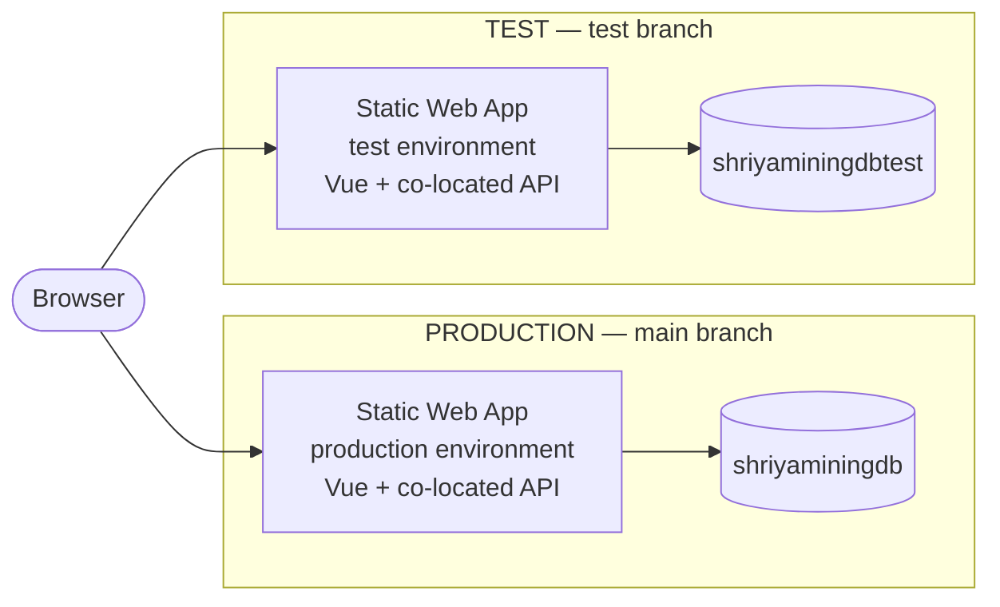
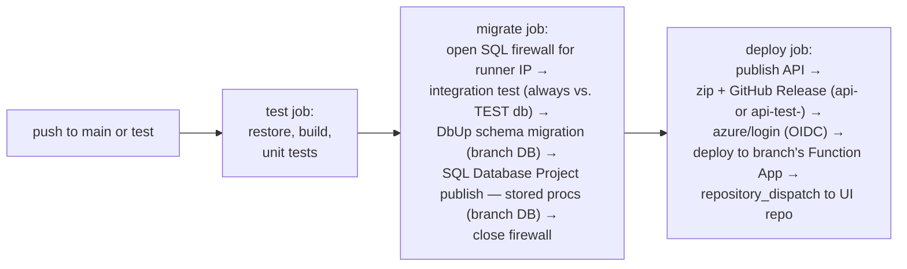
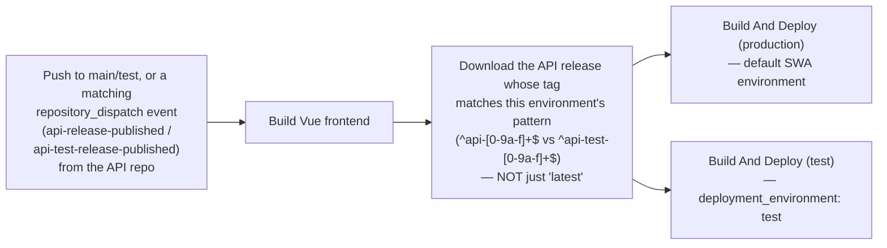

# Shriya Mining Industries — Invoice Platform: Architecture Reference

**Purpose of this document.** This is the living source of truth for the whole system — every
repo, every Azure resource, every pipeline, the database, auth model, costs, and the gotchas that
have actually bitten us in production. If you are new to this project, reading this document
start to finish should be enough to understand how the system fits together, make a change
safely, and debug a real incident. Keep it current: when you change something architectural,
update this file in the same session, not "later."

**Last substantially updated:** 2026-11-10, after closing out the final-review punch list
(UI test coverage, monitoring alerts, rollback runbook, API repo made private, Docker-based local
dev) and fixing a real migration run-order bug found while verifying the last of those.

---

## 1. What this system is

A web application for Shriya Mining Industries to manage export invoices: create/edit invoices,
import purchase orders (PO) from Excel, generate Excel/PDF exports and a print layout, manage
company profile data, and administer users/roles. Backend is C# (.NET, Azure Functions isolated
worker); frontend is Vue 3, deployed as its own independently-deployed repository.

---

## 2. Repositories

All three live under the **`shriyaminingindustriesgroup`** GitHub account.

| Repo | GitHub location | Purpose | Branch strategy |
|---|---|---|---|
| `ShriyaMiningIndustries_api` | `shriyaminingindustriesgroup/ShriyaMiningIndustries_api` (**private**) | The backend: C# / .NET, Azure Functions isolated worker. Owns all business logic, data access, and the SQL Database Project (stored procedures). | `main` (prod), `test` (test env) |
| `ShriyaMiningIndustries_UI` | `shriyaminingindustriesgroup/ShriyaMiningIndustries_UI` | The frontend: Vue 3 + Vite + TypeScript. Deployed as an Azure Static Web App with the C# API's build bundled in as its co-located Functions backend (see §4). | `main` (prod), `test` (test env) |
| `ShriyaMiningIndustries_Docs` | `shriyaminingindustriesgroup/ShriyaMiningIndustries_Docs` | This repo. Living architecture documentation, public so it can be published free via GitHub Pages. **Never put secrets, connection strings, or passwords in here** — reference *where* a value lives (a named GitHub secret, a named app setting), never the value itself. | `main` |

**Local clone layout** (on the primary dev machine), for orientation — not meaningful outside that
machine:
```
C:\Users\<user>\OneDrive\GIT\ShriyaMiningIndustriesApi\ShriyaMiningIndustriesApi\  (api repo — note the folder name doesn't match the GitHub repo name, which is ShriyaMiningIndustries_api)
C:\Users\<user>\OneDrive\GIT\ShriyaMiningIndustries_UI\                        (UI repo)
C:\Users\<user>\OneDrive\GIT\ShriyaMiningIndustries_Docs\                      (this repo)
```

---

## 3. High-level architecture



*Not pictured, to keep this diagram readable:* two standalone Function Apps
(`ShriyaMiningIndustries-api`, `ShriyaMiningIndustries-api-test`) are deployed and healthy but
carry no live traffic — see below. A single shared Application Insights instance
(`ShriyaMiningIndustries-api`) collects telemetry from all four deployments.

**The one non-obvious thing to understand first:** the Static Web App's *co-located* Functions —
not the standalone Function Apps — serve 100% of real user traffic. SWA Free tier cannot "link" to
an external Function App (that needs Standard tier, a real ongoing cost); instead, each SWA
environment (production and test) gets its *own private copy* of the API's compiled build,
uploaded as part of that environment's own deployment. The standalone Function Apps
(`ShriyaMiningIndustries-api`, `ShriyaMiningIndustries-api-test`) are kept deployed and healthy
on purpose, as a **decouple-ready fallback** — if you ever need the API to be a genuinely separate
service (e.g. to upgrade SWA to Standard and link to it, or to serve a non-browser client), the
code and infrastructure are already there and already proven working. See §9 for the exact
decoupling steps.

---

## 4. Environments: Production vs Test

| | Production | Test |
|---|---|---|
| Trigger branch | `main` | `test` |
| UI URL | `https://gray-meadow-0ebc61d10.6.azurestaticapps.net` | `https://gray-meadow-0ebc61d10-test.centralus.6.azurestaticapps.net` |
| SWA environment name | `default` | `test` |
| Database | `shriyaminingdb` | `shriyaminingdbtest` |
| Standalone Function App | `ShriyaMiningIndustries-api` | `ShriyaMiningIndustries-api-test` |
| GitHub Release tag prefix | `api-<sha>` | `api-test-<sha>` |
| Cross-repo dispatch event | `api-release-published` | `api-test-release-published` |

**Promotion workflow:** push/merge changes to `test` first. The pipeline deploys the whole stack
(DB migrations + stored procs + Function App + SWA test environment) in isolation from
production. Validate on the test URL. When satisfied, merge `test` → `main` via a normal PR — the
exact same commit that was validated on test is what reaches production, not a rebuild.

Both databases already exist and both have Azure SQL's **free offer** applied
(`useFreeLimit: true` — confirmed via `az sql db show`): 100,000 vCore-seconds + 32GB storage free
per database per month, for the life of the subscription. At the stated real usage pattern
(≈5 users, max 1–2 hours/day), this comfortably covers compute for both databases combined —
see §10 for the full cost picture.

---

## 5. Azure resources — full inventory

All resources live in resource group **`ShriyaMiningIndustries`**, region **Central US**, under
one Azure subscription.

| Resource | Name | Type / SKU | Notes |
|---|---|---|---|
| Static Web App | `ShriyaMiningIndustries-ui` | Free tier | 2 of its 3 allowed staging environments in use (`default`=prod, `test`). Co-located Functions runtime, no linked backend. |
| Function App (prod) | `ShriyaMiningIndustries-api` | Consumption (Y1), Windows, `dotnet-isolated` | Decouple-ready fallback, not in the live traffic path (see §3). |
| Function App (test) | `ShriyaMiningIndustries-api-test` | Consumption (Y1), Windows, `dotnet-isolated` | Same role as above, for test. |
| Storage account | `stshriyaminingapi` | Standard_LRS | Backs the prod Function App's internal state. |
| Storage account | `stshriyaminingapitest` | Standard_LRS | Backs the test Function App's internal state. |
| SQL Server | `shriyaminingindustries` (`shriyaminingindustries.database.windows.net`) | Logical server | SQL-auth admin login configured (ask a team member for the username/password — neither is written down here; this repo is public). No Azure AD admin configured yet. |
| SQL Database (prod) | `shriyaminingdb` | General Purpose, Serverless, 0.5 vCore min, free-limit enabled, auto-pause after 60 min idle | |
| SQL Database (test) | `shriyaminingdbtest` | Same tier/config as prod | |
| Application Insights | `ShriyaMiningIndustries-api` | Standard | Shared telemetry sink for all four API-side deployments (prod/test × co-located/standalone). One place to watch live traffic for any of them — see §12. |
| Azure AD App Registration | `ShriyaMiningIndustriesApi-github-actions` (App ID `32f692ff-e4ba-4492-a4cc-24375ea72d2a`) | — | Used for GitHub Actions OIDC login (`azure/login@v2`), no stored client secret. Has **two** federated credentials, one per branch — see §6. |
| Action Group | `ShriyaMiningAlerts` | Email | Notifies on the two alert rules below. |
| Metric alert | `ShriyaMining-ExceptionSpike` | Severity 2 | Fires when `exceptions/count` on the shared Application Insights instance exceeds 5 in a 15-minute window — catches a real error spike in any of the four API deployments. |
| Metric alert | `ShriyaMining-FailedRequests` | Severity 2 | Same trigger pattern, on `requests/failed`. Neither alert fires on the known SQL cold-start flake (§12) — that reports a 200 with `"status":"degraded"` in the body, not an exception or a failed request. |

Both alert rules were added specifically to close a real gap: before they existed, Application
Insights was collecting telemetry nobody would be notified about — an outage or error spike would
only be noticed if someone happened to be looking. Within Azure Monitor's free allowance (10
monitored metric time series/month, confirmed against current pricing guidance) — this adds two.

---

## 6. CI/CD pipelines

### 6.1 API repo (`ShriyaMiningIndustries_api`) — `.github/workflows/deploy-ShriyaMiningIndustriesApi.yml`

Triggers on push to `main` or `test`. Branch decides the environment end-to-end via a single
`github.ref_name == 'main'` condition, repeated wherever a per-environment value is needed
(Function App name, SQL connection string, release tag prefix, dispatch event type).



Key points worth knowing when debugging this pipeline:

- **The integration test always runs against the test database**, regardless of branch. This was
  deliberately fixed (it used to run against prod on every single deploy) — a throwaway
  health-check test has no business holding a live connection to production.
- **DbUp migrations and the SQL Database Project publish are branch-targeted**, not "both every
  time." Before the Test/Prod split, every push republished stored procedures to *both* databases
  unconditionally — that defeated the point of having an isolated test environment, so it's gated
  by branch now.
- **The SQL firewall rule name includes the GitHub run ID** (`github-actions-runner-<run_id>`) so
  concurrent runs across branches can't collide.
- **GitHub Releases are tagged with a branch-specific prefix** (`api-<sha>` vs `api-test-<sha>`)
  specifically so the UI repo's pipeline can pick the *right* release for the environment it's
  deploying — GitHub's own "latest release" is just whichever was published most recently across
  *both* prefixes, which is not necessarily correct for a given run.
- **OIDC login needs a federated credential matching the exact branch.** The Azure AD App
  Registration has two: `github-main-branch` (subject ends `ref:refs/heads/main`) and
  `github-test-branch` (`ref:refs/heads/test`). If you ever add a third long-lived branch, it
  needs its own federated credential or `azure/login` will fail with `AADSTS700213` — this bit us
  once already when `test` was first introduced; see §12.

### 6.2 UI repo (`ShriyaMiningIndustries_UI`) — `.github/workflows/azure-static-web-apps-deploy.yml`

Triggers on push to `main` or `test`, on `repository_dispatch` (fired by the API repo's deploy
job, see below), and on pull-request open/sync/close against `main` (SWA's own PR-preview
behavior, unchanged by any of this).



Key points worth knowing when debugging this pipeline:

- **`repository_dispatch` always checks out the repo's default branch (`main`) unless told
  otherwise.** The checkout step explicitly overrides `ref:` to `test` when the dispatch event is
  `api-test-release-published` — without this, a test-environment deploy would silently build
  `main`'s UI code paired with the test API build.
- **Release selection is tag-pattern matched, not "latest."** `gh release list` + a regex `select`
  on the tag name, sorted by publish date, picking the newest match for this environment's
  prefix. This was a real bug waiting to happen: with both environments publishing releases to
  the same repo, GitHub's own latest-release resolution would pick whichever of the two was most
  recently published, not necessarily the one this run is deploying.
- **The cross-repo trigger needs a PAT, not the default `GITHUB_TOKEN`.** `UI_REPO_DISPATCH_TOKEN`
  is a fine-grained PAT (Contents: Read and write, scoped only to this repo), stored as a secret
  on the *API* repo, since the default token can't dispatch into another repository.
- **Downloading the API release also needs a PAT**, for the same underlying reason in the
  opposite direction: `API_REPO_READ_TOKEN` (fine-grained, Contents: Read-only, scoped only to
  `ShriyaMiningIndustries_api`), stored as a secret on *this* repo. This is only needed because
  the API repo is private (§2) — the default `GITHUB_TOKEN` only sees the repo its own workflow
  runs in, so it couldn't see a private API repo's releases. (It worked without this token while
  the API repo was briefly public, which masked the need for it — worth knowing if this ever
  looks like it "used to just work.")
- **The SWA deployment token** (`AZURE_STATIC_WEB_APPS_API_TOKEN` secret, this repo) is the one
  credential that, if rotated or regenerated in Azure, needs to be re-copied here by hand — it's
  not something either pipeline can self-heal.

---

## 7. Database

### 7.1 Migration strategy — two separate mechanisms, deliberately

- **DbUp** (`database/migrations/*.sql`, run via `ShriyaMiningIndustries.Migrations`) owns
  **tables and data** — the things a destructive rebuild could lose. Sequential, numbered
  `V###__description.sql` files plus `R__*.sql` repeatable scripts, applied in order.
  Idempotent/tracked by DbUp's own journal table.
- **SQL Database Project** (`database/ShriyaMiningIndustries.Database/*.sqlproj`, built with
  `Microsoft.Build.Sql`, published via `SqlPackage`) owns **stored procedures, views, and
  functions** — pure code, safe to diff-and-replace on every deploy. Published with explicit
  `/p:` flags excluding `Tables;Users;Logins;...` from the diff — a `.publish.xml` profile was
  tried first and found to silently fail to apply these settings; don't reintroduce one without
  re-verifying via `/Action:Script` first, the same way this was originally verified.

**Known footgun:** the `ExcludeObjectTypes` value in the SqlPackage command must stay
double-quoted as one shell token. An unquoted `;` is treated as a command separator by the shell,
silently truncating the exclusion list down to just `Tables` — this was caught locally before it
ever reached CI, but would be a nasty one to debug blind if it recurred.

### 7.2 Schema overview

- **`security` schema** — `User`, `Role`, `Permission`, `UserRole` (many-to-many), `RolePermission`
  (many-to-many). Seeded roles: `Admin` (all permissions), `User`, `Approver`, `Viewer`, and `Manager` (V011; see §8) — see
  `database/migrations/V003__seed-initial-data.sql` for the exact permission grants per role.
- **`app` schema** — Vendor, Buyer, Invoice + InvoiceLine, PO import records, company profile, and
  related master data.
- **Partial fulfillment (`sales` + `app`)** — `sales.POLine` is the durable PO ledger. Every
  uploaded row must carry a unique, uploader-maintained **Line Id** column (rejected otherwise,
  with the exact rows named); re-uploads match on it alone, so quantity updates — and even
  PO#/SKU/SO Ref# corrections — update the same line in place while `POLineId` (the PK) and the
  fulfillment history attached to it survive. Rows imported before the Line Id column existed
  are adopted by a natural-key fallback (PO# + SKU + SO Ref# + occurrence) and stamped on their
  next upload. Each upload reports per-line import actions (Added / Updated / Unchanged).
  `app.InvoiceLine.POLineId` links each invoiced line back to the PO line it (partially)
  fulfills. A PO line's status (Open / Partial / Fulfilled / Over-invoiced) is **computed on
  read** from the live invoice lines (`sales.usp_PoFulfillment_GetList`), never stored — it
  can't drift. Saving an invoice is hard-blocked (`INV-VALIDATE-400`, with the specific lines
  named) when a line would push a PO line past its ordered quantity; quantities are compared
  directly regardless of UOM, per the product decision. A matching 50400 backstop lives in
  `usp_Invoice_Create`/`usp_Invoice_Update`, which also take `UPDLOCK, HOLDLOCK` on the
  referenced `sales.POLine` rows **before** writing any invoice line, so two concurrent saves
  against the same PO line are serialized and can't both pass the remaining-qty check.
  "Fulfilled" means "invoiced": there is no separate shipment record (product decision).
- **Lossless PO import (V009)** — `sales.POImportRow` keeps **every row of every worksheet of
  every upload** whole: all cells as displayed (`CellsJson`, column order preserved), the typed
  value where Excel stored a number/date that displays differently (`TypedJson`), the sheet and
  row number, and the import result — `Added`/`Updated`/`Unchanged` (ledger lines), `Skipped`
  (first sheet, no usable qty, with the reason), `Stored` (other sheets), `Restored`, or
  `Legacy` (the key-fields-only row backfilled for lines imported before V009 — the other
  columns were never saved and can't be recovered from the database). Re-uploads add rows
  rather than overwrite, so a line's full history survives. Columns are read **by position**: a
  blank heading becomes `Column X` instead of shifting later values (a real pre-V009 bug).
  `PONumber`/`SKU`/`SOReference`/`ExternalLineId` are `NVARCHAR(200)` and `Supplier`
  `NVARCHAR(1000)`; longer values are cut in the ledger only, never in the stored row. The
  uploaded **file itself is not kept** (product decision). `POLine.FirstImportBatchId` is the
  upload that first added a line (`POImportBatchId` is overwritten on every update);
  `LatestImportRowId` points at its newest full row. A **Restore** upload
  (`usp_POImport_Restore`) stores an old file's rows as history for the lines it matches (by
  Line Id, or PO# + SKU + SO Ref# + occurrence for files from before the Line Id column) and
  never changes a ledger value.
- **Buyer ownership (V009)** — `POImportBatch.BuyerId` is the buyer selected for an upload;
  `POLine.BuyerId` is set by the upload that first adds a line and never changes. The PO list,
  PO lines, fulfillment view and upload history are buyer-filtered, and an invoice may only
  include PO lines of its own buyer (service check naming the lines, plus a 50400 backstop).
  **Line Id stays unique across all buyers** — an upload carrying a Line Id another buyer owns
  is rejected with the rows named (`usp_POLine_GetOwners`). Only the legacy natural-key
  adoption index `UX_POLine_NaturalKey` is per-buyer (`BuyerId, PONumber, SKU, SOReference,
  Occurrence`), so two buyers can share PO numbers. Backfill: the buyer of invoices raised
  against the line, else the most-invoiced buyer, else the only buyer.
- **"Use existing PO"** (PO Import step 1) — POs are listed per buyer for an upload-date
  period (`usp_POLine_GetPoSummaries`: a PO is in [from, to) when any upload in it included
  the PO). A PO's lines (`usp_POLine_GetByPo`) are grouped by the upload that first added them;
  later updates don't move a line. Lines from several POs of one buyer are collected in a
  selection basket (kept in the tab's `sessionStorage`) and invoiced together. Line history:
  `usp_POLine_GetHistory`; upload history: `usp_POImport_GetBatches` / `usp_POImport_GetRows`.
  API routes: `GET /api/po-ledger/pos`, `GET /api/po-ledger/lines`,
  `GET /api/po-ledger/lines/{id}/history`, `GET /api/po-import/batches`,
  `GET /api/po-import/batches/{id}/rows`, `POST /api/po-import/restore` — all `file.upload`.
- **Purchase order PDFs are the PO source (V010)** — the buyer's PO PDF is uploaded, read and
  kept as a Pending `sales.PODocument` (original file in `Content VARBINARY(MAX)`, plus what was
  extracted); the user reviews/edits it and confirms. Reading is text-layer only (PdfPig,
  Apache-2.0; scanned PDFs are rejected) with one layout reader, `NsrPurchaseOrderLayout`, that
  locates columns from the table headings and handles both NSR line variants (a "Desc:" packaging
  line, or a main qty/price plus a second CRATE qty/price; the first qty is always the main one).
  `sales.PurchaseOrder` holds one row per buyer + PO# with the printed header; the first confirmed
  PDF is revision 1 and **every later PDF of the same PO# is an update** — lines are matched on SKU
  (letters/digits only, + occurrence), changed lines keep their `POLineId`/Line Id/invoice history,
  new lines get the next number, and missing lines get `RemovedInRevision` (never deleted; they can't
  be invoiced again). **Line Ids are generated**: `{PO#}-{NN}` (e.g. `172021-01`); if another buyer already has that PO number, `{PO#}-{NN}-B{BuyerId}` (e.g. `172021-01-B2`) so Line Ids stay unique across buyers, with a note on the import screen. A saved PO keeps its Line Ids across revisions.
- **POs may run over several pages**: the reader continues past page breaks (later pages have no table header) until the totals. **Invoice quantities match the PO**, up to 2 decimals (e.g. 2,050.56 SF), in the app, the API and SQL (DECIMAL qty × rate, rounded half away from zero to cents). The PO prints the per-crate price rounded to cents, so a crate total within half a cent per crate of the line total is a note, not an error; qty × price must still equal the line total exactly.
- **Crate numbers run on across invoices** (V012): the first crate is 1000 and each new PO invoice continues after the highest crate number any invoice uses (`app.Invoice.CrateStart`/`CrateEnd`). The server assigns them on save and rewrites the document's start and per-line ranges; a Draft keeps its start when edited; **Manager and Admin** may type another start. The save procedures hold an app lock and refuse any range that overlaps another invoice's (50409, naming it); an automatic range taken meanwhile is retried once. Checks before saving:
  qty × price (and alt qty × alt price) = Extended per line, lines = Subtotal = Total (acknowledgeable),
  whole quantities, buyer/supplier names, older file version (`_N_` in the file name). **Invoice
  rates for PO lines are locked to the PO unit price** (service check naming the line + SQL backstop;
  `InvoiceLine.POUnitPrice` records the price used); a draft priced from an older PO version must be
  updated before it can be saved. `app.Buyer.PoInputMethod` (`Pdf` default for all buyers |
  `Spreadsheet`) — the PendingOrders spreadsheet upload is rejected for `Pdf` buyers (no admin
  screen yet). Spreadsheet-only POs were backfilled as revision 0 (`Source='Spreadsheet'`), so a PDF
  of the same PO# becomes an update of those lines. Routes: `POST /api/purchase-orders/extract`,
  `POST /api/purchase-orders/documents/{id}/confirm|discard`, `GET /api/purchase-orders/{id}`,
  `GET /api/purchase-orders/documents/{id}/file` (also `file.download`), `GET /api/po-ledger/line-prices`.
  Storage: the two sample PDFs are 27 KB and 174 KB — 10,000 such POs ≈ 0.3–1.9 GB.
- **Old invoices before go-live (V018)**: `app.Invoice.IsLegacy` marks an invoice made in the old
  Excel process and recorded so its PO lines count as shipped. It keeps its own plain number ("72")
  in `InvoiceNumber` (app numbers are `SMI-YYYY-MM-NNN`, so they can't clash; the unique index refuses
  a second "72"). Its lines are read-only; its status can be set to any value, in either direction,
  without shipping details (`usp_Invoice_SetLegacyStatus`); the normal edit and status paths refuse it.
  `usp_Invoice_CreateLegacy` skips the checks that only apply to app invoices: PO price, remaining
  quantity (an old invoice may over-ship; the line then shows Over-invoiced), container fit, shipping.
  A line without a PO line may have a negative rate (the "LESS DISCOUNT" line). Its crate range is
  stored only when it doesn't overlap another invoice's, so the crate counter (largest + 1) and the
  overlap checks work unchanged. `app.LegacyInvoiceUpload` keeps each uploaded old Excel file
  (`Content VARBINARY(MAX)`), what was read from its INV sheet (ExcelDataReader, MIT, reads .xls and
  .xlsx; fields found by their labels), the user's draft choices and the invoice it became.
  `usp_Invoice_DeleteLegacy` (Admin) deletes one, frees its number and returns its file to the list.
  Lines whose PO isn't in the app use the fixed PO reference `LEGACY`. Routes (Admin or Manager):
  `POST /api/legacy-invoices/uploads`, `GET /api/legacy-invoices`, `GET|DELETE /api/legacy-invoices/uploads/{id}`,
  `PUT .../uploads/{id}/draft`, `POST .../uploads/{id}/save`, `POST /api/legacy-invoices` (no file),
  `POST /api/legacy-invoices/status`, `POST /api/legacy-invoices/{id}/delete`, `GET /api/legacy-invoices/file`,
  `GET /api/legacy-invoices/po-open-lines`, `POST /api/legacy-invoices/mark-shipped` ("Mark as shipped
  before go-live": one Delivered old invoice numbered `GL-<PO#>` for everything still open). V018 also
  widens `app.Buyer.Phone` to 40 characters (buyers in any country), and the buyer code can now change
  at any time (it's only a label; POs and invoices use `BuyerId`).
- **Photos in the email to the buyer (V027, 2026-11-16).** The Save and send email popup has
  **Add photos** (the computer's file picker, several at once; thumbnails with remove). The browser
  shrinks each photo (`email-photos.ts`: long side ≤ 1600 px, JPEG quality 0.8; a 12 MB photo became
  ~600 KB in testing); types the browser can't open (e.g. iPhone HEIC in Chrome/Edge) are refused with a
  message to save them as JPEG. **Limits: at most 10 photos, and the invoice PDF plus photos at most
  3 MB per email** (the user's choice, which is also Microsoft Graph's simple-send limit, so it stays
  valid after the move to Microsoft 365). The popup shows the running total and blocks sending over it;
  the API checks again (`EmailPhotos`: count, JPEG/PNG by the file's first bytes, clean distinct names,
  the 3 MB total) before anything is sent. Everyone on the email (To, CC, BCC, the service mailbox) gets
  the PDF and the photos; acknowledgement emails don't. **The photos aren't stored** (no database
  growth): `app.InvoiceReviewRequest.PhotosJson` keeps only `{ name, bytes, sha256 }` per photo, listed
  as "Photos sent" on the Buyer approval card; the buyer's review page is unchanged. In the payload log
  the photos' `contentBase64` becomes a size + SHA-256 summary.
- **Black and white email and invoice; the sender's name (2026-11-17, no migration).** Agreed so the
  documents print well on black-and-white printers.
  - *Email* (`EmailContent.Compose`): laid out like an ordinary business email. The message, the
    invoice details as a plain table with grey rules, a black **Review and approve invoice** button
    (To people only) and the link note, then the sign-off, then a small grey footer. No coloured box.
    `SplitSignOff` finds the last paragraph starting "Regards," / "Kind regards" / "Thanks" /
    "Sincerely"… (followed by a line break) and puts the details and button above it, so the email
    ends with the sender's name; a message without a sign-off gets them after it. Unit test: only
    greys (`#xxxxxx` with equal channels) appear in the HTML.
  - *Invoice / packing list* (`legacy-invoice.js`, workbook palette): black text, light grey heading
    fills, mid-grey borders; no brown, gold or green. Excel, Preview, Print and the emailed PDF all come
    from this one workbook layout, so all four match.
  - *Sender's name*: `{senderName}` is `IUserContext.Name`. The sign-in gives only the email, so
    `AuthenticationMiddleware` now takes `security.User.DisplayName` from the role lookup query when it
    is a real name (not blank, no "@"). Admin → Users gets a **Name** column (Add name / Edit) and a
    Name field on Add user: `PUT /api/console/users/{id}/name` → `security.usp_User_SetName` (empty
    puts the email back; the column is NOT NULL). Until a name is set the popup says the message is
    signed with the email address (`ApprovalEmailDraftDto.SenderNameMissing`). Buyer contact names
    (Admin → Buyers → Invoice emails) aren't used in the email yet.
- **Payload log (V026, 2026-11-16).** `log.PayloadLog` stores API calls with their request and
  response so a failure can be read exactly as it happened. `PayloadLoggingMiddleware` is registered
  **first** (outside `ErrorHandlingMiddleware`), so it records the final answer, error envelopes
  included. It reads the request body up front and rewinds it (`EnableBuffering`: some functions dispose
  the stream after reading it), and swaps the response body for a `CaptureStream` that passes every byte
  straight on while keeping a copy (first 1 MB, plus total size and SHA-256). Which calls: app settings
  **`PAYLOAD_LOG_FAILURES` = 1** (status 400 and above) and **`PAYLOAD_LOG_SUCCESSES` = 0** (built, off
  until needed), re-read by each running copy at most once a minute. **Redaction** (`PayloadRedactor`,
  unit-tested): login/session headers (`x-ms-client-principal…`, Authorization, cookies), `X-Review-Token`,
  and JSON fields or query values named like a password/secret/token become `[redacted]`, and so does
  `code` on the buyer's `public/` routes (the one-time code; elsewhere `code` is an ordinary product or
  error code); a `…Base64` field (the emailed PDF), a binary body (PDF/Excel download) or a text value
  over 16 KB becomes a one-line summary with size and SHA-256; a body is cut at 32 KB (`Truncated`).
  Never logged: `health`, `ping`, Swagger/OpenAPI, and `console/payload-log` itself. **Retention:**
  `PAYLOAD_LOG_DAYS` = 30. Static Web Apps' managed Functions have no timer triggers, so the API purges
  **opportunistically**: at most once an hour per running copy, `DELETE TOP (2000)` up to 10 batches,
  so no extra resource or cost. **Link to errors:** `log.ErrorLog.PayloadLogId` (nullable, optional:
  not every error comes from an API call) is filled when the payload row is written, matching on the
  request's CorrelationId; no foreign key, so purging payloads never touches the longer-lived error
  rows. A call the Functions **host** rejects before the worker runs (e.g. no matching route) isn't
  logged. Admin → **Payload logs** (`/admin/payloads`; Admin role + `errorlog.view`): list with
  filters, the call in full, and the switches/days (`GET /api/console/payload-log`, `.../{id}`,
  `GET|PUT .../settings`); Error logs → **View payload** opens the matching call. The go-live clean-up
  clears it with the other logs. Cost: one extra insert per logged call, inside the existing database.
- **Emailing invoices to buyers for approval (V025, 2026-11-16; part 2).** On a Draft/Rejected
  invoice, choosing In Review turns **Save** into **Save and send email**: the edits are saved
  (status kept), the browser builds the **PDF** from the Preview/Print layout (`invoice-pdf.ts`:
  html2canvas + jsPDF, pages cut only between items), and a popup shows the email (To/CC/BCC from the
  buyer's list, the service mailbox locked in CC, subject and a formatted message). **Confirm and send**
  (`POST /api/invoices/{id}/submit-for-approval`, `invoice.send` + `invoice.status`) runs the In Review
  checks first (`InvoiceService.PrecheckReviewAsync`), sends **one email per To person with their own
  link** (delivered only to them) and **one copy without links** for CC/BCC/the service mailbox, and
  **only if a To address was accepted** moves the invoice to In Review; some failed → the sender is
  emailed; all failed → nothing changes, the Email Alerts service's To are emailed and the
  `email_send_all_failed` metric is counted. Admin only: "Don't email the buyer". Tables:
  `app.InvoiceReviewRequest` (subject, message, the PDF, the invoice RowVersion it was sent for, state),
  `app.InvoiceReviewRecipient` (only the **SHA-256 of each link token**; send result; opens; one-time
  code hash, tries, lock-out), `app.InvoiceReviewDecision` (once per sending: unique index),
  `app.EmailTemplate` (default subject/message), `app.AppSetting` (link days 14, code required 0),
  `app.Buyer.RequireReviewCode` (per-buyer exception). **The buyer's page** is `/review#t=<token>`
  (outside the app frame and sign-in; the token stays in the `#` part, sent in the `X-Review-Token`
  header to the anonymous routes `GET /api/public/invoice-review`, `.../attachment`, `POST .../code`,
  `POST .../decision`). A link works only while its sending is Open, unexpired, undecided and the
  invoice is **In Review with the same RowVersion** it was sent for: any change to the invoice makes it
  stale ("changed"), a newer email replaces it ("replaced"). `app.usp_InvoiceReview_Decide` re-checks
  all of that under lock, records the decision (email from the token row, typed name, IP from
  `X-Forwarded-For`, browser), saves the buyer's shipping reference (the old one named), and moves the
  status through `usp_Invoice_Update` with `Source='Buyer email'`; everyone on the email then gets an
  acknowledgement (no links). Messages are cleaned server-side (HtmlSanitizer, allow-list). Company
  profile → **Email settings** edits the template, link days and the code switch.
- **Email: Services and buyers' invoice email lists (V024, 2026-11-16; part 1 of emailing invoices
  to buyers for approval, plan in `plan/email-functionality` outside the repos).**
  `app.OrganizationService` is **Admin → Company profile → Services**: one row per service the system
  sends email as, with **From / To / CC** (JSON lists), display name, reply-to and a fixed `ServiceKey`
  the code uses. Two system rows (can't be deleted): `INVOICE_EMAIL` (Invoice Email Service; its To
  comes from the invoice's buyer, `ToFromBuyer`) and `EMAIL_ALERTS` (who's told when emails fail).
  V024 creates both **with empty addresses**: they're typed on screen per environment, so no person's
  address is in a migration. `app.BuyerContact` is each buyer's **invoice email list** (Admin →
  Buyers → Invoice emails): To (approves), Cc, Bcc; an address once per buyer. `app.EmailLog` keeps
  every email sent or tried, with the provider's answer. Sending goes through one `IEmailSender`:
  `SmtpEmailSender` (MailKit, MIT; Zoho Mail today) or `GraphEmailSender` (Microsoft Graph
  `sendMail`, for the planned move to Microsoft 365), picked by the `EMAIL_PROVIDER` app setting, so
  the switch is a settings change. Routes: `GET|POST /api/organization/services`,
  `PUT|DELETE /api/organization/services/{id}`, `POST /api/organization/services/{id}/test-email`
  (`vendor.manage`), `GET|PUT /api/console/buyers/{id}/invoice-emails` (Admin). Mailbox passwords
  are never in the database or on screen (§11). The go-live clean-up keeps Services and the buyer
  lists (the lists go only with `@KeepBuyers = 0`) and clears `EmailLog` with the logs.
- **Tracking → Product groups on the SKU without its delivery prefix** (2026-11-16, no migration).
  NSR prints a delivery code in front of some SKUs (`BED-GRNABSBLK1224FL` goes to Los Angeles · BED);
  the rest of the SKU names the stone, colour, size and finish (`GRN` granite, `ABSBLK`, `1224`,
  `FL` flamed). `sales.usp_PoFulfillment_GetList` works out each line's `ProductSku` **at read time**
  from the buyer's active delivery rules: every `itemStartsWith` value (today `TLBR`, `DAL`, `BED`) is a
  prefix, removed only when followed by a dash (`BEDROCK12` is untouched; the longest prefix wins).
  By-product rows group on `ProductSku + unit`, so `BED-X` and `X` are one product, with a delivery
  chip per place and `skus` listing the SKUs as printed. Lines merge **only** when the rest of the SKU
  is identical, never on the description. It is read-time on purpose: `sales.POLine` is written in four
  procedures (`usp_POImport_Create`/`_Upsert`, `usp_PurchaseOrder_Confirm`/`_Edit`), and a rule an Admin
  changes applies at once with nothing to backfill. Only Tracking → Product uses it; PO import, Line Ids,
  revisions, invoices, Create Invoice and the PO/Invoice tracking views keep the SKU as printed.
- **Invoice currency (V009)** — `app.Invoice.Currency CHAR(3)` default `USD`, returned as
  `currency`. PO invoices carry no tax (the printed export invoice has no tax column); totals
  show Tax 0.00.

### 7.3 Tooling note — SQL Database Project and Visual Studio 2026

The SQL Database Project uses the **SDK-style** project format (`Microsoft.Build.Sql`), which
Visual Studio 2026 cannot render in Solution Explorer (confirmed against Microsoft's own docs:
SDK-style SQL projects are currently VS-2022-preview-only). This is expected, not a broken
project — use **VS Code's SQL Database Projects extension** to work on it instead. Converting to
the legacy project format would fix the VS 2026 complaint but break the cross-platform Linux CI
build; don't do that.

---

## 8. Authentication & authorization

1. **The Static Web App's built-in Entra ID (AAD) auth** handles the actual login. No custom app
   registration is configured for this (the default, built-in multi-tenant SWA provider is used,
   carried over faithfully from the original app) — hitting `/.auth/login/aad` on either
   environment triggers it.
2. On every authenticated request, SWA injects an `x-ms-client-principal` header (base64 JSON)
   into the request before it reaches `/api/*`. This happens identically for co-located and linked
   backends.
3. **`AuthenticationMiddleware`** (API repo, `src/ShriyaMiningIndustries.Api/Middleware/`) decodes
   that header, extracts the email (`userPrincipalName` or `userDetails`), and looks up roles and
   permissions **by email** — not by any Entra object ID — via `UserRoleLookupRepository`, joining
   `security.User → UserRole → Role → RolePermission → Permission`. This means: logging in via AAD
   always succeeds if your Entra identity is valid, but you get **zero permissions** until your
   email exists as an active row in `security.User` with a role assigned. Login success and
   application-level authorization are two separate things — don't conflate them when debugging a
   "logged in but nothing works" report.
4. There is **no self-service bootstrap**: the very first admin user in a fresh database can't be
   created through the app's own admin console (that requires an already-authenticated admin to
   call it — chicken and egg). Bootstrap it directly via SQL instead:

   ```sql
   -- Bootstraps <email> as an Admin user. Idempotent — safe to run more than once.
   IF NOT EXISTS (SELECT 1 FROM security.[User] WHERE Email = '<email>')
   BEGIN
       DECLARE @NewUserId NVARCHAR(255) = CAST(NEWID() AS NVARCHAR(255));
       INSERT INTO security.[User] (UserId, Email, DisplayName, IsActive, CreatedBy, ModifiedBy)
       VALUES (@NewUserId, '<email>', '<display name>', 1, 'bootstrap-admin', 'bootstrap-admin');
       INSERT INTO security.UserRole (UserId, RoleId, GrantedBy)
       VALUES (@NewUserId, 1, 'bootstrap-admin'); -- RoleId 1 = Admin
   END;
   ```

   Run via the Azure Portal's Query Editor against the target database (`shriyaminingdb` or
   `shriyaminingdbtest`), signed in with the SQL admin login. Remember: the two databases are
   completely separate — bootstrapping prod doesn't touch test, and vice versa.
5. **Entra ID bearer-token validation for non-browser callers is intentionally not implemented.**
   The target design reserves this for an app registration that needs tenant-admin access no
   session has had so far — building JWT validation against a tenant/client ID that doesn't exist
   yet would be speculative, untestable code. The SWA header path above is what the real UI and
   all current testing actually uses.

6. **Roles** (`V003` seeds the first four, `V011` adds Manager and `Invoice.Status`). Admins change
   anyone's roles on **Admin → Users** (tick roles, *Save roles*; `PUT /api/console/users/{id}/roles`).
   Safeguards: every user keeps at least one role, an Admin can't remove their own Admin role, and
   the last Admin can't lose it.

   | Role | Can do |
   |---|---|
   | Admin | Everything, including the Admin screens (users/roles), Error logs and Company profile. Can move an invoice from **any status to any status**. |
   | Manager | Everything Admin can **except** the Admin screens, Error logs, Company profile and buyer management. Can move an invoice **one step forward** only: Draft → In Review → Approved → Shipped. |
   | Approver | Read invoices, download files, view reports (`invoice.approve` is granted but can't change status today — reserved for a future buyer-side approver). |
   | User / Viewer | Unchanged from `V003`. |

   **Invoice status** is a dropdown on the invoice page (with **Update status**:
   `POST /api/invoices/{id}/status`) and on both editors (Edit invoice, PO invoice review), where it is
   saved **together with the edits in one request** (`PATCH /api/invoices/{id}` with `status`). Either way
   it needs `invoice.status` and follows the rules above; every change is in the invoice's version
   history. **Only Draft invoices can be edited** — or edited in the same save that moves the invoice
   back to Draft (Admin). After every save the app opens the invoice's page.

   **Status sync (ticket 382840, V013):** invoice statuses are Draft → In Review → Approved or
   **Rejected** (remarks required; editable again, then back to In Review) → Approved → **Final
   Information Pending** → **In Transit** → **Delivered** (formerly Shipped). Manager takes the next
   step only; Admin any status to any status. **Approved needs the shipping reference (shipment
   number); from Ready to Ship on, the container no. too** (changed 2026-11-16, V025: there's no
   container no. yet when a buyer approves by email; Shipping details card on the invoice page, or
   the review page's header fields). PO line
   and PO statuses are **stored** (`sales.POLine.Status`, `sales.POStatus`) and recalculated by
   `sales.usp_POStatus_Recalculate` in the same transaction as every invoice create/update/delete, PO
   confirm and spreadsheet upload. Line: least advanced of its invoices (Invoiced, In Review, Approved,
   In Transit, Delivered / Partially Delivered), Open when on none, plus Removed and Over-invoiced. PO:
   Fulfilled (every line Delivered), Partially Fulfilled, Open. Every status change is recorded in
   `app.InvoiceStatusChange` (who, when, from/to, remarks). Tracking hides Fulfilled POs unless
   "Show fulfilled POs" is ticked.

   **Pages:** **Create Invoice** (`/create-invoice`, the home page for anyone with `file.upload`) picks lines from saved POs, then review & save; editing a PO invoice opens it too. **PO Import** (`/po-import`) only uploads and saves POs, then offers Create invoice. **Home page:** Create Invoice for anyone with `file.upload` (Admin, Manager, User); Invoices for
   everyone else. Admin pages also check the role by address, not just in the menu.

---

## 9. Decoupling the API later (if/when needed)

The whole co-located-backend design exists specifically so this is an upgrade, not a rewrite,
when the time comes:

1. Upgrade the Static Web App from Free to Standard tier (real ongoing cost — confirm current
   pricing before doing this; it was ~$9/month when last checked, see §10).
2. `az staticwebapp backends link` the SWA to the already-running, already-proven
   `ShriyaMiningIndustries-api` standalone Function App (or its test counterpart).
3. Remove the "Download matching API release" + co-located packaging step from the UI repo's
   workflow — the linked backend serves `/api/*` directly, no bundling needed.

Nothing about the API's code, the auth model, or the database needs to change for this — it was
designed in from the start.

---

## 10. Cost model

Deliberately built to stay at or near **$0/month** at the stated real usage (~5 users, ~10k hits,
max 1–2 hours/day), verified against real Azure pricing rather than assumed:

| Component | Why it's free at this scale |
|---|---|
| Static Web App (both environments) | Free tier. Co-located Functions chosen specifically because Free tier can't link an external backend (that needs Standard, ~$9/month). 2 of 3 allowed staging environments in use. |
| Function Apps (both, standalone) | Consumption (Y1) plan: 1,000,000 executions + 400,000 GB-s free **per month, per subscription** (shared across every Function App in the subscription, not per-app) — confirmed against Microsoft's own Functions pricing page. Nowhere close to this ceiling at the stated usage. |
| SQL Databases (both) | Azure SQL free offer applied (`useFreeLimit: true`, confirmed via `az sql db show`): 100,000 vCore-seconds + 32GB storage free per database per month, for the life of the subscription. At 0.5 vCore minimum, that's ≈55.6 hours of active compute free per database per month — comfortably covers the stated 1–2 hrs/day ceiling. Default behavior on exceeding the limit is auto-pause, not a surprise bill. |
| Application Insights | Shared single instance across all four API deployments rather than one per environment — avoids multiplying ingestion volume for no benefit at this telemetry volume. |
| This docs site (GitHub Pages) | Free for a public repo. |

**Known cost risk, not a concern today:** the Functions execution grant is subscription-wide, not
per-app — if usage grows substantially (more apps, much higher traffic), that shared pool is the
thing that would eventually need watching.

---

## 11. Secrets and credentials — current state and the plan

**Today:** the SQL admin password is duplicated across several places — two GitHub secrets per
repo-that-needs-it (`SQL_CONNECTION_STRING`, `SQL_CONNECTION_STRING_TEST`), the SWA's production
and test environment app settings, and both standalone Function Apps' app settings. This is a
real rotation/drift risk, flagged explicitly rather than ignored.

**Email (V024, 2026-11-16):** the email settings live only in the app settings of each SWA
environment (and the standby Function Apps), never in a repo: `EMAIL_PROVIDER` (`Smtp` / `Graph`),
`EMAIL_SMTP_HOST`, `EMAIL_SMTP_PORT`, and one login per service key, `EMAIL_SMTP_USER__<KEY>` /
`EMAIL_SMTP_PASSWORD__<KEY>` (the mailbox's Zoho **app-specific password**, a secret). For Microsoft
365 later: `EMAIL_GRAPH_TENANT_ID`, `EMAIL_GRAPH_CLIENT_ID`, `EMAIL_GRAPH_CLIENT_SECRET` (secret). On
Test, `EMAIL_TEST_ALLOWLIST` limits who email can go to. The Services screen only shows whether a
login is set up. These belong in the Key Vault plan below with the SQL password.

**The planned fix (not yet built — architecture decision made, implementation deferred):**
- **Near-term:** centralize the password in **Azure Key Vault**, one secret per environment.
  Function App / SWA app settings reference it via a Key Vault Reference
  (`@Microsoft.KeyVault(SecretUri=...)`) instead of holding the raw value — confirmed this works
  for Function Apps; SWA app setting support for Key Vault references specifically needs to be
  verified empirically before relying on it. GitHub Actions fetches it at runtime via
  `az keyvault secret show`, using the OIDC identity already set up for `azure/login` — no
  `SQL_CONNECTION_STRING*` GitHub secrets needed at all once this is done.
- **Longer-term, the real gold standard:** move to Azure AD / Managed Identity authentication for
  SQL entirely — no password anywhere, ever. Needs an Azure AD admin configured on the SQL server
  (not set up yet) and a `CREATE USER ... FROM EXTERNAL PROVIDER` per identity that needs access.
  Bigger lift, worth doing once the system is stable rather than alongside active feature work.

**Never put an actual secret value in this repo.** If you need to document *which* app setting or
GitHub secret holds something, name it — never paste the value.

---

## 12. Debugging playbook — things that have actually gone wrong

These are real incidents from building this system, kept here because they'll recur and the fix
is non-obvious each time.

**"degraded" health status / `Error Number:40613` / connection timeouts against SQL.**
Azure SQL Serverless auto-pauses after 60 minutes idle (`autoPauseDelay: 60`, both databases).
The *first* request after a pause wakes it up; the database is usually ready within 10–30 seconds
(up to about a minute). This is not a bug, it recurs regularly, and it's expected — don't spend
time investigating it as if it were new each time. In CI: `gh run rerun <id> --failed`.

**The app handles it itself (since 2026-11-16), at no cost.** Pausing is what keeps the database
free, so there is deliberately **no keep-alive ping or timer**: the database sleeps whenever nobody
uses the app (nights, weekends). Instead:
1. **API waits.** `DbConnectionFactory` (`DatabaseWake`) retries **only opening the connection**
   while it fails with a "still starting" error (40613, 40197, 40501, 49918–49920, 4060,
   10928/10929, connection drops, timeouts), pausing 1, 2, 3, then 4 s, for up to **30 s** (inside
   Static Web Apps' ~45 s gateway limit; each try is cut off at the budget). Opening is the only safe
   thing to retry: if the connection never opened, nothing reached the database, so nothing can be
   saved twice. Queries and saves are never retried.
2. **Still not up → 503 `DB-WAKING-503`** with `Retry-After: 5` ("The database is starting up…").
   `ErrorHandlingMiddleware` writes **no** error-log row for it and the payload log skips it (not a
   fault; the database can't take the row anyway). `UserRoleLookupRepository` lets it through rather
   than turning it into a 500. The error and payload log writers open with
   `CreateOpenConnectionNoWaitAsync` (one try), so logging never adds a 30 s wait.
3. **UI retries.** The API client (`database-wake.ts`) sends the same request again after
   `Retry-After`, for up to **90 s** from the first 503, saves included (same reason as above), while
   the layout shows **"Waking up the database… this usually takes under a minute."** (on the first
   load screen, or as a strip over the page). The buyer's `/review` page does the same with its
   own `fetch`. Only after 90 s does the user see an error.
The app's first call, `/api/me` (roles), is what wakes the database when someone opens it.
Verified locally by making the database unreachable: 12 s away → the call waited and answered
200; 45 s away → 503 with `Retry-After` at 30 s, no error/payload rows; in the browser the page
said "Waking up the database…" and loaded by itself when the database came back.

**Azure Functions silently 404s a route containing the literal segment `admin`.** The Functions
host reserves `/admin/*` for its own internal Admin API, independent of any `api/` prefix your app
uses. If you ever add a new route and it 404s with a bare platform response (no `Server` header,
not your app's own JSON error envelope) instead of your app's actual error handling, check whether
the route contains `admin` anywhere in the path. This is why the admin console's routes are
`console/*`, not `admin/*`, in both the C# routes and `api.ts`.

**`AADSTS700213: No matching federated identity record found` on `azure/login@v2`.** The Azure AD
App Registration's federated credentials are scoped per-branch by exact subject string
(`repo:<org>@<org-id>/<repo>@<repo-id>:ref:refs/heads/<branch>`). Adding a new long-lived branch
(like `test` was) needs a matching new federated credential — see §6.1 and §5 for where this
lives (`ShriyaMiningIndustriesApi-github-actions` app registration).

**A `gh release list` "latest" pick grabs the wrong environment's build.** Don't rely on "latest"
when two environments publish to the same repo's releases — match on a tag pattern instead (see
§6.2). If you ever add a third environment, give it its own tag prefix too.

**`skip_api_build` reported as an "unexpected input" warning by `Azure/static-web-apps-deploy@v1`,
then co-located deploy fails with "Couldn't detect a version for the platform 'dotnet'."** The
input is real and declared in the action's own `action.yml` (confirmed by reading it directly) —
without it, Oryx tries to detect a buildable platform in the already-compiled `api-package`
folder (which has no `.csproj`, just publish output) and fails. If this warning reappears, verify
against the action's actual `action.yml` before assuming the input is invalid — the warning text
can be misleading.

**VS 2026 shows "Target framework not installed" for the SQL Database Project.** Expected, not a
bug — see §7.3. Use VS Code's SQL Database Projects extension for that project instead of VS 2026.

**A print/PDF export call fails even though Excel export on the same invoice works fine.** Print
layout (`format=print`) is deliberately **not served by the API at all** — it's built entirely
client-side (`buildLegacyPrintHtml` in `src/services/legacy-invoice.js`) from data already fetched.
If you see a call to `GET /invoices/{id}/export?format=print` anywhere, that's a regression of a
bug that was already fixed once (see commit history on both repos, "print HTML client-side"); the
fix is to call the client-side builder instead of adding the format back to the API.

**`GET /invoices/{id}/export?format=excel` returns 400 for a PO-editor (document) invoice.**
Deliberate, same principle as print above: for invoices carrying a legacy `document`, the Excel
workbook is built entirely **client-side** (`buildLegacyWorkbook` in
`src/services/legacy-invoice.js` → `downloadWorkbook` in `src/services/invoice-download.ts`) — the
exact same code that renders the on-screen Excel preview, so the downloaded file can never drift
from the preview. The API's export endpoint only serves simple items-based invoices. Don't "fix"
a document invoice's failing export call by porting the legacy workbook layout into C# — route the
call site to the client-side builder instead (see `downloadExcel` in `InvoiceView.vue` /
`InvoiceList.vue` and `saveDownload` in `POImport.vue` for the pattern).

**A migration against a genuinely empty database fails with "the specified schema name ... does
not exist".** Fixed once already (`R__error-handling.sql` was running before `V001__schemas.sql`
because DbUp's effective default order is plain alphabetical filename order, and "R" sorts before
"V" — see `ScriptRunGroupOrder` in `src/ShriyaMiningIndustries.Migrations/Program.cs`). If this
recurs after adding a new repeatable (`R__`) or versioned (`V###__`) script, check that the new
script doesn't depend on something from a script with a *higher* `RunGroupOrder` — right now that
just means "every `R__` script can assume every `V###__` script has already run," nothing more
granular. This class of bug is easy to reintroduce silently and hard to notice, because the real
Azure databases were seeded via `seed-baseline` (see that command's own remarks in `Program.cs`)
rather than ever being built from empty — so a from-scratch run is the only thing that actually
exercises migration order. The local Docker setup (§15.2 Option A) is exactly that kind of
from-scratch run; running it after any migration-file change is the real regression check here,
not just "did DbUp return success against Azure" (which tells you nothing about order, since nothing
new was actually applied there).

**A newly-private repo breaks a cross-repo workflow step with `GraphQL: Could not resolve to a
Repository`.** The default `GITHUB_TOKEN` a workflow gets is scoped only to the repo it runs in —
it can read a *public* repo it doesn't belong to, but not a private one. If a repo's visibility
changes from public to private (as `ShriyaMiningIndustries_api` did — see §2), every other repo's
workflow that reads from it (not just the ones that write to it) needs its own fine-grained PAT
added as a secret, matching the pattern already used for `UI_REPO_DISPATCH_TOKEN` /
`API_REPO_READ_TOKEN` (§6.2). Easy to miss because the step worked fine right up until the
visibility change, with no code change of its own to point at.

**`StatusCode cannot be set because the response has already started` after a successful call
(found 2026-11-16).** With the ASP.NET Core integration, `HttpResponseData` writes straight to the
real response, so the status code is sent with the first bytes of the body. Six `Json(...)` helpers
(buyers, container fit, delivery rules, email services, invoice review, role create) set
`response.StatusCode` again *after* `WriteAsJsonAsync`, which throws. The caller still got the right
answer (200/201 and the body), but the function was then marked Failed and `ErrorHandlingMiddleware`
wrote a spurious `API-ERROR-500` row to `log.ErrorLog` for every successful call through them (it
couldn't send its own 500 either, for the same reason). Found when the payload log recorded these calls
as 500s. Fix: set the status once, in `CreateResponse(status)`, and never after writing; worker 2.x's
`WriteAsJsonAsync` keeps it. If the error log shows `API-ERROR-500` rows whose stack ends in
`set_StatusCode`, that's this pattern somewhere new.

**`Msg 1934 … SET options have incorrect settings: 'QUOTED_IDENTIFIER'` on a PO upload.**
`sales.POLine` and `sales.POImportRow` have filtered indexes, which need `QUOTED_IDENTIFIER ON`
both when a procedure is *created* and when it runs. SqlClient, DbUp and SqlPackage all use ON,
but `sqlcmd` defaults to OFF — so a procedure deployed by hand with `sqlcmd -i` (e.g. replaying
`R__platform-procedures.sql` against a local database) fails on its first insert. Always pass
`sqlcmd -I`. Also note DbUp journals `R__` scripts like versioned ones: changing
`R__platform-procedures.sql` doesn't re-run it on an existing database — the SQL Database Project
publish is what deploys changed procedures there.

---

## 13. Common tasks

**Deploy a change:** push to `test`, watch its CI run (both repos — the API repo's deploy
auto-triggers the UI repo's via `repository_dispatch`), validate on the test URL, then open a PR
merging `test` → `main`.

**Add a new user:** run the bootstrap SQL pattern in §8 against the target database, or (once
you're logged in as an existing Admin) use the admin console's "Create user" — same effect as
the SQL script, friendlier UI, but needs an existing admin to already be logged in to use it.

**Rotate the SQL password:** today, that means updating it in every location listed in §11 by
hand. This is exactly the pain point §11's Key Vault plan is meant to fix — until then, be
thorough and don't skip one of the locations.

**Check whether a deployed request actually hit the C# backend, not something stale/cached:**
open DevTools → Network tab → inspect the response JSON for `InvoiceResponseDto`'s duplicate
field pairing (both `id` and `invoiceId`, both `createdOn` and `createdAt`, present together) —
that pairing is a fingerprint unique to this codebase. For a more authoritative check,
open Application Insights → Live Metrics (§5) and watch requests arrive in real time as you use
the app.

---

## 14. Open items / not yet done

- Key Vault centralization for the SQL password (§11) — architecture decided, not yet built.
- No custom domain configured for either SWA environment (default Azure-issued domains only).
- SWA app setting support for Key Vault references not yet empirically verified.
- Azure AD admin not yet configured on the SQL server (blocks passwordless/Managed Identity SQL
  auth, §11's longer-term plan).

---

## 15. Local development — running the API from a fresh clone

**If you've just cloned `ShriyaMiningIndustries_api` and want to run it locally with the
interactive Swagger UI, this section is everything you need.** Verified end-to-end, not
theoretical — every step here was actually run successfully before being written down.

### 15.1 Prerequisites

| Tool | Version | Install |
|---|---|---|
| .NET SDK | 10.0.x | https://dotnet.microsoft.com/download — no `global.json` pins a specific SDK, any .NET 10 SDK works |
| Azure Functions Core Tools | v4 | `npm install -g azure-functions-core-tools@4` |
| Azurite (local storage emulator) | any recent | `npm install -g azurite`, then run `azurite` in its own terminal (or use the Azurite extension in VS Code) |
| Docker Desktop | any recent | **Recommended** — gives you a fully isolated local database with no external dependency at all. See §15.2 Option A. |

### 15.2 One-time setup — database

Two options. **Option A is recommended for most work:** fully isolated, nothing to ask anyone
for, nothing shared with other developers. Use Option B only if you specifically need to test
against data shaped like the shared test environment, or don't want to run Docker.

**Option A — local Docker SQL Server (recommended):**

1. `git clone https://github.com/shriyaminingindustriesgroup/ShriyaMiningIndustries_api.git`
2. ```
   cd local-dev
   docker compose up -d
   ```
   First run pulls the SQL Server image (a few hundred MB — may take a few minutes). Wait for
   `docker ps` to show the container as `healthy`.
3. The container gives you a SQL Server instance, not a database — create one (any SQL client
   connected to `localhost,1433`, login `sa`, password `LocalDevOnly!2026`):
   ```sql
   CREATE DATABASE ShriyaMiningIndustriesLocal
   ```
4. Apply the full schema, from a fresh clone, exactly as CI does — this is also the real
   regression check for migration ordering (§12):
   ```
   dotnet run --project src/ShriyaMiningIndustries.Migrations --configuration Release -- apply "Server=tcp:localhost,1433;Initial Catalog=ShriyaMiningIndustriesLocal;User ID=sa;Password=LocalDevOnly!2026;TrustServerCertificate=True;Encrypt=False;" database/migrations
   ```
5. Copy the template — it's already pre-filled for exactly this setup, nothing to edit:
   ```
   cd src/ShriyaMiningIndustries.Api
   cp local.settings.json.example local.settings.json
   ```

**Option B — the shared test database:** ask an existing team member for the
`shriyaminingdbtest` connection string, and ask them to add your current public IP as a SQL
Server firewall rule (same server as production, different database — see §5). **Never** request
or use the production (`shriyaminingdb`) connection string for local development. Then copy the
template (`cp local.settings.json.example local.settings.json`) and replace the connection string
with the one you were given.

Either way: `local.settings.json` is git-ignored — it will never be committed, and the repo only
ever ships the `.example` template. **Never commit a filled-in `local.settings.json`.**

Make sure Azurite is running (`azurite` in a separate terminal, defaults are fine —
`AzureWebJobsStorage` in the template already points at it via `UseDevelopmentStorage=true`).

### 15.3 Run it

```
cd src/ShriyaMiningIndustries.Api
dotnet run --configuration Release
```

**Use `dotnet run`, not `func start`.** `func start` run directly against this project prints its
own warning that it may not correctly load function extensions for a .NET isolated-worker
project — `dotnet run` is what was actually verified to work cleanly.

Once it's up (watch for `Host lock lease acquired` in the console), open:

**`http://localhost:7071/api/swagger/ui`**

Every endpoint is listed, grouped by tag, each with an auto-generated sample request body you can
edit and a "Try it out" button that calls your real local API and shows the real response. The
raw OpenAPI 3.0 spec is also available at `http://localhost:7071/api/openapi/v3.json` if you want
to import it into another tool (Postman, Insomnia, etc.).

### 15.4 Testing authenticated endpoints without a real login

The template's `LocalDevelopment:AutoAuthenticateAsEmail` setting auto-authenticates every local
request as the email you set there — no need to construct a real `x-ms-client-principal` header
by hand (see §8 for what that header normally carries). This bypass is double-gated so it can
never activate anywhere real: it only works when `ASPNETCORE_ENVIRONMENT`/the hosting environment
is `Development` (true only for a local run, never a deployed one), **and** only when this exact
config key is set, which only ever exists in the git-ignored `local.settings.json`, never
committed, never deployed.

This only gets you *authenticated* — it does not grant permissions by itself. The email you put
there still needs to exist as an active row in `security.User` with a role assigned, in whichever
database your connection string points at (`shriyaminingdbtest` for local dev), exactly like any
other user — see §8 for the bootstrap SQL script. Run it against `shriyaminingdbtest` with your
own email (or the template's placeholder `localdev@shriyaminingindustries.test`) to get real
permissions when testing locally.

To test the real authentication path instead (as the deployed app actually behaves), delete the
`LocalDevelopment:AutoAuthenticateAsEmail` key, or set it to `""` — then only a request carrying a
real `x-ms-client-principal` header is treated as authenticated, same as production.

### 15.5 Running the UI locally, against your local API

`ShriyaMiningIndustries_UI`'s `vite.config.ts` already proxies `/api/*` to `localhost:7071` for
its dev server — no extra config needed to run the full stack locally:

```
git clone https://github.com/shriyaminingindustriesgroup/ShriyaMiningIndustries_UI.git
cd ShriyaMiningIndustries_UI
npm install
npm run dev
```

Open `http://localhost:3000` with the API from §15.3 running alongside it (`dotnet run` in the
API repo, port 7071) — requests the Vue app makes to `/api/*` transparently reach your local
Functions host. Other scripts worth knowing: `npm run test` (Vitest — the financial/business
logic suite, see the UI repo's `src/services/legacy-invoice.test.js`) and `npm run type-check`
(`vue-tsc`). All three (`test`, `build`, `type-check`) run in CI on every push — see §6.2.

---

## 16. Rollback runbook — a bad deploy just reached production

The promotion workflow (§4) protects you from deploying something untested, but it doesn't protect
you from something that passed on `test` and still breaks in `main` (different data, different
timing, a flake that didn't reproduce). When that happens:

### 16.1 Decide: forward-fix or revert

- **If the fix is small and obvious**, it's usually faster to fix forward: commit the fix to
  `test`, validate it there, merge to `main`. The pipeline (§6) handles the rest automatically.
- **If you don't yet know the cause, or the fix isn't small**, revert first, investigate after.
  Production being broken is more expensive than losing a few minutes to a clean revert.

### 16.2 How to revert — API or UI code

```
git checkout main
git revert <bad-commit-sha>   # or the merge commit, if it was a squash-merged PR
git push
```

A normal push to `main`, which goes through the exact same pipeline as any other change (§6) —
no special "rollback mode" exists or is needed. The previous, known-good build gets redeployed
through the standard path. This is why keeping `main` deployable at every commit matters: a
revert is only safe and fast if the commit before the bad one was itself good.

### 16.3 How to revert — a database migration

This is the case that needs more care, because DbUp migrations (§7.1) are forward-only by design
— there's no `migrate down`. Two different situations:

- **A new migration itself is broken** (bad SQL, wrong assumption) and hasn't been widely used
  yet: write a new migration that undoes the specific change (drop the column you added, etc.)
  and push it through the normal pipeline. Don't edit or delete the broken migration file — DbUp
  tracks which migrations have already run by filename, and an already-applied database would
  silently skip a modified file next time, leaving it in a different state than a fresh database.
- **A migration is fine, but the feature built on top of it is broken**: this is just a normal
  code revert (§16.2) — the schema change can stay, only the application code needs to roll back.

The SQL Database Project (stored procedures, §7.1) is safer to revert — it's a diff-and-replace
publish, not a one-way migration, so reverting the C# source and redeploying naturally republishes
the previous version of any changed stored procedure.

### 16.4 If the deploy itself is the problem (not the code)

If `main`'s pipeline deploys successfully but the live app is still broken (bad app setting, a
resource outage, something environmental rather than code), check, in order:

1. `/api/health` on the production URL (§4) — confirms whether the database connection itself is
   the problem (see the SQL cold-start gotcha, §12, before assuming it's something else).
2. Application Insights → Live Metrics (§5) — are requests arriving and what's actually failing.
3. The app settings on the live resource (`ShriyaMiningIndustries-ui`'s production environment,
   or `ShriyaMiningIndustries-api`) — did something get changed outside of a normal deploy.

### 16.5 What this runbook deliberately doesn't cover

There's no automated rollback, no deployment slots with instant swap, and no database
point-in-time restore procedure written down here yet — those would be the next layer of
investment if production incidents become frequent enough to justify them. Today, a careful manual
revert through the normal pipeline is the real, working path — tested by actually being the way
every fix in this project has shipped so far.

---

## 17. Onboarding a new developer (with AI assistance)

Both `ShriyaMiningIndustries_api` and `ShriyaMiningIndustries_UI` carry two auto-loaded context
files — `CLAUDE.md` (Claude Code) and `.github/copilot-instructions.md` (GitHub Copilot, confirmed
against [GitHub's own docs](https://docs.github.com/en/copilot/how-tos/custom-instructions/adding-repository-custom-instructions-for-github-copilot)
as the real mechanism) — both pointing back at this document. A new developer using either tool
gets the full architecture context automatically, with nothing to paste in by hand.

1. **Get repo access first — both repos are private.** Someone with admin access adds the new
   developer as a collaborator (repo → Settings → Collaborators) on whichever repo(s) they'll
   touch — often both, since most features span backend and frontend.
2. **Clone the relevant repo(s).**
3. **Set up local dev** — each repo's `README.md` has a self-contained quick start (§15; Docker-
   based for the API, no one to ask for credentials). Run both side by side: API via `dotnet run`
   (port 7071), UI via `npm run dev` (port 3000, already proxies to the API — §15.5).
4. **Branch off `test`, not `main`:**
   ```
   git checkout test && git pull
   git checkout -b feature/whatever-it-is
   ```
5. **Open the project in an AI tool:**
   - **Claude Code:** `cd` into the repo, start a session. `CLAUDE.md` loads automatically.
   - **GitHub Copilot (VS Code):** open the repo folder, open Copilot Chat.
     `.github/copilot-instructions.md` applies automatically if the VS Code setting
     `github.copilot.chat.codeGeneration.useInstructionFiles` is enabled (default-on in recent
     versions) — confirm by expanding the references list on a Copilot Chat response.
6. **Describe the feature in plain language.** The loaded instructions tell the AI this is a
   live, deployed system to extend within existing patterns, not a greenfield project.
7. **Ask for a plan before code** on anything non-trivial — neither instructions file forces this
   automatically. Review the plan, correct anything off, then say go.
8. **Test locally before pushing** — `dotnet test` / Swagger UI for the API, `npm run test` for
   the UI (§15.3, §15.5).
9. **Push the feature branch, open a PR into `test`.** CI runs there in isolation (§4) —
   validate on the test URL before going further.
10. **Merge `test` → `main`** once satisfied — the same validated commit reaches production, not
    a rebuild (§4, §16).
